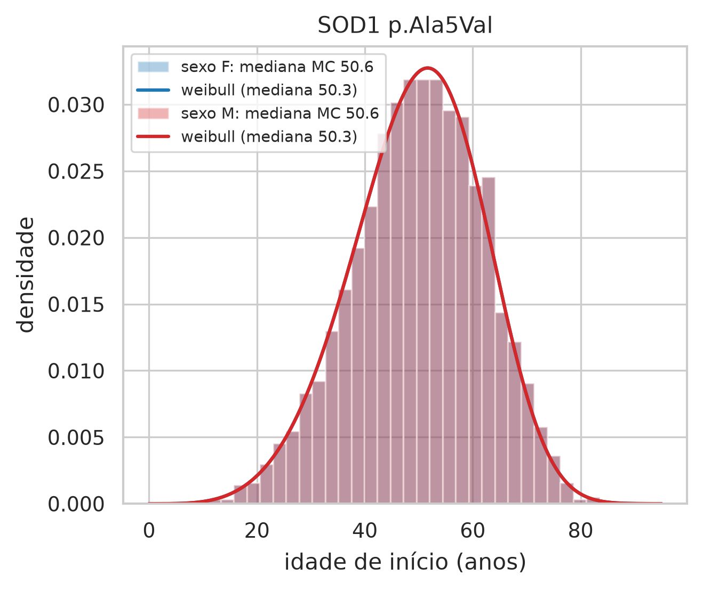
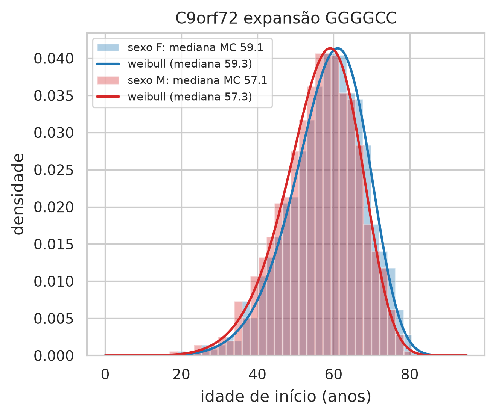
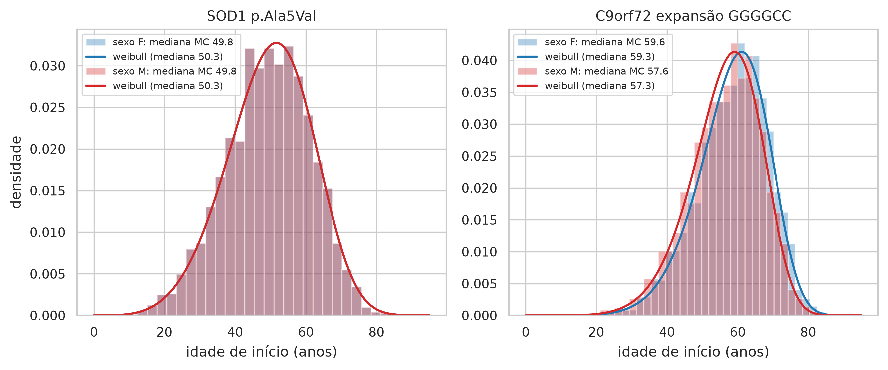
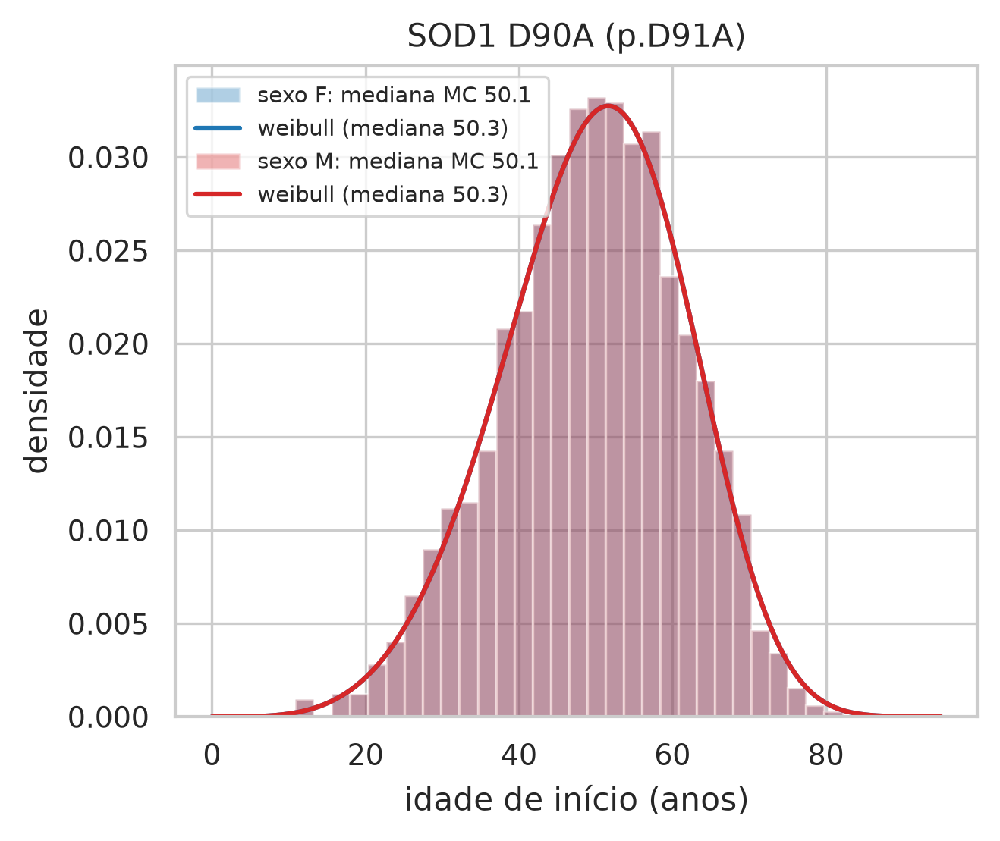
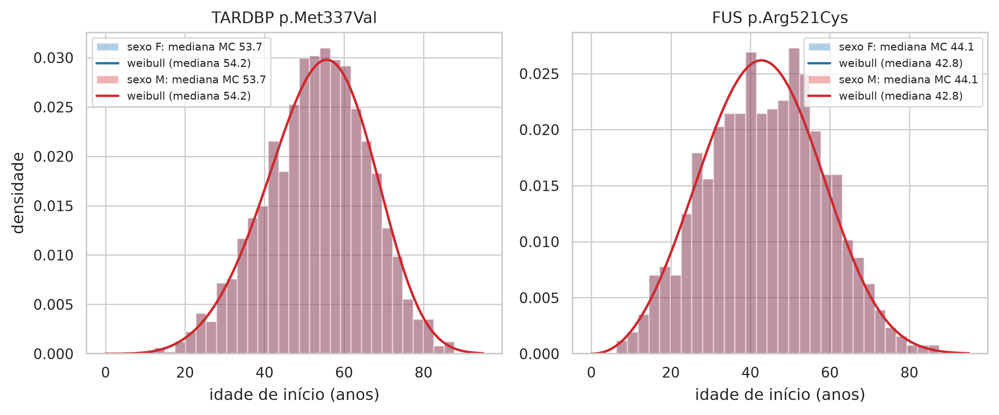

# Resultados do artefato ela_preditivo v0.1.0

> AVISO: instrumento experimental de apoio à decisão no aconselhamento genético preditivo da ELA, construído com dados sintéticos e parâmetros populacionais da literatura. Não constitui diagnóstico, não substitui o julgamento clínico e não deve ser usado isoladamente em decisões sobre pacientes.

Gerado em 03/11/2026 14:31 com seed 42, N = 10.000 por execução, avaliação com N ∈ [1000, 10000, 100000] × 30 repetições. Tempo total: 311 s.

Base de anotação: clinvar_base_consolidada (1458 variantes do ClinVar dos quatro genes + 1 da tabela curada).
A expansão do C9orf72 entra pelo laudo laboratorial de cada cenário (TCC 4.2.1), não pelo VCF.

Sem lócus de risco nesta base de anotação (relatório explica o motivo): cenário 4 (F), cenário 4 (M).

## Relatórios por cenário

- Cenário 1, sexo F: [`cenarios/cenario_1_F/relatorio.md`](cenarios/cenario_1_F/relatorio.md)
- Cenário 1, sexo M: [`cenarios/cenario_1_M/relatorio.md`](cenarios/cenario_1_M/relatorio.md)
- Cenário 2, sexo F: [`cenarios/cenario_2_F/relatorio.md`](cenarios/cenario_2_F/relatorio.md)
- Cenário 2, sexo M: [`cenarios/cenario_2_M/relatorio.md`](cenarios/cenario_2_M/relatorio.md)
- Cenário 3, sexo F: [`cenarios/cenario_3_F/relatorio.md`](cenarios/cenario_3_F/relatorio.md)
- Cenário 3, sexo M: [`cenarios/cenario_3_M/relatorio.md`](cenarios/cenario_3_M/relatorio.md)
- Cenário 4, sexo F: [`cenarios/cenario_4_F/relatorio.md`](cenarios/cenario_4_F/relatorio.md)
- Cenário 4, sexo M: [`cenarios/cenario_4_M/relatorio.md`](cenarios/cenario_4_M/relatorio.md)
- Cenário 5, sexo F: [`cenarios/cenario_5_F/relatorio.md`](cenarios/cenario_5_F/relatorio.md)
- Cenário 5, sexo M: [`cenarios/cenario_5_M/relatorio.md`](cenarios/cenario_5_M/relatorio.md)

## Avaliação transversal

- [`avaliacao/relatorio.md`](avaliacao/relatorio.md) (Tabelas 5 a 9; Figuras 2, 3 e 7)

## Tabela consolidada

**Tabela 3 (consolidada) — Probabilidade de transmissão, risco vitalício de manifestação (IC 95%) e idade mediana de início por cenário, lócus e sexo do descendente**

| cenario | descricao | sexo | variante | heranca | p_portador | p_manifesta | ic95 | idade_mediana |
|---|---|---|---|---|---|---|---|---|
| 1 | Pai heterozigoto SOD1 p.Ala5Val (alta penetrância) × mãe selvagem | F | SOD1 p.Ala5Val | dominante | 0.5 | 0.2694 | 0.163–0.372 | 50.2576 |
| 1 | Pai heterozigoto SOD1 p.Ala5Val (alta penetrância) × mãe selvagem | F | qualquer lócus | independência | 0.5 | 0.2694 | 0.163–0.372 | 50.5814 |
| 1 | Pai heterozigoto SOD1 p.Ala5Val (alta penetrância) × mãe selvagem | M | SOD1 p.Ala5Val | dominante | 0.5 | 0.2694 | 0.163–0.372 | 50.2576 |
| 1 | Pai heterozigoto SOD1 p.Ala5Val (alta penetrância) × mãe selvagem | M | qualquer lócus | independência | 0.5 | 0.2694 | 0.163–0.372 | 50.5814 |
| 2 | Mãe com expansão de hexanucleotídeos no C9orf72 (45 repetições, laudo) × pai selvagem | F | C9orf72 expansão GGGGCC | dominante | 0.5 | 0.1664 | 0.102–0.237 | 59.3045 |
| 2 | Mãe com expansão de hexanucleotídeos no C9orf72 (45 repetições, laudo) × pai selvagem | F | qualquer lócus | independência | 0.5 | 0.1664 | 0.102–0.237 | 59.0751 |
| 2 | Mãe com expansão de hexanucleotídeos no C9orf72 (45 repetições, laudo) × pai selvagem | M | C9orf72 expansão GGGGCC | dominante | 0.5 | 0.1664 | 0.102–0.237 | 57.3045 |
| 2 | Mãe com expansão de hexanucleotídeos no C9orf72 (45 repetições, laudo) × pai selvagem | M | qualquer lócus | independência | 0.5 | 0.1664 | 0.102–0.237 | 57.0751 |
| 3 | Pai heterozigoto SOD1 p.Ala5Val × mãe com expansão C9orf72 (45 repetições, laudo; exemplo literal do TCC, 4.5) | F | SOD1 p.Ala5Val | dominante | 0.5 | 0.2694 | 0.163–0.372 | 50.2576 |
| 3 | Pai heterozigoto SOD1 p.Ala5Val × mãe com expansão C9orf72 (45 repetições, laudo; exemplo literal do TCC, 4.5) | F | C9orf72 expansão GGGGCC | dominante | 0.5 | 0.1664 | 0.102–0.237 | 59.3045 |
| 3 | Pai heterozigoto SOD1 p.Ala5Val × mãe com expansão C9orf72 (45 repetições, laudo; exemplo literal do TCC, 4.5) | F | qualquer lócus | independência | 0.75 | 0.3909 | 0.249–0.521 | 52.5956 |
| 3 | Pai heterozigoto SOD1 p.Ala5Val × mãe com expansão C9orf72 (45 repetições, laudo; exemplo literal do TCC, 4.5) | M | SOD1 p.Ala5Val | dominante | 0.5 | 0.2694 | 0.163–0.372 | 50.2576 |
| 3 | Pai heterozigoto SOD1 p.Ala5Val × mãe com expansão C9orf72 (45 repetições, laudo; exemplo literal do TCC, 4.5) | M | C9orf72 expansão GGGGCC | dominante | 0.5 | 0.1664 | 0.102–0.237 | 57.3045 |
| 3 | Pai heterozigoto SOD1 p.Ala5Val × mãe com expansão C9orf72 (45 repetições, laudo; exemplo literal do TCC, 4.5) | M | qualquer lócus | independência | 0.75 | 0.3909 | 0.249–0.521 | 51.8939 |
| 5 | Pai heterozigoto TARDBP p.Met337Val × mãe heterozigota FUS p.Arg521Cys | F | TARDBP p.Met337Val | dominante | 0.5 | 0.1916 | 0.105–0.287 | 54.1776 |
| 5 | Pai heterozigoto TARDBP p.Met337Val × mãe heterozigota FUS p.Arg521Cys | F | FUS p.Arg521Cys | dominante | 0.5 | 0.096 | 0.063–0.133 | 42.8269 |
| 5 | Pai heterozigoto TARDBP p.Met337Val × mãe heterozigota FUS p.Arg521Cys | F | qualquer lócus | independência | 0.75 | 0.2691 | 0.162–0.382 | 50.4905 |
| 5 | Pai heterozigoto TARDBP p.Met337Val × mãe heterozigota FUS p.Arg521Cys | M | TARDBP p.Met337Val | dominante | 0.5 | 0.1916 | 0.105–0.287 | 54.1776 |
| 5 | Pai heterozigoto TARDBP p.Met337Val × mãe heterozigota FUS p.Arg521Cys | M | FUS p.Arg521Cys | dominante | 0.5 | 0.096 | 0.063–0.133 | 42.8269 |
| 5 | Pai heterozigoto TARDBP p.Met337Val × mãe heterozigota FUS p.Arg521Cys | M | qualquer lócus | independência | 0.75 | 0.2691 | 0.162–0.382 | 50.4905 |

*Fonte: elaborado pela autora (2026), a partir do artefato ela_preditivo.*

## Figuras de idade de início por sexo

