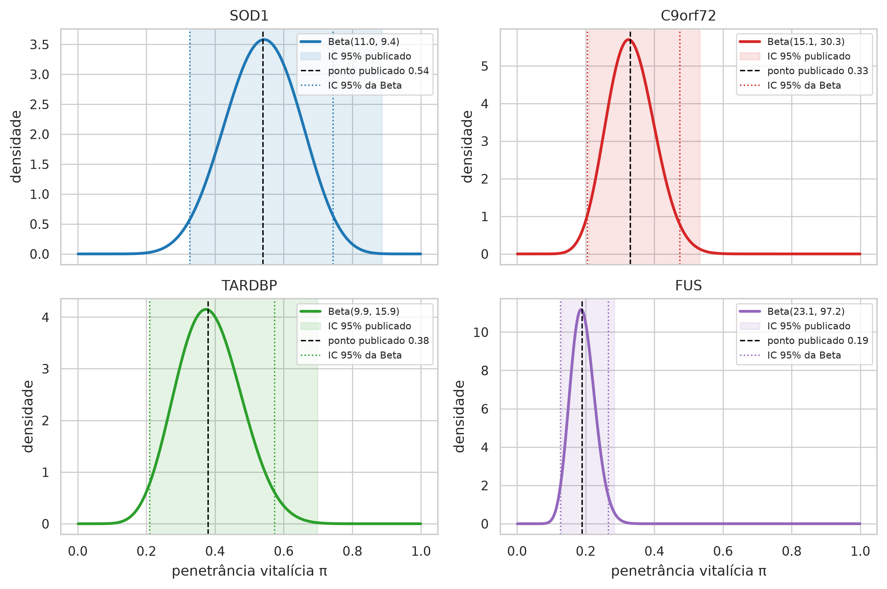
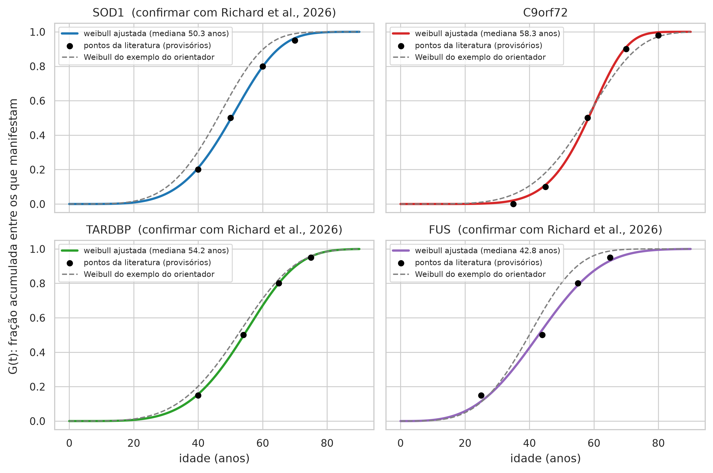
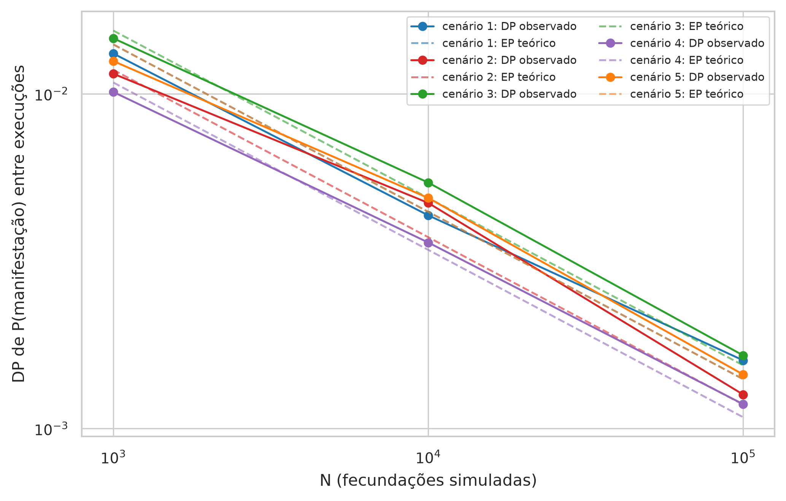

# Avaliação do artefato (TCC 4.5)

> AVISO: instrumento experimental de apoio à decisão no aconselhamento genético preditivo da ELA, construído com dados sintéticos e parâmetros populacionais da literatura. Não constitui diagnóstico, não substitui o julgamento clínico e não deve ser usado isoladamente em decisões sobre pacientes.

## Configuração

Cenários [1, 2, 3, 4, 5]; N ∈ [1000, 10000, 100000]; 30 repetições por N; seed inicial 1000; sexo do descendente F; coerência e sensibilidade com N = 10.000.

## Leitura

Razão DP/EP média = 1.04. Picos de risco entre 60 e 75 anos: 2 de 7 lóci. Tempo médio PyMC para N = 100.000: 16.40 s; NumPy: 0.007 s.

## Tabelas

**Tabela 5 — Estabilidade numérica: média e desvio padrão de P(manifestação) e da idade mediana entre 30 execuções com sementes distintas, por N, vs erro padrão teórico √(p(1−p)/N)**

| cenario | motor | n | repeticoes | p_manifesta_qualquer_exato | p_manifesta_qualquer_media | p_manifesta_qualquer_dp | ep_teorico | razao_dp_ep | idade_mediana_media | idade_mediana_dp | tempo_medio_s |
|---|---|---|---|---|---|---|---|---|---|---|---|
| cenário 1 | numpy | 1000 | 30 | 0.2694 | 0.2688 | 0.0132 | 0.014 | 0.9394 | 50.0888 | 0.8875 | 0.0001 |
| cenário 1 | numpy | 10000 | 30 | 0.2694 | 0.2688 | 0.0043 | 0.0044 | 0.9759 | 50.2786 | 0.3173 | 0.0005 |
| cenário 1 | numpy | 100000 | 30 | 0.2694 | 0.2694 | 0.0016 | 0.0014 | 1.1382 | 50.2666 | 0.0879 | 0.0049 |
| cenário 2 | numpy | 1000 | 30 | 0.1664 | 0.1663 | 0.0115 | 0.0118 | 0.9738 | 59.3742 | 0.8932 | 0.0001 |
| cenário 2 | numpy | 10000 | 30 | 0.1664 | 0.1651 | 0.0047 | 0.0037 | 1.2662 | 59.3289 | 0.3366 | 0.0005 |
| cenário 2 | numpy | 100000 | 30 | 0.1664 | 0.1663 | 0.0013 | 0.0012 | 1.0714 | 59.3147 | 0.1092 | 0.0044 |
| cenário 3 | numpy | 1000 | 30 | 0.3909 | 0.3878 | 0.0146 | 0.0154 | 0.9484 | 53.0815 | 0.7744 | 0.0002 |
| cenário 3 | numpy | 10000 | 30 | 0.3909 | 0.3913 | 0.0054 | 0.0049 | 1.1115 | 52.9185 | 0.3111 | 0.0011 |
| cenário 3 | numpy | 100000 | 30 | 0.3909 | 0.391 | 0.0017 | 0.0015 | 1.0705 | 52.8674 | 0.0716 | 0.0106 |
| cenário 4 | numpy | 1000 | 30 | 0.1347 | 0.1367 | 0.0101 | 0.0108 | 0.9368 | 50.3384 | 1.3088 | 0.0001 |
| cenário 4 | numpy | 10000 | 30 | 0.1347 | 0.1338 | 0.0036 | 0.0034 | 1.052 | 50.2638 | 0.4771 | 0.0005 |
| cenário 4 | numpy | 100000 | 30 | 0.1347 | 0.1346 | 0.0012 | 0.0011 | 1.0941 | 50.2753 | 0.1625 | 0.0044 |
| cenário 5 | numpy | 1000 | 30 | 0.2691 | 0.2676 | 0.0125 | 0.014 | 0.892 | 50.0144 | 1.1614 | 0.0002 |
| cenário 5 | numpy | 10000 | 30 | 0.2691 | 0.2684 | 0.0049 | 0.0044 | 1.1001 | 50.1338 | 0.4375 | 0.0011 |
| cenário 5 | numpy | 100000 | 30 | 0.2691 | 0.2694 | 0.0014 | 0.0014 | 1.0328 | 50.1485 | 0.1245 | 0.0101 |

*Fonte: elaborado pela autora (2026), a partir do artefato ela_preditivo.*

DP/EP próximo de 1 indica que a variabilidade entre execuções é a esperada para o Monte Carlo; o DP cai por ≈√10 a cada década de N.

**Tabela 6 — Calibração das priors Beta de penetrância e das distribuições de idade de início a partir da literatura (docs/02, §2)**

| gene | heranca | penetrancia_publicada | ic95_publicado | alpha | beta | media_beta | mediana_beta | ic95_beta | distribuicao_inicio | parametros_inicio | mediana_inicio_anos | rss_escolhida | rss_alternativa | delta_sexo | erro_ic_beta | valor_provisorio | citacao_penetrancia | citacao_inicio |
|---|---|---|---|---|---|---|---|---|---|---|---|---|---|---|---|---|---|---|
| SOD1 | dominante | 0.54 | 0.327–0.886 | 11.026 | 9.441 | 0.539 | 0.54 | 0.327–0.744 | weibull | k=4.72, lam=54.32 | 50.3 | 0.0004 | 0.001 | M +0.0 / F +0.0 | 0.142 | sim | DOUGLAS; BARALLE, 2024, p. 294 | PLACEHOLDER: substituir pelas faixas etárias de RICHARD et al., 2026; mediana ~50 anos coerente com FELDMAN et al., 2022 |
| C9orf72 | dominante | 0.33 | 0.209–0.532 | 15.086 | 30.257 | 0.333 | 0.33 | 0.205–0.475 | weibull | k=6.83, lam=61.52 | 58.3 | 0.0011 | 0.0016 | M -1.0 / F +1.0 | 0.057 | sim | DOUGLAS; BARALLE, 2024, p. 294 | MURPHY et al., 2017: 35, 58 e 80 anos vêm do resumo (0%, 50%, quase completa); 45 e 70 anos são leituras aproximadas da curva, a digitalizar da figura |
| TARDBP | dominante | 0.38 | 0.211–0.698 | 9.896 | 15.933 | 0.383 | 0.38 | 0.210–0.574 | weibull | k=4.63, lam=58.64 | 54.2 | 0.0001 | 0.0023 | M +0.0 / F +0.0 | 0.124 | sim | DOUGLAS; BARALLE, 2024, p. 294 | PLACEHOLDER: substituir pelas faixas etárias de RICHARD et al., 2026 |
| FUS | dominante | 0.19 | 0.130–0.284 | 23.078 | 97.174 | 0.192 | 0.19 | 0.127–0.267 | weibull | k=3.23, lam=47.97 | 42.8 | 0.0027 | 0.0125 | M +0.0 / F +0.0 | 0.017 | sim | DOUGLAS; BARALLE, 2024, p. 294 | PLACEHOLDER: substituir pelas faixas etárias de RICHARD et al., 2026; início mais precoce (FELDMAN et al., 2022) |

*Fonte: elaborado pela autora (2026), a partir do artefato ela_preditivo.*

valor_provisorio = sim: parâmetro marcado com confirmar: true no YAML, a validar pela autora.

**Tabela 7 — Coerência das curvas: F(∞) exato vs Kaplan-Meier, medianas de início (exata vs Weibull da Lifelines), parâmetros recuperados pelo modelo de cura mista e idade do pico de risco**

| cenario | variante | F_inf_exato | risco_vitalicio_km | idade_mediana_exata | idade_mediana_weibull_lifelines | pi_recuperado | lambda_recuperado | rho_recuperado | idade_pico_hazard | pico_em_60_75 | idade_90pct_do_risco | mediana_sobrevivencia |
|---|---|---|---|---|---|---|---|---|---|---|---|---|
| cenário 1 | SOD1 A4V (p.A5V) | 0.2694 | 0.263 | 50.2576 | 50.0128 | 0.5262 | 53.9663 | 4.8174 | 53 | não | 64.3 | não atingida |
| cenário 2 | C9orf72 expansão GGGGCC | 0.1664 | 0.1676 | 59.3045 | 59.173 | 0.3376 | 62.2726 | 7.1786 | 62 | sim | 70.6 | não atingida |
| cenário 3 | C9orf72 expansão GGGGCC | 0.1664 | 0.1664 | 59.3045 | 59.061 | 0.3351 | 62.322 | 6.8194 | 62 | sim | 70.6 | não atingida |
| cenário 3 | SOD1 A4V (p.A5V) | 0.2694 | 0.2682 | 50.2576 | 50.5107 | 0.5366 | 54.5153 | 4.8039 | 53 | não | 64.5 | não atingida |
| cenário 4 | SOD1 D90A (p.D91A) | 0.1347 | 0.1333 | 50.2576 | 50.2956 | 0.5317 | 54.2282 | 4.8684 | 52.5 | não | 64.7 | não atingida |
| cenário 5 | TARDBP M337V | 0.1916 | 0.1954 | 54.1776 | 53.745 | 0.3913 | 58.3715 | 4.4606 | 57 | não | 70.8 | não atingida |
| cenário 5 | FUS R521C | 0.096 | 0.0965 | 42.8269 | 41.6528 | 0.1944 | 46.8436 | 3.1271 | 43.5 | não | 60.7 | não atingida |

*Fonte: elaborado pela autora (2026), a partir do artefato ela_preditivo.*

**Tabela 8 — Tempo de processamento por motor (PyMC e NumPy) e por N, em segundos (média de execuções sucessivas)**

| cenario | motor | n | repeticoes | tempo_medio_s | tempo_max_s | sorteios_por_segundo |
|---|---|---|---|---|---|---|
| cenário 1 | numpy | 1000 | 5 | 0.0001 | 0.0002 | 7.494.971 |
| cenário 1 | pymc | 1000 | 3 | 0.1765 | 0.1777 | 5.666 |
| cenário 1 | numpy | 10000 | 5 | 0.0006 | 0.0007 | 17.306.901 |
| cenário 1 | pymc | 10000 | 3 | 1.478 | 1.5019 | 6.766 |
| cenário 1 | numpy | 100000 | 5 | 0.0049 | 0.0052 | 20.274.265 |
| cenário 1 | pymc | 100000 | 3 | 13.7031 | 13.8293 | 7.298 |
| cenário 2 | numpy | 1000 | 5 | 0.0001 | 0.0002 | 7.654.225 |
| cenário 2 | pymc | 1000 | 3 | 0.1817 | 0.1864 | 5.504 |
| cenário 2 | numpy | 10000 | 5 | 0.0005 | 0.0007 | 18.687.788 |
| cenário 2 | pymc | 10000 | 3 | 1.4892 | 1.5292 | 6.715 |
| cenário 2 | numpy | 100000 | 5 | 0.0044 | 0.0047 | 22.661.321 |
| cenário 2 | pymc | 100000 | 3 | 14.6876 | 14.9127 | 6.808 |
| cenário 3 | numpy | 1000 | 5 | 0.0002 | 0.0003 | 4.546.893 |
| cenário 3 | pymc | 1000 | 3 | 0.2282 | 0.2322 | 4.382 |
| cenário 3 | numpy | 10000 | 5 | 0.0011 | 0.0013 | 8.810.245 |
| cenário 3 | pymc | 10000 | 3 | 2.0178 | 2.0585 | 4.956 |
| cenário 3 | numpy | 100000 | 5 | 0.0112 | 0.012 | 8.965.997 |
| cenário 3 | pymc | 100000 | 3 | 20.8828 | 22.6969 | 4.789 |
| cenário 4 | numpy | 1000 | 5 | 0.0001 | 0.0002 | 7.880.817 |
| cenário 4 | pymc | 1000 | 3 | 0.185 | 0.1882 | 5.406 |
| cenário 4 | numpy | 10000 | 5 | 0.0006 | 0.0007 | 17.581.985 |
| cenário 4 | pymc | 10000 | 3 | 1.4362 | 1.4549 | 6.963 |
| cenário 4 | numpy | 100000 | 5 | 0.0045 | 0.0047 | 22.230.214 |
| cenário 4 | pymc | 100000 | 3 | 13.8732 | 14.1092 | 7.208 |
| cenário 5 | numpy | 1000 | 5 | 0.0002 | 0.0003 | 4.573.239 |
| cenário 5 | pymc | 1000 | 3 | 0.217 | 0.2191 | 4.608 |
| cenário 5 | numpy | 10000 | 5 | 0.0011 | 0.0012 | 9.442.366 |
| cenário 5 | pymc | 10000 | 3 | 1.9541 | 1.9781 | 5.118 |
| cenário 5 | numpy | 100000 | 5 | 0.0099 | 0.0103 | 10.112.695 |
| cenário 5 | pymc | 100000 | 3 | 18.8605 | 19.1762 | 5.302 |

*Fonte: elaborado pela autora (2026), a partir do artefato ela_preditivo.*

**Tabela 9 — Análise de sensibilidade: risco vitalício e idade mediana sob a calibração pela literatura, sob os parâmetros do exemplo do orientador e sob penetrância de coorte familiar para o C9orf72**

| cenario | conjunto_de_parametros | variante | penetrancia_media | p_manifesta_exato | p_manifesta_mc | idade_mediana_exata | idade_mediana_mc |
|---|---|---|---|---|---|---|---|
| cenário 1 | literatura (Douglas & Baralle 2024; Murphy 2017) | SOD1 A4V (p.A5V) | 0.5387 | 0.2694 | 0.2724 | 50.2576 | 50.1095 |
| cenário 1 | literatura (Douglas & Baralle 2024; Murphy 2017) | qualquer lócus |  | 0.2694 | 0.2724 |  | 50.1095 |
| cenário 1 | exemplo do orientador (penetrance_max e Weibull fixos) | SOD1 A4V (p.A5V) | 0.9 | 0.45 | 0.4474 | 46.0891 | 46.2669 |
| cenário 1 | exemplo do orientador (penetrance_max e Weibull fixos) | qualquer lócus |  | 0.45 | 0.4474 |  | 46.2669 |
| cenário 2 | literatura (Douglas & Baralle 2024; Murphy 2017) | C9orf72 expansão GGGGCC | 0.3327 | 0.1664 | 0.1749 | 59.3045 | 58.808 |
| cenário 2 | literatura (Douglas & Baralle 2024; Murphy 2017) | qualquer lócus |  | 0.1664 | 0.1749 |  | 58.808 |
| cenário 2 | exemplo do orientador (penetrance_max e Weibull fixos) | C9orf72 expansão GGGGCC | 0.6 | 0.3 | 0.3002 | 58.6178 | 58.6868 |
| cenário 2 | exemplo do orientador (penetrance_max e Weibull fixos) | qualquer lócus |  | 0.3 | 0.3002 |  | 58.6868 |
| cenário 2 | C9orf72 com penetrância de coorte familiar (Murphy 2017) | C9orf72 expansão GGGGCC | 0.9 | 0.45 | 0.4457 | 59.3045 | 59.4291 |
| cenário 2 | C9orf72 com penetrância de coorte familiar (Murphy 2017) | qualquer lócus |  | 0.45 | 0.4457 |  | 59.4291 |
| cenário 3 | literatura (Douglas & Baralle 2024; Murphy 2017) | C9orf72 expansão GGGGCC | 0.3327 | 0.1664 | 0.162 | 59.3045 | 59.1471 |
| cenário 3 | literatura (Douglas & Baralle 2024; Murphy 2017) | SOD1 A4V (p.A5V) | 0.5387 | 0.2694 | 0.2688 | 50.2576 | 50.0589 |
| cenário 3 | literatura (Douglas & Baralle 2024; Murphy 2017) | qualquer lócus |  | 0.3909 | 0.3879 |  | 52.7708 |
| cenário 3 | exemplo do orientador (penetrance_max e Weibull fixos) | C9orf72 expansão GGGGCC | 0.6 | 0.3 | 0.293 | 58.6178 | 58.5603 |
| cenário 3 | exemplo do orientador (penetrance_max e Weibull fixos) | SOD1 A4V (p.A5V) | 0.9 | 0.45 | 0.4399 | 46.0891 | 45.5837 |
| cenário 3 | exemplo do orientador (penetrance_max e Weibull fixos) | qualquer lócus |  | 0.615 | 0.6038 |  | 47.7645 |
| cenário 3 | C9orf72 com penetrância de coorte familiar (Murphy 2017) | C9orf72 expansão GGGGCC | 0.9 | 0.45 | 0.4431 | 59.3045 | 59.3181 |
| cenário 3 | C9orf72 com penetrância de coorte familiar (Murphy 2017) | SOD1 A4V (p.A5V) | 0.5387 | 0.2694 | 0.2659 | 50.2576 | 50.1931 |
| cenário 3 | C9orf72 com penetrância de coorte familiar (Murphy 2017) | qualquer lócus |  | 0.5981 | 0.59 |  | 54.9658 |
| cenário 4 | literatura (Douglas & Baralle 2024; Murphy 2017) | SOD1 D90A (p.D91A) | 0.5387 | 0.1347 | 0.1371 | 50.2576 | 49.3823 |
| cenário 4 | literatura (Douglas & Baralle 2024; Murphy 2017) | qualquer lócus |  | 0.1347 | 0.1371 |  | 49.3823 |
| cenário 4 | exemplo do orientador (penetrance_max e Weibull fixos) | SOD1 D90A (p.D91A) | 0.9 | 0.225 | 0.2215 | 46.0891 | 46.1504 |
| cenário 4 | exemplo do orientador (penetrance_max e Weibull fixos) | qualquer lócus |  | 0.225 | 0.2215 |  | 46.1504 |
| cenário 5 | literatura (Douglas & Baralle 2024; Murphy 2017) | TARDBP M337V | 0.3831 | 0.1916 | 0.1997 | 54.1776 | 54.1882 |
| cenário 5 | literatura (Douglas & Baralle 2024; Murphy 2017) | FUS R521C | 0.1919 | 0.096 | 0.0951 | 42.8269 | 43.0086 |
| cenário 5 | literatura (Douglas & Baralle 2024; Murphy 2017) | qualquer lócus |  | 0.2691 | 0.2775 |  | 50.011 |
| cenário 5 | exemplo do orientador (penetrance_max e Weibull fixos) | TARDBP M337V | 0.8 | 0.4 | 0.4058 | 52.2368 | 52.1617 |
| cenário 5 | exemplo do orientador (penetrance_max e Weibull fixos) | FUS R521C | 0.45 | 0.225 | 0.2257 | 39.9544 | 39.5133 |
| cenário 5 | exemplo do orientador (penetrance_max e Weibull fixos) | qualquer lócus |  | 0.535 | 0.5355 |  | 45.5094 |

*Fonte: elaborado pela autora (2026), a partir do artefato ela_preditivo.*

## Figuras

*Figura 2 — Priors Beta de penetrância vitalícia por gene, calibradas ao ponto e ao IC 95% de Douglas & Baralle (2024). Fonte: elaborado pela autora (2026), a partir do artefato ela_preditivo.*

*Figura 3 — Distribuição acumulada da idade de início G(t) ajustada aos pontos da literatura, por gene. Fonte: elaborado pela autora (2026), a partir do artefato ela_preditivo.*

*Figura 7 — Estabilidade numérica: desvio padrão entre execuções vs N (escala log-log) e erro padrão teórico √(p(1−p)/N). Fonte: elaborado pela autora (2026), a partir do artefato ela_preditivo.*
