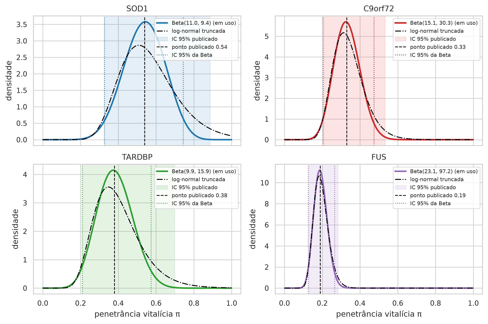
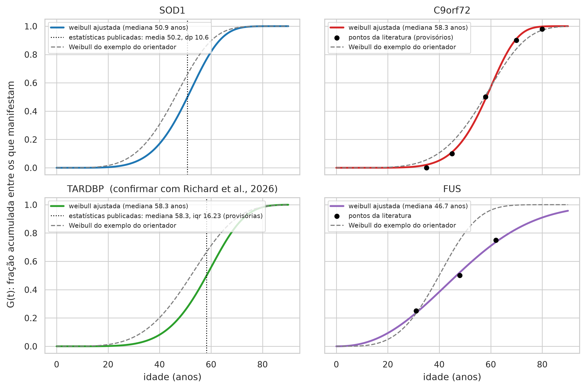
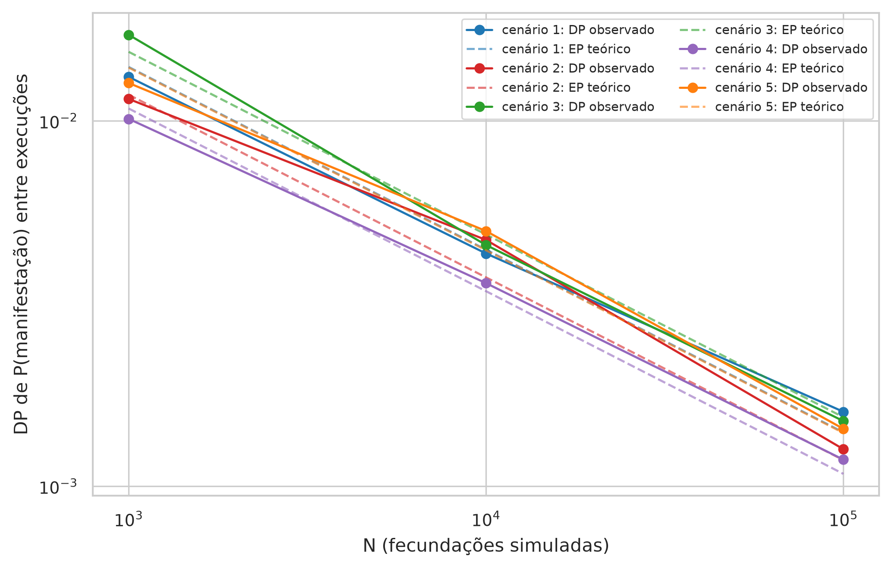
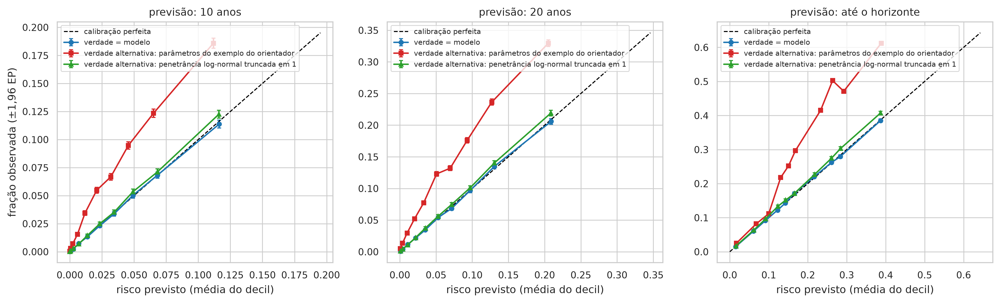
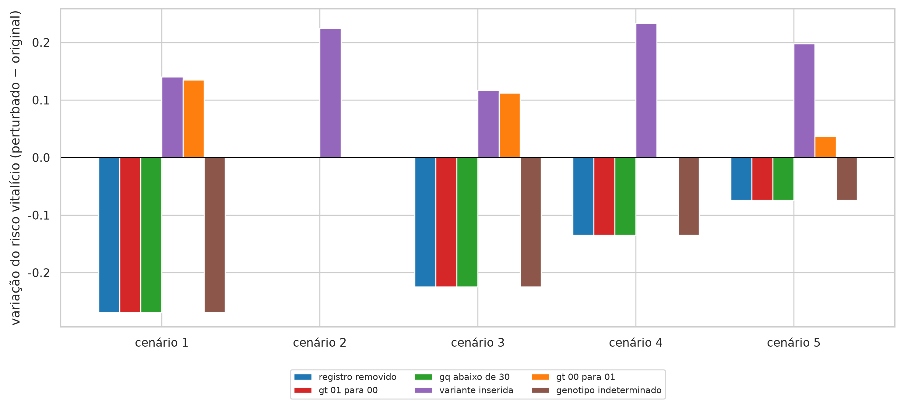
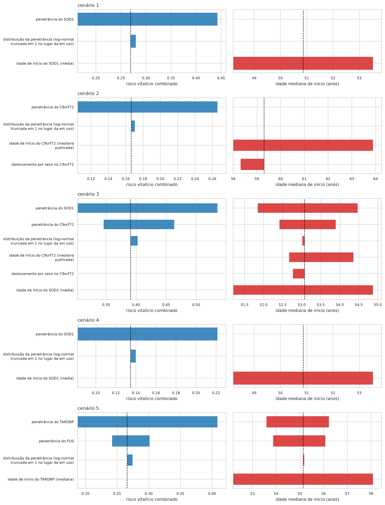

# Avaliação do artefato (TCC 4.5)

> AVISO: instrumento experimental de apoio à decisão no aconselhamento genético preditivo da ELA, construído com dados sintéticos e parâmetros populacionais da literatura. Não constitui diagnóstico, não substitui o julgamento clínico e não deve ser usado isoladamente em decisões sobre pacientes.

## Configuração

Cenários [1, 2, 3, 4, 5]; N ∈ [1000, 10000, 100000]; 30 repetições por N; seed inicial 1000; sexo do descendente F; coerência e sensibilidade com N = 10.000. Base de anotação: clinvar_base_consolidada.

## Leitura

Razão DP/EP média = 1.04. Idade do pico de h(t) do risco combinado por cenário: cenário 1: 53.5 anos; cenário 2: 62.0 anos; cenário 3: 56.5 anos; cenário 4: 53.0 anos; cenário 5: 60.5 anos; 2 de 5 dentro da faixa de incidência populacional 60–75 anos (FELDMAN et al., 2022), que é referência e não critério de aprovação: variantes de início precoce (SOD1 p.Ala5Val, FUS) têm pico antes dela. Tempo médio PyMC para N = 100.000: 16.84 s; NumPy: 0.007 s.

## Verificação com famílias sintéticas de desfecho conhecido

Com dados sintéticos gerados pelo próprio modelo, estas métricas medem verificação (a implementação reproduz o modelo especificado), não validação contra pacientes reais. Para não ficar só circular, cada métrica é calculada em dois mundos: verdade = modelo, em que o desfecho é sorteado com os mesmos parâmetros da previsão, e verdade alternativa, em que o desfecho é sorteado com parâmetros diferentes e as métricas mostram como degradam quando o modelo está errado. Com verdade = modelo: Brier até o horizonte 0.1327 (referência 0.1443); C-index 0.630; AUC a 10 e 20 anos 0.806 e 0.787; cobertura média dos intervalos do Monte Carlo 94.8% (esperado 95 %); cobertura média das bandas de F(t) 93.3% (94.6% sem o ruído amostral do F empírico); erro absoluto médio da idade de início 7.9 anos para um piso teórico de 8.0. Com a verdade alternativa: parâmetros do exemplo do orientador: Brier até o horizonte 0.1948 e cobertura média das bandas 15.6%. Com a verdade alternativa: penetrância log-normal truncada em 1: Brier até o horizonte 0.1375 e cobertura média das bandas 87.5%.

## Como ler as métricas de verificação

Calibração (Tabelas 13 e 14, Figura 10): o risco previsto bate com a fração observada quando a verdade é o modelo e se afasta quando não é. Discriminação (Tabela 15): só existe porque a coorte mistura cenários, sexos e idades; dentro de um só cenário todos têm a mesma previsão. Idade de início (Tabela 16): o erro é comparado com o piso teórico, que nenhum modelo vence. Cobertura (Tabelas 17 e 17b): intervalos do Monte Carlo e bandas de F(t). Divergência (Tabela 18): distância entre curvas empíricas e teóricas. Robustez (Tabela 19, Figura 11): efeito de erros controlados no VCF, com o que o artefato declara. Tornado (Tabela 20, Figura 12): um parâmetro por vez, sempre dentro de faixa publicada.

## Tabelas

**Tabela 5 — Estabilidade numérica: média e desvio padrão de P(manifestação) e da idade mediana entre 30 execuções com sementes distintas, por N, vs erro padrão teórico √(p(1−p)/N)**

| cenario | motor | n | repeticoes | p_manifesta_qualquer_exato | p_manifesta_qualquer_media | p_manifesta_qualquer_dp | ep_teorico | razao_dp_ep | idade_mediana_media | idade_mediana_dp | tempo_medio_s |
|---|---|---|---|---|---|---|---|---|---|---|---|
| cenário 1 | numpy | 1000 | 30 | 0.2694 | 0.2688 | 0.0132 | 0.014 | 0.9394 | 50.7188 | 0.7763 | 0.0001 |
| cenário 1 | numpy | 10000 | 30 | 0.2694 | 0.2688 | 0.0043 | 0.0044 | 0.9759 | 50.8855 | 0.2773 | 0.0006 |
| cenário 1 | numpy | 100000 | 30 | 0.2694 | 0.2694 | 0.0016 | 0.0014 | 1.1382 | 50.8751 | 0.0768 | 0.0049 |
| cenário 2 | numpy | 1000 | 30 | 0.1664 | 0.1663 | 0.0115 | 0.0118 | 0.9738 | 59.3742 | 0.8932 | 0.0001 |
| cenário 2 | numpy | 10000 | 30 | 0.1664 | 0.1651 | 0.0047 | 0.0037 | 1.2662 | 59.3289 | 0.3366 | 0.0005 |
| cenário 2 | numpy | 100000 | 30 | 0.1664 | 0.1663 | 0.0013 | 0.0012 | 1.071 | 59.3147 | 0.1092 | 0.0046 |
| cenário 3 | numpy | 1000 | 30 | 0.3909 | 0.3887 | 0.0172 | 0.0154 | 1.1134 | 53.1774 | 0.6983 | 0.0002 |
| cenário 3 | numpy | 10000 | 30 | 0.3909 | 0.3912 | 0.0046 | 0.0049 | 0.9357 | 53.1212 | 0.2959 | 0.0012 |
| cenário 3 | numpy | 100000 | 30 | 0.3909 | 0.3909 | 0.0015 | 0.0015 | 0.9757 | 53.063 | 0.0652 | 0.0108 |
| cenário 4 | numpy | 1000 | 30 | 0.1347 | 0.1367 | 0.0101 | 0.0108 | 0.9368 | 50.9359 | 1.1433 | 0.0001 |
| cenário 4 | numpy | 10000 | 30 | 0.1347 | 0.1338 | 0.0036 | 0.0034 | 1.052 | 50.8724 | 0.417 | 0.0005 |
| cenário 4 | numpy | 100000 | 30 | 0.1347 | 0.1346 | 0.0012 | 0.0011 | 1.0941 | 50.8827 | 0.142 | 0.0045 |
| cenário 5 | numpy | 1000 | 30 | 0.2657 | 0.2649 | 0.0127 | 0.014 | 0.9077 | 55.2399 | 1.2058 | 0.0003 |
| cenário 5 | numpy | 10000 | 30 | 0.2657 | 0.265 | 0.005 | 0.0044 | 1.129 | 55.3616 | 0.4593 | 0.0011 |
| cenário 5 | numpy | 100000 | 30 | 0.2657 | 0.266 | 0.0014 | 0.0014 | 1.0265 | 55.3762 | 0.1284 | 0.0105 |

*Fonte: elaborado pela autora (2026), a partir do artefato ela_preditivo.*

DP/EP próximo de 1 indica que a variabilidade entre execuções é a esperada para o Monte Carlo; o DP cai por ≈√10 a cada década de N.

**Tabela 6 — Calibração das distribuições de penetrância (Beta e log-normal truncada em 1) e das distribuições de idade de início a partir da literatura**

| gene | heranca | penetrancia_publicada | ic95_publicado | alpha | beta | media_beta | mediana_beta | ic95_beta | distribuicao_penetrancia_em_uso | lognormal_mu | lognormal_sigma | media_lognormal | mediana_lognormal | ic95_lognormal | erro_max_lognormal | massa_truncada_lognormal | distribuicao_inicio | metodo_inicio | parametros_inicio | mediana_inicio_anos | rss_escolhida | rss_alternativa | delta_sexo | erro_ic_beta | valor_provisorio | citacao_penetrancia | citacao_inicio |
|---|---|---|---|---|---|---|---|---|---|---|---|---|---|---|---|---|---|---|---|---|---|---|---|---|---|---|---|
| SOD1 | dominante | 0.54 | 0.327–0.886 | 11.026 | 9.441 | 0.539 | 0.54 | 0.327–0.744 | beta | -0.6048 | 0.2674 | 0.56 | 0.544 | 0.323–0.882 | 0.004 | 0.0119 | weibull | momentos | k=5.46, lam=54.40 | 50.9 |  |  | M +0.0 / F +0.0 | 0.142 | não | DOUGLAS; BARALLE, 2024, p. 295, Tabela 1 | BERDYŃSKI et al., 2022, Tabela 1: idade de início dos 64 portadores de mutação no SOD1 (média 50,2 ± 10,6 anos; faixa 21–75). Weibull resolvida pelos momentos; a mediana implicada (50,9) reproduz a mediana publicada (51,0), que não entrou no ajuste. Corroboram McFARLANE et al., 2025 (mediana 54,19; n = 149) e OPIE-MARTIN et al., 2022 (média 48,9 ± 12,8; n = 1.383). Curva por gene, não por variante: a p.Ala5Val tem início mais precoce (RICHARD et al., 2026) |
| C9orf72 | dominante | 0.33 | 0.209–0.532 | 15.086 | 30.257 | 0.333 | 0.33 | 0.205–0.475 | beta | -1.1037 | 0.2396 | 0.341 | 0.332 | 0.207–0.530 | 0.0016 | 2.04e-06 | weibull | pontos | k=6.83, lam=61.52 | 58.3 | 0.0011 | 0.0016 | M -1.0 / F +1.0 | 0.057 | sim | DOUGLAS; BARALLE, 2024, p. 295, Tabela 1 | MURPHY et al., 2017: 35, 58 e 80 anos vêm do resumo (0%, 50%, quase completa); 45 e 70 anos são leituras aproximadas da curva, a digitalizar da figura. A mediana ajustada (58,3) é compatível com McFARLANE et al., 2025 (59,58), GRASSANO et al., 2022, Figura 1 (62,9) e YAMASHITA; ANDO, 2015, Tabela 1 (média 57) |
| TARDBP | dominante | 0.38 | 0.211–0.698 | 9.896 | 15.933 | 0.383 | 0.38 | 0.210–0.574 | beta | -0.9618 | 0.3081 | 0.4 | 0.382 | 0.209–0.696 | 0.0021 | 0.0009 | weibull | quantis | k=5.57, lam=62.26 | 58.3 |  |  | M +0.0 / F +0.0 | 0.124 | sim | DOUGLAS; BARALLE, 2024, p. 295, Tabela 1 | McFARLANE et al., 2025 (PRECISION-ALS): mediana da idade de início de 58,30 anos e IQR de 16,23 entre 64 portadores de variante no TARDBP. Weibull resolvida pelo casamento de quantis. Corroboram YAMASHITA; ANDO, 2015, Tabela 1 (média 54; faixa 20–77) e GRASSANO et al., 2022, Figura 1 (mediana 66,6, em coorte de perfil etário mais alto). A CONFERIR: mediana e IQR na Figura 2 do artigo antes da versão final |
| FUS | dominante | 0.19 | 0.130–0.284 | 23.078 | 97.174 | 0.192 | 0.19 | 0.127–0.267 | beta | -1.6553 | 0.2005 | 0.195 | 0.191 | 0.129–0.283 | 0.001 | 1.11e-16 | weibull | pontos | k=2.31, lam=54.75 | 46.7 | 0.0009 | 0.0027 | M +0.0 / F +0.0 | 0.017 | não | DOUGLAS; BARALLE, 2024, p. 295, Tabela 1 | GRASSANO et al., 2022, Figura 1 (distribuição acumulada da idade de início): mediana 48,00 anos, primeiro quartil 31,0 e terceiro quartil 62,0 entre os portadores de variante no FUS. Quartis publicados, usados sem derivação. Limitação: a distribuição é bimodal, com picos entre 30–40 e entre 60–70 anos (McFARLANE et al., 2025), e uma Weibull única a descreve de forma aproximada |

*Fonte: elaborado pela autora (2026), a partir do artefato ela_preditivo.*

valor_provisorio = sim: parâmetro marcado com confirmar: true no YAML, a validar na literatura. massa_truncada_lognormal: fração da log-normal acima de 1, retirada pelo truncamento.

**Tabela 7 — Coerência das curvas: risco vitalício exato (até o horizonte) vs Kaplan-Meier, fração que manifesta em algum momento (sem limite de idade) vs a recuperada pelo modelo de cura mista, medianas de início (exata vs Weibull da Lifelines), parâmetros recuperados e idade do pico de h(t) por lócus e para o risco combinado**

| cenario | variante | risco_vitalicio_exato | risco_vitalicio_km | fracao_manifesta_sem_limite | fracao_sem_limite_recuperada | idade_mediana_exata | idade_mediana_weibull_lifelines | pi_recuperado | lambda_recuperado | rho_recuperado | idade_pico_hazard | pico_combinado_na_faixa_60_75 | idade_90pct_do_risco | mediana_sobrevivencia |
|---|---|---|---|---|---|---|---|---|---|---|---|---|---|---|
| cenário 1 | SOD1 p.Ala5Val | 0.2694 | 0.263 | 0.2694 | 0.2631 | 50.8673 | 50.6533 | 0.5262 | 54.092 | 5.58 | 53.5 |  | 62.9 | não atingida |
| cenário 1 | qualquer lócus | 0.2694 | 0.263 | 0.2694 |  |  |  |  |  |  | 53.5 | não | 62.9 | não atingida |
| cenário 2 | C9orf72 expansão GGGGCC | 0.1664 | 0.1676 | 0.1664 | 0.1688 | 59.3045 | 59.173 | 0.3376 | 62.2726 | 7.1786 | 62 |  | 70.6 | não atingida |
| cenário 2 | qualquer lócus | 0.1664 | 0.1676 | 0.1664 |  |  |  |  |  |  | 62 | sim | 70.6 | não atingida |
| cenário 3 | SOD1 p.Ala5Val | 0.2694 | 0.2696 | 0.2694 | 0.2697 | 50.8673 | 50.9787 | 0.5394 | 54.5138 | 5.4667 | 53.5 |  | 63.7 | não atingida |
| cenário 3 | C9orf72 expansão GGGGCC | 0.1664 | 0.1662 | 0.1664 | 0.1674 | 59.3045 | 58.8705 | 0.3347 | 62.1069 | 6.8485 | 62 |  | 70.1 | não atingida |
| cenário 3 | qualquer lócus | 0.3909 | 0.3903 | 0.3909 |  |  |  |  |  |  | 56.5 | não | 66.2 | não atingida |
| cenário 4 | SOD1 p.Asp91Ala | 0.1347 | 0.1333 | 0.1347 | 0.1329 | 50.8673 | 50.9004 | 0.5317 | 54.3187 | 5.6391 | 53 |  | 63.2 | não atingida |
| cenário 4 | qualquer lócus | 0.1347 | 0.1333 | 0.1347 |  |  |  |  |  |  | 53 | não | 63.2 | não atingida |
| cenário 5 | TARDBP p.Met337Val | 0.1915 | 0.1954 | 0.1916 | 0.1956 | 58.3 | 57.9132 | 0.3912 | 62.0048 | 5.3835 | 61 |  | 72.8 | não atingida |
| cenário 5 | FUS p.Arg521Cys | 0.0918 | 0.0925 | 0.096 | 0.0963 | 46.7083 | 43.2531 | 0.1926 | 52.3505 | 2.2684 | 44 |  | 72 | não atingida |
| cenário 5 | qualquer lócus | 0.2657 | 0.2696 | 0.2691 |  |  |  |  |  |  | 60.5 | sim | 72.5 | não atingida |

*Fonte: elaborado pela autora (2026), a partir do artefato ela_preditivo.*

A faixa de incidência populacional 60–75 anos (FELDMAN et al., 2022) é comparada só com o pico do risco combinado (linha 'qualquer lócus'); o pico de cada variante é propriedade da sua distribuição de início e não é critério de aprovação.

**Tabela 8 — Tempo de processamento por motor (PyMC e NumPy) e por N, em segundos (média de execuções sucessivas)**

| cenario | motor | n | repeticoes | tempo_medio_s | tempo_max_s | sorteios_por_segundo |
|---|---|---|---|---|---|---|
| cenário 1 | numpy | 1000 | 5 | 0.0001 | 0.0002 | 7.197.103 |
| cenário 1 | pymc | 1000 | 3 | 0.1792 | 0.1821 | 5.580 |
| cenário 1 | numpy | 10000 | 5 | 0.0006 | 0.0007 | 16.990.563 |
| cenário 1 | pymc | 10000 | 3 | 1.4852 | 1.493 | 6.733 |
| cenário 1 | numpy | 100000 | 5 | 0.0049 | 0.0052 | 20.322.915 |
| cenário 1 | pymc | 100000 | 3 | 15.226 | 15.9806 | 6.568 |
| cenário 2 | numpy | 1000 | 5 | 0.0001 | 0.0002 | 7.180.349 |
| cenário 2 | pymc | 1000 | 3 | 0.1886 | 0.1896 | 5.301 |
| cenário 2 | numpy | 10000 | 5 | 0.0006 | 0.0007 | 17.810.207 |
| cenário 2 | pymc | 10000 | 3 | 1.5783 | 1.6149 | 6.336 |
| cenário 2 | numpy | 100000 | 5 | 0.0048 | 0.005 | 20.794.258 |
| cenário 2 | pymc | 100000 | 3 | 15.2062 | 15.2817 | 6.576 |
| cenário 3 | numpy | 1000 | 5 | 0.0002 | 0.0003 | 4.332.831 |
| cenário 3 | pymc | 1000 | 3 | 0.2371 | 0.2412 | 4.217 |
| cenário 3 | numpy | 10000 | 5 | 0.0012 | 0.0014 | 8.436.861 |
| cenário 3 | pymc | 10000 | 3 | 2.0761 | 2.1114 | 4.817 |
| cenário 3 | numpy | 100000 | 5 | 0.0108 | 0.0111 | 9.223.426 |
| cenário 3 | pymc | 100000 | 3 | 20.1031 | 20.2085 | 4.974 |
| cenário 4 | numpy | 1000 | 5 | 0.0001 | 0.0002 | 7.014.984 |
| cenário 4 | pymc | 1000 | 3 | 0.1751 | 0.1777 | 5.710 |
| cenário 4 | numpy | 10000 | 5 | 0.0005 | 0.0007 | 18.799.388 |
| cenário 4 | pymc | 10000 | 3 | 1.4862 | 1.5217 | 6.729 |
| cenário 4 | numpy | 100000 | 5 | 0.0045 | 0.0047 | 22.058.973 |
| cenário 4 | pymc | 100000 | 3 | 14.2474 | 14.3321 | 7.019 |
| cenário 5 | numpy | 1000 | 5 | 0.0002 | 0.0003 | 4.184.696 |
| cenário 5 | pymc | 1000 | 3 | 0.2528 | 0.2848 | 3.955 |
| cenário 5 | numpy | 10000 | 5 | 0.0012 | 0.0013 | 8.589.529 |
| cenário 5 | pymc | 10000 | 3 | 1.9495 | 1.9555 | 5.130 |
| cenário 5 | numpy | 100000 | 5 | 0.0105 | 0.0107 | 9.496.015 |
| cenário 5 | pymc | 100000 | 3 | 19.439 | 19.7118 | 5.144 |

*Fonte: elaborado pela autora (2026), a partir do artefato ela_preditivo.*

**Tabela 9 — Análise de sensibilidade: risco vitalício e idade mediana sob a calibração pela literatura, sob a distribuição alternativa da penetrância (log-normal truncada em 1), sob os parâmetros do exemplo do orientador e sob penetrância de coorte familiar para o C9orf72**

| cenario | conjunto_de_parametros | variante | penetrancia_media | p_manifesta_exato | p_manifesta_mc | idade_mediana_exata | idade_mediana_mc |
|---|---|---|---|---|---|---|---|
| cenário 1 | literatura (Douglas & Baralle 2024; Murphy 2017) | SOD1 p.Ala5Val | 0.5387 | 0.2694 | 0.2724 | 50.8673 | 50.7378 |
| cenário 1 | literatura (Douglas & Baralle 2024; Murphy 2017) | qualquer lócus |  | 0.2694 | 0.2724 |  | 50.7378 |
| cenário 1 | penetrância log-normal truncada em 1 (alternativa de calibração; Douglas & Baralle 2024) | SOD1 p.Ala5Val | 0.5597 | 0.2798 | 0.2801 | 50.8673 | 50.3879 |
| cenário 1 | penetrância log-normal truncada em 1 (alternativa de calibração; Douglas & Baralle 2024) | qualquer lócus |  | 0.2798 | 0.2801 |  | 50.3879 |
| cenário 1 | exemplo do orientador (penetrance_max e Weibull fixos) | SOD1 p.Ala5Val | 0.9 | 0.45 | 0.4474 | 46.0891 | 46.2669 |
| cenário 1 | exemplo do orientador (penetrance_max e Weibull fixos) | qualquer lócus |  | 0.45 | 0.4474 |  | 46.2669 |
| cenário 2 | literatura (Douglas & Baralle 2024; Murphy 2017) | C9orf72 expansão GGGGCC | 0.3327 | 0.1664 | 0.1749 | 59.3045 | 58.808 |
| cenário 2 | literatura (Douglas & Baralle 2024; Murphy 2017) | qualquer lócus |  | 0.1664 | 0.1749 |  | 58.808 |
| cenário 2 | penetrância log-normal truncada em 1 (alternativa de calibração; Douglas & Baralle 2024) | C9orf72 expansão GGGGCC | 0.3413 | 0.1706 | 0.1669 | 59.3045 | 58.7278 |
| cenário 2 | penetrância log-normal truncada em 1 (alternativa de calibração; Douglas & Baralle 2024) | qualquer lócus |  | 0.1706 | 0.1669 |  | 58.7278 |
| cenário 2 | exemplo do orientador (penetrance_max e Weibull fixos) | C9orf72 expansão GGGGCC | 0.6 | 0.2993 | 0.2996 | 58.6178 | 58.6868 |
| cenário 2 | exemplo do orientador (penetrance_max e Weibull fixos) | qualquer lócus |  | 0.2993 | 0.2996 |  | 58.6868 |
| cenário 2 | C9orf72 com penetrância de coorte familiar (Murphy 2017) | C9orf72 expansão GGGGCC | 0.9 | 0.45 | 0.4457 | 59.3045 | 59.4291 |
| cenário 2 | C9orf72 com penetrância de coorte familiar (Murphy 2017) | qualquer lócus |  | 0.45 | 0.4457 |  | 59.4291 |
| cenário 3 | literatura (Douglas & Baralle 2024; Murphy 2017) | SOD1 p.Ala5Val | 0.5387 | 0.2694 | 0.2739 | 50.8673 | 50.8692 |
| cenário 3 | literatura (Douglas & Baralle 2024; Murphy 2017) | C9orf72 expansão GGGGCC | 0.3327 | 0.1664 | 0.1717 | 59.3045 | 58.889 |
| cenário 3 | literatura (Douglas & Baralle 2024; Murphy 2017) | qualquer lócus |  | 0.3909 | 0.3983 |  | 52.9355 |
| cenário 3 | penetrância log-normal truncada em 1 (alternativa de calibração; Douglas & Baralle 2024) | SOD1 p.Ala5Val | 0.5597 | 0.2798 | 0.284 | 50.8673 | 51.0477 |
| cenário 3 | penetrância log-normal truncada em 1 (alternativa de calibração; Douglas & Baralle 2024) | C9orf72 expansão GGGGCC | 0.3413 | 0.1706 | 0.1756 | 59.3045 | 59.8347 |
| cenário 3 | penetrância log-normal truncada em 1 (alternativa de calibração; Douglas & Baralle 2024) | qualquer lócus |  | 0.4027 | 0.4059 |  | 52.9602 |
| cenário 3 | exemplo do orientador (penetrance_max e Weibull fixos) | SOD1 p.Ala5Val | 0.9 | 0.45 | 0.4526 | 46.0891 | 45.9328 |
| cenário 3 | exemplo do orientador (penetrance_max e Weibull fixos) | C9orf72 expansão GGGGCC | 0.6 | 0.2993 | 0.299 | 58.6178 | 57.9244 |
| cenário 3 | exemplo do orientador (penetrance_max e Weibull fixos) | qualquer lócus |  | 0.6146 | 0.6129 |  | 47.8712 |
| cenário 3 | C9orf72 com penetrância de coorte familiar (Murphy 2017) | SOD1 p.Ala5Val | 0.5387 | 0.2694 | 0.2719 | 50.8673 | 51.0792 |
| cenário 3 | C9orf72 com penetrância de coorte familiar (Murphy 2017) | C9orf72 expansão GGGGCC | 0.9 | 0.45 | 0.4528 | 59.3045 | 59.152 |
| cenário 3 | C9orf72 com penetrância de coorte familiar (Murphy 2017) | qualquer lócus |  | 0.5981 | 0.6021 |  | 54.9001 |
| cenário 4 | literatura (Douglas & Baralle 2024; Murphy 2017) | SOD1 p.Asp91Ala | 0.5387 | 0.1347 | 0.1371 | 50.8673 | 50.1014 |
| cenário 4 | literatura (Douglas & Baralle 2024; Murphy 2017) | qualquer lócus |  | 0.1347 | 0.1371 |  | 50.1014 |
| cenário 4 | penetrância log-normal truncada em 1 (alternativa de calibração; Douglas & Baralle 2024) | SOD1 p.Asp91Ala | 0.5597 | 0.1399 | 0.1405 | 50.8673 | 50.3956 |
| cenário 4 | penetrância log-normal truncada em 1 (alternativa de calibração; Douglas & Baralle 2024) | qualquer lócus |  | 0.1399 | 0.1405 |  | 50.3956 |
| cenário 4 | exemplo do orientador (penetrance_max e Weibull fixos) | SOD1 p.Asp91Ala | 0.9 | 0.225 | 0.2215 | 46.0891 | 46.1504 |
| cenário 4 | exemplo do orientador (penetrance_max e Weibull fixos) | qualquer lócus |  | 0.225 | 0.2215 |  | 46.1504 |
| cenário 5 | literatura (Douglas & Baralle 2024; Murphy 2017) | TARDBP p.Met337Val | 0.3831 | 0.1915 | 0.1996 | 58.3 | 58.3094 |
| cenário 5 | literatura (Douglas & Baralle 2024; Murphy 2017) | FUS p.Arg521Cys | 0.1919 | 0.0918 | 0.0909 | 46.7083 | 46.9865 |
| cenário 5 | literatura (Douglas & Baralle 2024; Murphy 2017) | qualquer lócus |  | 0.2657 | 0.2744 |  | 55.3146 |
| cenário 5 | penetrância log-normal truncada em 1 (alternativa de calibração; Douglas & Baralle 2024) | TARDBP p.Met337Val | 0.4002 | 0.2 | 0.205 | 58.3 | 58.3034 |
| cenário 5 | penetrância log-normal truncada em 1 (alternativa de calibração; Douglas & Baralle 2024) | FUS p.Arg521Cys | 0.1949 | 0.0933 | 0.0947 | 46.7083 | 48.2235 |
| cenário 5 | penetrância log-normal truncada em 1 (alternativa de calibração; Douglas & Baralle 2024) | qualquer lócus |  | 0.2746 | 0.2799 |  | 55.7015 |
| cenário 5 | exemplo do orientador (penetrance_max e Weibull fixos) | TARDBP p.Met337Val | 0.8 | 0.3996 | 0.4056 | 52.2368 | 52.1617 |
| cenário 5 | exemplo do orientador (penetrance_max e Weibull fixos) | FUS p.Arg521Cys | 0.45 | 0.225 | 0.2257 | 39.9544 | 39.5133 |
| cenário 5 | exemplo do orientador (penetrance_max e Weibull fixos) | qualquer lócus |  | 0.5347 | 0.5353 |  | 45.5094 |

*Fonte: elaborado pela autora (2026), a partir do artefato ela_preditivo.*

**Tabela 12 — Coorte sintética de verificação: 200 mundos, 10 pessoas sorteadas por estrato e mundo (cenário × sexo × idade atual de 0 a 70 anos) e desfecho verdadeiro conhecido, por verdade e cenário**

| verdade | cenario | estratos | pessoas_sorteadas | pessoas | mundos | eventos_ate_o_horizonte | fracao_que_manifesta | risco_previsto_min | risco_previsto_max |
|---|---|---|---|---|---|---|---|---|---|
| verdade = modelo | cenário 1 | 30 | 60000 | 55342 | 200 | 11349 | 0.2051 | 0.0069 | 0.2694 |
| verdade = modelo | cenário 2 | 30 | 60000 | 57867 | 200 | 8163 | 0.1411 | 0.0137 | 0.1664 |
| verdade = modelo | cenário 3 | 30 | 60000 | 53654 | 200 | 16966 | 0.3162 | 0.0205 | 0.3909 |
| verdade = modelo | cenário 4 | 30 | 60000 | 57671 | 200 | 5645 | 0.0979 | 0.0029 | 0.1347 |
| verdade = modelo | cenário 5 | 30 | 60000 | 55782 | 200 | 11817 | 0.2118 | 0.0464 | 0.2657 |
| verdade = modelo | cenário de parentes 1 | 30 | 60000 | 45690 | 200 | 3088 | 0.0676 | 0.0019 | 0.0935 |
| verdade alternativa: parâmetros do exemplo do orientador | cenário 1 | 30 | 60000 | 50433 | 200 | 17354 | 0.3441 | 0.0069 | 0.2694 |
| verdade alternativa: parâmetros do exemplo do orientador | cenário 2 | 30 | 60000 | 56110 | 200 | 14127 | 0.2518 | 0.0137 | 0.1664 |
| verdade alternativa: parâmetros do exemplo do orientador | cenário 3 | 30 | 60000 | 47858 | 200 | 24883 | 0.5199 | 0.0205 | 0.3909 |
| verdade alternativa: parâmetros do exemplo do orientador | cenário 4 | 30 | 60000 | 55274 | 200 | 8835 | 0.1598 | 0.0029 | 0.1347 |
| verdade alternativa: parâmetros do exemplo do orientador | cenário 5 | 30 | 60000 | 48734 | 200 | 20698 | 0.4247 | 0.0464 | 0.2657 |
| verdade alternativa: parâmetros do exemplo do orientador | cenário de parentes 1 | 30 | 60000 | 34641 | 200 | 1627 | 0.047 | 0.0019 | 0.0935 |
| verdade alternativa: penetrância log-normal truncada em 1 | cenário 1 | 30 | 60000 | 54974 | 200 | 12171 | 0.2214 | 0.0069 | 0.2694 |
| verdade alternativa: penetrância log-normal truncada em 1 | cenário 2 | 30 | 60000 | 57940 | 200 | 8271 | 0.1428 | 0.0137 | 0.1664 |
| verdade alternativa: penetrância log-normal truncada em 1 | cenário 3 | 30 | 60000 | 53231 | 200 | 17877 | 0.3358 | 0.0205 | 0.3909 |
| verdade alternativa: penetrância log-normal truncada em 1 | cenário 4 | 30 | 60000 | 57427 | 200 | 6128 | 0.1067 | 0.0029 | 0.1347 |
| verdade alternativa: penetrância log-normal truncada em 1 | cenário 5 | 30 | 60000 | 55769 | 200 | 12164 | 0.2181 | 0.0464 | 0.2657 |
| verdade alternativa: penetrância log-normal truncada em 1 | cenário de parentes 1 | 30 | 60000 | 44489 | 200 | 3117 | 0.0701 | 0.0019 | 0.0935 |

*Fonte: elaborado pela autora (2026), a partir do artefato ela_preditivo.*

Verificação, não validação: Com dados sintéticos gerados pelo próprio modelo, estas métricas medem verificação (a implementação reproduz o modelo especificado), não validação contra pacientes reais. Para não ficar só circular, cada métrica é calculada em dois mundos: verdade = modelo, em que o desfecho é sorteado com os mesmos parâmetros da previsão, e verdade alternativa, em que o desfecho é sorteado com parâmetros diferentes e as métricas mostram como degradam quando o modelo está errado. Entram na coorte as pessoas que chegam sem sintomas à idade atual (e, com genitor inferido, as de famílias compatíveis com a evidência), de modo que cada mundo pesa pelo quanto é compatível com o que se observa. Semente própria da coorte: 105729 (independente da semente das previsões, 1000).

**Tabela 13 — Brier score das previsões a 10 e 20 anos a partir da idade atual e até o horizonte, com verdade = modelo e com verdades alternativas**

| verdade | previsao | n | prevalencia_observada | risco_previsto_medio | brier | brier_referencia | habilidade |
|---|---|---|---|---|---|---|---|
| verdade = modelo | 10 anos | 326006 | 0.0313 | 0.0315 | 0.029 | 0.0303 | 0.0428 |
| verdade = modelo | 20 anos | 326006 | 0.0632 | 0.0633 | 0.0551 | 0.0592 | 0.0691 |
| verdade = modelo | até o horizonte | 326006 | 0.1749 | 0.1746 | 0.1327 | 0.1443 | 0.0805 |
| verdade alternativa: parâmetros do exemplo do orientador | 10 anos | 293050 | 0.0586 | 0.0296 | 0.0531 | 0.0552 | 0.0368 |
| verdade alternativa: parâmetros do exemplo do orientador | 20 anos | 293050 | 0.1174 | 0.0613 | 0.0979 | 0.1036 | 0.0551 |
| verdade alternativa: parâmetros do exemplo do orientador | até o horizonte | 293050 | 0.2987 | 0.1813 | 0.1948 | 0.2095 | 0.0699 |
| verdade alternativa: penetrância log-normal truncada em 1 | 10 anos | 323830 | 0.0332 | 0.0315 | 0.0306 | 0.0321 | 0.0462 |
| verdade alternativa: penetrância log-normal truncada em 1 | 20 anos | 323830 | 0.0667 | 0.0634 | 0.0576 | 0.0622 | 0.0739 |
| verdade alternativa: penetrância log-normal truncada em 1 | até o horizonte | 323830 | 0.1844 | 0.1752 | 0.1375 | 0.1504 | 0.0858 |

*Fonte: elaborado pela autora (2026), a partir do artefato ela_preditivo.*

brier_referencia = p̄(1 − p̄), de quem prevê a prevalência para todos; habilidade = 1 − Brier/referência.

**Tabela 14 — Curva de calibração: risco previsto médio contra fração observada por decil de risco previsto**

| verdade | previsao | decil | n | risco_previsto | fracao_observada | ep_observado | diferenca |
|---|---|---|---|---|---|---|---|
| verdade = modelo | 10 anos | 1 | 32601 | 3.64e-05 | 6.13e-05 | 4.34e-05 | 2.50e-05 |
| verdade = modelo | 10 anos | 2 | 32601 | 0.0006 | 0.0008 | 0.0002 | 0.0001 |
| verdade = modelo | 10 anos | 3 | 32601 | 0.0027 | 0.0023 | 0.0003 | -0.0004 |
| verdade = modelo | 10 anos | 4 | 32601 | 0.007 | 0.0074 | 0.0005 | 0.0004 |
| verdade = modelo | 10 anos | 5 | 32601 | 0.0137 | 0.0133 | 0.0006 | -0.0004 |
| verdade = modelo | 10 anos | 6 | 32601 | 0.0233 | 0.0232 | 0.0008 | -0.0001 |
| verdade = modelo | 10 anos | 7 | 32600 | 0.0344 | 0.0337 | 0.001 | -0.0007 |
| verdade = modelo | 10 anos | 8 | 32600 | 0.0491 | 0.0502 | 0.0012 | 0.0011 |
| verdade = modelo | 10 anos | 9 | 32600 | 0.0682 | 0.0682 | 0.0014 | 1.02e-05 |
| verdade = modelo | 10 anos | 10 | 32600 | 0.1163 | 0.1138 | 0.0018 | -0.0026 |
| verdade = modelo | 20 anos | 1 | 32601 | 0.0009 | 0.0008 | 0.0002 | -6.87e-05 |
| verdade = modelo | 20 anos | 2 | 32601 | 0.0041 | 0.0042 | 0.0004 | 4.67e-05 |
| verdade = modelo | 20 anos | 3 | 32601 | 0.0108 | 0.0114 | 0.0006 | 0.0006 |
| verdade = modelo | 20 anos | 4 | 32601 | 0.0216 | 0.0215 | 0.0008 | -0.0001 |
| verdade = modelo | 20 anos | 5 | 32601 | 0.0352 | 0.0345 | 0.001 | -0.0007 |
| verdade = modelo | 20 anos | 6 | 32601 | 0.0528 | 0.0539 | 0.0013 | 0.0011 |
| verdade = modelo | 20 anos | 7 | 32600 | 0.0714 | 0.0683 | 0.0014 | -0.0032 |
| verdade = modelo | 20 anos | 8 | 32600 | 0.097 | 0.0966 | 0.0016 | -0.0003 |
| verdade = modelo | 20 anos | 9 | 32600 | 0.1305 | 0.1348 | 0.0019 | 0.0042 |
| verdade = modelo | 20 anos | 10 | 32600 | 0.2089 | 0.2059 | 0.0022 | -0.0031 |
| verdade = modelo | até o horizonte | 1 | 32601 | 0.0153 | 0.0152 | 0.0007 | -0.0001 |
| verdade = modelo | até o horizonte | 2 | 32601 | 0.0607 | 0.0602 | 0.0013 | -0.0005 |
| verdade = modelo | até o horizonte | 3 | 32601 | 0.0914 | 0.0914 | 0.0016 | 4.67e-05 |
| verdade = modelo | até o horizonte | 4 | 32601 | 0.1225 | 0.1222 | 0.0018 | -0.0004 |
| verdade = modelo | até o horizonte | 5 | 32601 | 0.1425 | 0.1426 | 0.0019 | 0.0001 |
| verdade = modelo | até o horizonte | 6 | 32601 | 0.1656 | 0.1711 | 0.0021 | 0.0055 |
| verdade = modelo | até o horizonte | 7 | 32600 | 0.2163 | 0.2201 | 0.0023 | 0.0038 |
| verdade = modelo | até o horizonte | 8 | 32600 | 0.261 | 0.262 | 0.0024 | 0.001 |
| verdade = modelo | até o horizonte | 9 | 32600 | 0.284 | 0.2795 | 0.0025 | -0.0044 |
| verdade = modelo | até o horizonte | 10 | 32600 | 0.3868 | 0.385 | 0.0027 | -0.0018 |
| verdade alternativa: parâmetros do exemplo do orientador | 10 anos | 1 | 29305 | 3.10e-05 | 0.0004 | 0.0001 | 0.0003 |
| verdade alternativa: parâmetros do exemplo do orientador | 10 anos | 2 | 29305 | 0.0005 | 0.003 | 0.0003 | 0.0025 |
| verdade alternativa: parâmetros do exemplo do orientador | 10 anos | 3 | 29305 | 0.0023 | 0.0072 | 0.0005 | 0.0049 |
| verdade alternativa: parâmetros do exemplo do orientador | 10 anos | 4 | 29305 | 0.0059 | 0.0155 | 0.0007 | 0.0096 |
| verdade alternativa: parâmetros do exemplo do orientador | 10 anos | 5 | 29305 | 0.0118 | 0.0344 | 0.0011 | 0.0226 |
| verdade alternativa: parâmetros do exemplo do orientador | 10 anos | 6 | 29305 | 0.0209 | 0.0548 | 0.0013 | 0.0339 |
| verdade alternativa: parâmetros do exemplo do orientador | 10 anos | 7 | 29305 | 0.0319 | 0.0667 | 0.0015 | 0.0348 |
| verdade alternativa: parâmetros do exemplo do orientador | 10 anos | 8 | 29305 | 0.0455 | 0.0947 | 0.0017 | 0.0492 |
| verdade alternativa: parâmetros do exemplo do orientador | 10 anos | 9 | 29305 | 0.0651 | 0.1234 | 0.0019 | 0.0582 |
| verdade alternativa: parâmetros do exemplo do orientador | 10 anos | 10 | 29305 | 0.1118 | 0.1858 | 0.0023 | 0.074 |
| verdade alternativa: parâmetros do exemplo do orientador | 20 anos | 1 | 29305 | 0.0008 | 0.0049 | 0.0004 | 0.0041 |
| verdade alternativa: parâmetros do exemplo do orientador | 20 anos | 2 | 29305 | 0.0038 | 0.0136 | 0.0007 | 0.0098 |
| verdade alternativa: parâmetros do exemplo do orientador | 20 anos | 3 | 29305 | 0.0101 | 0.0294 | 0.001 | 0.0194 |
| verdade alternativa: parâmetros do exemplo do orientador | 20 anos | 4 | 29305 | 0.0203 | 0.0519 | 0.0013 | 0.0316 |
| verdade alternativa: parâmetros do exemplo do orientador | 20 anos | 5 | 29305 | 0.033 | 0.0772 | 0.0016 | 0.0443 |
| verdade alternativa: parâmetros do exemplo do orientador | 20 anos | 6 | 29305 | 0.0508 | 0.1229 | 0.0019 | 0.0722 |
| verdade alternativa: parâmetros do exemplo do orientador | 20 anos | 7 | 29305 | 0.0696 | 0.132 | 0.002 | 0.0624 |
| verdade alternativa: parâmetros do exemplo do orientador | 20 anos | 8 | 29305 | 0.093 | 0.176 | 0.0022 | 0.083 |
| verdade alternativa: parâmetros do exemplo do orientador | 20 anos | 9 | 29305 | 0.127 | 0.2364 | 0.0025 | 0.1094 |
| verdade alternativa: parâmetros do exemplo do orientador | 20 anos | 10 | 29305 | 0.2051 | 0.3295 | 0.0027 | 0.1244 |
| verdade alternativa: parâmetros do exemplo do orientador | até o horizonte | 1 | 29305 | 0.0173 | 0.0254 | 0.0009 | 0.008 |
| verdade alternativa: parâmetros do exemplo do orientador | até o horizonte | 2 | 29305 | 0.068 | 0.082 | 0.0016 | 0.014 |
| verdade alternativa: parâmetros do exemplo do orientador | até o horizonte | 3 | 29305 | 0.1 | 0.1118 | 0.0018 | 0.0118 |
| verdade alternativa: parâmetros do exemplo do orientador | até o horizonte | 4 | 29305 | 0.1306 | 0.2177 | 0.0024 | 0.0871 |
| verdade alternativa: parâmetros do exemplo do orientador | até o horizonte | 5 | 29305 | 0.1507 | 0.252 | 0.0025 | 0.1013 |
| verdade alternativa: parâmetros do exemplo do orientador | até o horizonte | 6 | 29305 | 0.1685 | 0.2969 | 0.0027 | 0.1284 |
| verdade alternativa: parâmetros do exemplo do orientador | até o horizonte | 7 | 29305 | 0.2331 | 0.4151 | 0.0029 | 0.182 |
| verdade alternativa: parâmetros do exemplo do orientador | até o horizonte | 8 | 29305 | 0.2638 | 0.5024 | 0.0029 | 0.2386 |
| verdade alternativa: parâmetros do exemplo do orientador | até o horizonte | 9 | 29305 | 0.2924 | 0.471 | 0.0029 | 0.1786 |
| verdade alternativa: parâmetros do exemplo do orientador | até o horizonte | 10 | 29305 | 0.3886 | 0.6122 | 0.0028 | 0.2236 |
| verdade alternativa: penetrância log-normal truncada em 1 | 10 anos | 1 | 32383 | 3.63e-05 | 9.26e-05 | 5.35e-05 | 5.63e-05 |
| verdade alternativa: penetrância log-normal truncada em 1 | 10 anos | 2 | 32383 | 0.0006 | 0.0007 | 0.0002 | 0.0001 |
| verdade alternativa: penetrância log-normal truncada em 1 | 10 anos | 3 | 32383 | 0.0027 | 0.0027 | 0.0003 | 3.66e-05 |
| verdade alternativa: penetrância log-normal truncada em 1 | 10 anos | 4 | 32383 | 0.0069 | 0.0069 | 0.0005 | -5.14e-05 |
| verdade alternativa: penetrância log-normal truncada em 1 | 10 anos | 5 | 32383 | 0.0136 | 0.0145 | 0.0007 | 0.0008 |
| verdade alternativa: penetrância log-normal truncada em 1 | 10 anos | 6 | 32383 | 0.0233 | 0.0249 | 0.0009 | 0.0016 |
| verdade alternativa: penetrância log-normal truncada em 1 | 10 anos | 7 | 32383 | 0.0345 | 0.0352 | 0.001 | 0.0008 |
| verdade alternativa: penetrância log-normal truncada em 1 | 10 anos | 8 | 32383 | 0.0491 | 0.0534 | 0.0012 | 0.0043 |
| verdade alternativa: penetrância log-normal truncada em 1 | 10 anos | 9 | 32383 | 0.0682 | 0.0711 | 0.0014 | 0.0029 |
| verdade alternativa: penetrância log-normal truncada em 1 | 10 anos | 10 | 32383 | 0.1161 | 0.1226 | 0.0018 | 0.0065 |
| verdade alternativa: penetrância log-normal truncada em 1 | 20 anos | 1 | 32383 | 0.0009 | 0.001 | 0.0002 | 0.0001 |
| verdade alternativa: penetrância log-normal truncada em 1 | 20 anos | 2 | 32383 | 0.0041 | 0.0043 | 0.0004 | 0.0002 |
| verdade alternativa: penetrância log-normal truncada em 1 | 20 anos | 3 | 32383 | 0.0108 | 0.0108 | 0.0006 | -1.22e-06 |
| verdade alternativa: penetrância log-normal truncada em 1 | 20 anos | 4 | 32383 | 0.0217 | 0.0221 | 0.0008 | 0.0005 |
| verdade alternativa: penetrância log-normal truncada em 1 | 20 anos | 5 | 32383 | 0.0353 | 0.0373 | 0.0011 | 0.002 |
| verdade alternativa: penetrância log-normal truncada em 1 | 20 anos | 6 | 32383 | 0.0529 | 0.056 | 0.0013 | 0.0032 |
| verdade alternativa: penetrância log-normal truncada em 1 | 20 anos | 7 | 32383 | 0.0716 | 0.0747 | 0.0015 | 0.0031 |
| verdade alternativa: penetrância log-normal truncada em 1 | 20 anos | 8 | 32383 | 0.0971 | 0.101 | 0.0017 | 0.0039 |
| verdade alternativa: penetrância log-normal truncada em 1 | 20 anos | 9 | 32383 | 0.1305 | 0.1402 | 0.0019 | 0.0097 |
| verdade alternativa: penetrância log-normal truncada em 1 | 20 anos | 10 | 32383 | 0.2087 | 0.2192 | 0.0023 | 0.0105 |
| verdade alternativa: penetrância log-normal truncada em 1 | até o horizonte | 1 | 32383 | 0.0155 | 0.0166 | 0.0007 | 0.0011 |
| verdade alternativa: penetrância log-normal truncada em 1 | até o horizonte | 2 | 32383 | 0.0614 | 0.0632 | 0.0014 | 0.0018 |
| verdade alternativa: penetrância log-normal truncada em 1 | até o horizonte | 3 | 32383 | 0.0919 | 0.0965 | 0.0016 | 0.0046 |
| verdade alternativa: penetrância log-normal truncada em 1 | até o horizonte | 4 | 32383 | 0.1236 | 0.1335 | 0.0019 | 0.0099 |
| verdade alternativa: penetrância log-normal truncada em 1 | até o horizonte | 5 | 32383 | 0.1432 | 0.1513 | 0.002 | 0.008 |
| verdade alternativa: penetrância log-normal truncada em 1 | até o horizonte | 6 | 32383 | 0.1657 | 0.171 | 0.0021 | 0.0054 |
| verdade alternativa: penetrância log-normal truncada em 1 | até o horizonte | 7 | 32383 | 0.2177 | 0.227 | 0.0023 | 0.0092 |
| verdade alternativa: penetrância log-normal truncada em 1 | até o horizonte | 8 | 32383 | 0.2612 | 0.2747 | 0.0025 | 0.0136 |
| verdade alternativa: penetrância log-normal truncada em 1 | até o horizonte | 9 | 32383 | 0.2845 | 0.3032 | 0.0026 | 0.0188 |
| verdade alternativa: penetrância log-normal truncada em 1 | até o horizonte | 10 | 32383 | 0.387 | 0.4074 | 0.0027 | 0.0204 |

*Fonte: elaborado pela autora (2026), a partir do artefato ela_preditivo.*

**Tabela 15 — Discriminação: C-index de Harrell e AUC dependente do tempo a 10 e 20 anos**

| verdade | metrica | valor | dp_entre_mundos | mundos | casos | controles |
|---|---|---|---|---|---|---|
| verdade = modelo | C-index de Harrell (risco residual até o horizonte) | 0.6296 | 0.0152 | 200 | 57028 | 268978 |
| verdade = modelo | AUC dependente do tempo, 10 anos (Mann-Whitney) | 0.8056 | 0.0252 | 200 | 10198 | 315808 |
| verdade = modelo | AUC dependente do tempo, 20 anos (Mann-Whitney) | 0.7865 | 0.0213 | 200 | 20599 | 305407 |
| verdade alternativa: parâmetros do exemplo do orientador | C-index de Harrell (risco residual até o horizonte) | 0.6548 | 0.0125 | 200 | 87524 | 205526 |
| verdade alternativa: parâmetros do exemplo do orientador | AUC dependente do tempo, 10 anos (Mann-Whitney) | 0.7865 | 0.0187 | 200 | 17170 | 275880 |
| verdade alternativa: parâmetros do exemplo do orientador | AUC dependente do tempo, 20 anos (Mann-Whitney) | 0.7709 | 0.0176 | 200 | 34404 | 258646 |
| verdade alternativa: penetrância log-normal truncada em 1 | C-index de Harrell (risco residual até o horizonte) | 0.6309 | 0.0154 | 200 | 59728 | 264102 |
| verdade alternativa: penetrância log-normal truncada em 1 | AUC dependente do tempo, 10 anos (Mann-Whitney) | 0.8074 | 0.0254 | 200 | 10751 | 313079 |
| verdade alternativa: penetrância log-normal truncada em 1 | AUC dependente do tempo, 20 anos (Mann-Whitney) | 0.7886 | 0.0202 | 200 | 21591 | 302239 |

*Fonte: elaborado pela autora (2026), a partir do artefato ela_preditivo.*

Tempo contado a partir da idade atual, com censura no horizonte. A verdade sintética não tem censura além do horizonte e as idades atuais vão até 70 anos, por isso a AUC não precisa de ponderação pela censura.

**Tabela 16 — Erro absoluto médio da idade de início prevista (mediana condicional à idade atual) entre quem manifesta, por gene, com o piso teórico**

| verdade | gene | n_manifestam | erro_absoluto_medio_anos | erro_padrao_anos | piso_teorico_anos | razao_erro_piso | vies_medio_anos |
|---|---|---|---|---|---|---|---|
| verdade = modelo | C9orf72 | 14739 | 6.9603 | 0.0449 | 7.0587 | 0.9861 | -0.1741 |
| verdade = modelo | FUS | 3190 | 12.6144 | 0.1665 | 12.9662 | 0.9729 | 0.9283 |
| verdade = modelo | SOD1 | 30472 | 7.3897 | 0.0332 | 7.3993 | 0.9987 | -0.1768 |
| verdade = modelo | TARDBP | 8627 | 8.3926 | 0.0707 | 8.4116 | 0.9977 | -0.1931 |
| verdade = modelo | combinado (mediana do indicador) | 57028 | 7.9405 | 0.0269 | 7.9761 | 0.9955 | -0.227 |
| verdade alternativa: parâmetros do exemplo do orientador | C9orf72 | 23218 | 9.3346 | 0.0472 | 7.044 | 1.3252 | -0.4923 |
| verdade alternativa: parâmetros do exemplo do orientador | FUS | 6683 | 9.8168 | 0.0821 | 13.7875 | 0.712 | -6.4626 |
| verdade alternativa: parâmetros do exemplo do orientador | SOD1 | 43608 | 8.5684 | 0.0322 | 7.6105 | 1.1259 | -3.8381 |
| verdade alternativa: parâmetros do exemplo do orientador | TARDBP | 14015 | 10.6437 | 0.0703 | 8.6435 | 1.2314 | -4.8882 |
| verdade alternativa: parâmetros do exemplo do orientador | combinado (mediana do indicador) | 87524 | 9.704 | 0.0255 | 8.2656 | 1.174 | -3.6684 |
| verdade alternativa: penetrância log-normal truncada em 1 | C9orf72 | 14805 | 7.1175 | 0.0459 | 7.0671 | 1.0071 | -0.4821 |
| verdade alternativa: penetrância log-normal truncada em 1 | FUS | 3225 | 13.0512 | 0.1705 | 13.0023 | 1.0038 | 2.0135 |
| verdade alternativa: penetrância log-normal truncada em 1 | SOD1 | 32759 | 7.4029 | 0.0318 | 7.4027 | 1 | -0.1405 |
| verdade alternativa: penetrância log-normal truncada em 1 | TARDBP | 8939 | 8.4851 | 0.0688 | 8.4088 | 1.0091 | -0.3607 |
| verdade alternativa: penetrância log-normal truncada em 1 | combinado (mediana do indicador) | 59728 | 7.9747 | 0.0262 | 7.9798 | 0.9994 | -0.2775 |

*Fonte: elaborado pela autora (2026), a partir do artefato ela_preditivo.*

Piso teórico: desvio absoluto médio da distribuição de início em torno da sua mediana, condicionado à idade atual. Um modelo perfeito não fica abaixo dele, porque a idade de início é aleatória; razões um pouco abaixo de 1 são flutuação amostral (compare com `erro_padrao_anos`). Nos casos com dois lóci, a distribuição de cada gene é a do início daquele gene quando ele é o primeiro.

**Tabela 17 — Cobertura dos intervalos de 95 % do Monte Carlo: fração de 200 sementes em que o intervalo de P(portador) e de P(manifesta) contém o valor exato**

| cenario | unidade | n | sementes | cobertura_p_portador | cobertura_p_manifesta | esperado |
|---|---|---|---|---|---|---|
| cenário 1 | SOD1 p.Ala5Val | 10000 | 200 | 0.95 | 0.955 | 0.95 |
| cenário 2 | C9orf72 expansão GGGGCC | 10000 | 200 | 0.94 | 0.935 | 0.95 |
| cenário 3 | SOD1 p.Ala5Val | 10000 | 200 | 0.975 | 0.955 | 0.95 |
| cenário 3 | C9orf72 expansão GGGGCC | 10000 | 200 | 0.94 | 0.96 | 0.95 |
| cenário 3 | qualquer lócus | 10000 | 200 | 0.975 | 0.97 | 0.95 |
| cenário 4 | SOD1 p.Asp91Ala | 10000 | 200 | 0.945 | 0.95 | 0.95 |
| cenário 5 | TARDBP p.Met337Val | 10000 | 200 | 0.975 | 0.92 | 0.95 |
| cenário 5 | FUS p.Arg521Cys | 10000 | 200 | 0.94 | 0.945 | 0.95 |
| cenário 5 | qualquer lócus | 10000 | 200 | 0.975 | 0.93 | 0.95 |
| cenário de parentes 1 | SOD1 p.Ala5Val | 10000 | 200 | 0.935 | 0.96 | 0.95 |

*Fonte: elaborado pela autora (2026), a partir do artefato ela_preditivo.*

**Tabela 17b — Cobertura das bandas de F(t): fração dos mundos em que o F(t) empírico do mundo cai dentro da banda de 95 % do artefato, aos 50, 60 e 70 anos**

| verdade | cenario | idade | F_modelo | banda_q025 | banda_q975 | F_mundos_media | cobertura_da_banda | cobertura_sem_ruido_amostral | mundos | pessoas_por_mundo | esperado_com_verdade_igual_ao_modelo |
|---|---|---|---|---|---|---|---|---|---|---|---|
| verdade = modelo | cenário 1 | 50 | 0.126 | 0.077 | 0.1744 | 0.1248 | 0.945 | 0.945 | 200 | 10000 | 0.95 |
| verdade = modelo | cenário 1 | 60 | 0.2206 | 0.1348 | 0.3052 | 0.2179 | 0.945 | 0.945 | 200 | 10000 | 0.95 |
| verdade = modelo | cenário 1 | 70 | 0.2643 | 0.1615 | 0.3656 | 0.2612 | 0.945 | 0.945 | 200 | 10000 | 0.95 |
| verdade = modelo | cenário 2 | 50 | 0.0317 | 0.0196 | 0.045 | 0.0305 | 0.95 | 0.945 | 200 | 10000 | 0.95 |
| verdade = modelo | cenário 2 | 60 | 0.0879 | 0.0543 | 0.1248 | 0.0849 | 0.935 | 0.945 | 200 | 10000 | 0.95 |
| verdade = modelo | cenário 2 | 70 | 0.1478 | 0.0912 | 0.2098 | 0.1431 | 0.94 | 0.945 | 200 | 10000 | 0.95 |
| verdade = modelo | cenário 3 | 50 | 0.1537 | 0.1043 | 0.2011 | 0.1518 | 0.955 | 0.96 | 200 | 10000 | 0.95 |
| verdade = modelo | cenário 3 | 60 | 0.2891 | 0.2046 | 0.3694 | 0.2853 | 0.96 | 0.96 | 200 | 10000 | 0.95 |
| verdade = modelo | cenário 3 | 70 | 0.373 | 0.2725 | 0.4678 | 0.3678 | 0.965 | 0.96 | 200 | 10000 | 0.95 |
| verdade = modelo | cenário 4 | 50 | 0.063 | 0.0385 | 0.0872 | 0.0623 | 0.945 | 0.945 | 200 | 10000 | 0.95 |
| verdade = modelo | cenário 4 | 60 | 0.1103 | 0.0674 | 0.1526 | 0.1089 | 0.94 | 0.945 | 200 | 10000 | 0.95 |
| verdade = modelo | cenário 4 | 70 | 0.1321 | 0.0808 | 0.1828 | 0.1305 | 0.94 | 0.945 | 200 | 10000 | 0.95 |
| verdade = modelo | cenário 5 | 50 | 0.0996 | 0.0712 | 0.1292 | 0.0987 | 0.93 | 0.945 | 200 | 10000 | 0.95 |
| verdade = modelo | cenário 5 | 60 | 0.1674 | 0.1161 | 0.2215 | 0.1663 | 0.94 | 0.945 | 200 | 10000 | 0.95 |
| verdade = modelo | cenário 5 | 70 | 0.23 | 0.1555 | 0.309 | 0.2285 | 0.95 | 0.945 | 200 | 10000 | 0.95 |
| verdade = modelo | cenário de parentes 1 | 50 | 0.0438 | 0.032 | 0.049 | 0.0435 | 0.8207 | 0.9369 | 200 | 10000 | 0.95 |
| verdade = modelo | cenário de parentes 1 | 60 | 0.0766 | 0.0561 | 0.0858 | 0.076 | 0.8795 | 0.9369 | 200 | 10000 | 0.95 |
| verdade = modelo | cenário de parentes 1 | 70 | 0.0918 | 0.0672 | 0.1027 | 0.0909 | 0.9038 | 0.9369 | 200 | 10000 | 0.95 |
| verdade alternativa: parâmetros do exemplo do orientador | cenário 1 | 50 | 0.126 | 0.077 | 0.1744 | 0.2844 | 0 | 0 | 200 | 10000 | 0.95 |
| verdade alternativa: parâmetros do exemplo do orientador | cenário 1 | 60 | 0.2206 | 0.1348 | 0.3052 | 0.4035 | 0 | 0 | 200 | 10000 | 0.95 |
| verdade alternativa: parâmetros do exemplo do orientador | cenário 1 | 70 | 0.2643 | 0.1615 | 0.3656 | 0.4454 | 0 | 0 | 200 | 10000 | 0.95 |
| verdade alternativa: parâmetros do exemplo do orientador | cenário 2 | 50 | 0.0317 | 0.0196 | 0.045 | 0.0796 | 0 | 0 | 200 | 10000 | 0.95 |
| verdade alternativa: parâmetros do exemplo do orientador | cenário 2 | 60 | 0.0879 | 0.0543 | 0.1248 | 0.1624 | 0 | 0 | 200 | 10000 | 0.95 |
| verdade alternativa: parâmetros do exemplo do orientador | cenário 2 | 70 | 0.1478 | 0.0912 | 0.2098 | 0.2453 | 0 | 0 | 200 | 10000 | 0.95 |
| verdade alternativa: parâmetros do exemplo do orientador | cenário 3 | 50 | 0.1537 | 0.1043 | 0.2011 | 0.3416 | 0 | 0 | 200 | 10000 | 0.95 |
| verdade alternativa: parâmetros do exemplo do orientador | cenário 3 | 60 | 0.2891 | 0.2046 | 0.3694 | 0.5007 | 0 | 0 | 200 | 10000 | 0.95 |
| verdade alternativa: parâmetros do exemplo do orientador | cenário 3 | 70 | 0.373 | 0.2725 | 0.4678 | 0.5817 | 0 | 0 | 200 | 10000 | 0.95 |
| verdade alternativa: parâmetros do exemplo do orientador | cenário 4 | 50 | 0.063 | 0.0385 | 0.0872 | 0.1424 | 0 | 0 | 200 | 10000 | 0.95 |
| verdade alternativa: parâmetros do exemplo do orientador | cenário 4 | 60 | 0.1103 | 0.0674 | 0.1526 | 0.2019 | 0 | 0 | 200 | 10000 | 0.95 |
| verdade alternativa: parâmetros do exemplo do orientador | cenário 4 | 70 | 0.1321 | 0.0808 | 0.1828 | 0.2228 | 0 | 0 | 200 | 10000 | 0.95 |
| verdade alternativa: parâmetros do exemplo do orientador | cenário 5 | 50 | 0.0996 | 0.0712 | 0.1292 | 0.3242 | 0 | 0 | 200 | 10000 | 0.95 |
| verdade alternativa: parâmetros do exemplo do orientador | cenário 5 | 60 | 0.1674 | 0.1161 | 0.2215 | 0.4387 | 0 | 0 | 200 | 10000 | 0.95 |
| verdade alternativa: parâmetros do exemplo do orientador | cenário 5 | 70 | 0.23 | 0.1555 | 0.309 | 0.5054 | 0 | 0 | 200 | 10000 | 0.95 |
| verdade alternativa: parâmetros do exemplo do orientador | cenário de parentes 1 | 50 | 0.0438 | 0.032 | 0.049 | 0.0461 | 0.8949 | 1 | 200 | 10000 | 0.95 |
| verdade alternativa: parâmetros do exemplo do orientador | cenário de parentes 1 | 60 | 0.0766 | 0.0561 | 0.0858 | 0.065 | 1 | 1 | 200 | 10000 | 0.95 |
| verdade alternativa: parâmetros do exemplo do orientador | cenário de parentes 1 | 70 | 0.0918 | 0.0672 | 0.1027 | 0.0716 | 0.9203 | 1 | 200 | 10000 | 0.95 |
| verdade alternativa: penetrância log-normal truncada em 1 | cenário 1 | 50 | 0.126 | 0.077 | 0.1744 | 0.1281 | 0.865 | 0.87 | 200 | 10000 | 0.95 |
| verdade alternativa: penetrância log-normal truncada em 1 | cenário 1 | 60 | 0.2206 | 0.1348 | 0.3052 | 0.2241 | 0.865 | 0.87 | 200 | 10000 | 0.95 |
| verdade alternativa: penetrância log-normal truncada em 1 | cenário 1 | 70 | 0.2643 | 0.1615 | 0.3656 | 0.2688 | 0.86 | 0.87 | 200 | 10000 | 0.95 |
| verdade alternativa: penetrância log-normal truncada em 1 | cenário 2 | 50 | 0.0317 | 0.0196 | 0.045 | 0.0322 | 0.92 | 0.93 | 200 | 10000 | 0.95 |
| verdade alternativa: penetrância log-normal truncada em 1 | cenário 2 | 60 | 0.0879 | 0.0543 | 0.1248 | 0.0893 | 0.945 | 0.93 | 200 | 10000 | 0.95 |
| verdade alternativa: penetrância log-normal truncada em 1 | cenário 2 | 70 | 0.1478 | 0.0912 | 0.2098 | 0.1501 | 0.93 | 0.93 | 200 | 10000 | 0.95 |
| verdade alternativa: penetrância log-normal truncada em 1 | cenário 3 | 50 | 0.1537 | 0.1043 | 0.2011 | 0.1563 | 0.88 | 0.88 | 200 | 10000 | 0.95 |
| verdade alternativa: penetrância log-normal truncada em 1 | cenário 3 | 60 | 0.2891 | 0.2046 | 0.3694 | 0.2936 | 0.88 | 0.885 | 200 | 10000 | 0.95 |
| verdade alternativa: penetrância log-normal truncada em 1 | cenário 3 | 70 | 0.373 | 0.2725 | 0.4678 | 0.3787 | 0.885 | 0.895 | 200 | 10000 | 0.95 |
| verdade alternativa: penetrância log-normal truncada em 1 | cenário 4 | 50 | 0.063 | 0.0385 | 0.0872 | 0.0642 | 0.89 | 0.87 | 200 | 10000 | 0.95 |
| verdade alternativa: penetrância log-normal truncada em 1 | cenário 4 | 60 | 0.1103 | 0.0674 | 0.1526 | 0.1125 | 0.875 | 0.87 | 200 | 10000 | 0.95 |
| verdade alternativa: penetrância log-normal truncada em 1 | cenário 4 | 70 | 0.1321 | 0.0808 | 0.1828 | 0.1347 | 0.87 | 0.87 | 200 | 10000 | 0.95 |
| verdade alternativa: penetrância log-normal truncada em 1 | cenário 5 | 50 | 0.0996 | 0.0712 | 0.1292 | 0.1006 | 0.86 | 0.895 | 200 | 10000 | 0.95 |
| verdade alternativa: penetrância log-normal truncada em 1 | cenário 5 | 60 | 0.1674 | 0.1161 | 0.2215 | 0.1702 | 0.865 | 0.88 | 200 | 10000 | 0.95 |
| verdade alternativa: penetrância log-normal truncada em 1 | cenário 5 | 70 | 0.23 | 0.1555 | 0.309 | 0.2346 | 0.87 | 0.875 | 200 | 10000 | 0.95 |
| verdade alternativa: penetrância log-normal truncada em 1 | cenário de parentes 1 | 50 | 0.0438 | 0.032 | 0.049 | 0.0434 | 0.8162 | 0.9478 | 200 | 10000 | 0.95 |
| verdade alternativa: penetrância log-normal truncada em 1 | cenário de parentes 1 | 60 | 0.0766 | 0.0561 | 0.0858 | 0.0761 | 0.8298 | 0.9478 | 200 | 10000 | 0.95 |
| verdade alternativa: penetrância log-normal truncada em 1 | cenário de parentes 1 | 70 | 0.0918 | 0.0672 | 0.1027 | 0.0912 | 0.8436 | 0.9478 | 200 | 10000 | 0.95 |

*Fonte: elaborado pela autora (2026), a partir do artefato ela_preditivo.*

Com verdade = modelo a cobertura fica perto de 95 % por construção (um pouco abaixo, pelo ruído amostral do F empírico de cada mundo); com a verdade alternativa aparece a subcobertura. `cobertura_sem_ruido_amostral` usa a F exata de cada mundo no lugar da empírica e mostra quanto da diferença é só ruído, que pesa mais onde a banda é estreita (genitor inferido). Com genitor inferido, cada mundo pesa pela probabilidade de a família ser compatível com a evidência.

**Tabela 18 — Divergência entre curvas: distância de Kolmogorov-Smirnov entre o F(t) empírico e o teórico em [0, horizonte] e distância de Wasserstein (anos) entre as distribuições de idade de início dos que manifestam**

| cenario | origem | unidade | n_sorteios | n_manifestam | ks_F | ks_referencia_amostral | wasserstein_idade_inicio_anos |
|---|---|---|---|---|---|---|---|
| cenário 1 | sorteios do artefato (verdade = modelo) | SOD1 p.Ala5Val | 10000 | 2630 | 0.0065 | 0.0136 | 0.3548 |
| cenário 2 | sorteios do artefato (verdade = modelo) | C9orf72 expansão GGGGCC | 10000 | 1676 | 0.0053 | 0.0136 | 0.3732 |
| cenário 3 | sorteios do artefato (verdade = modelo) | SOD1 p.Ala5Val | 10000 | 2696 | 0.0043 | 0.0136 | 0.2685 |
| cenário 3 | sorteios do artefato (verdade = modelo) | C9orf72 expansão GGGGCC | 10000 | 1662 | 0.0048 | 0.0136 | 0.4576 |
| cenário 3 | sorteios do artefato (verdade = modelo) | qualquer lócus | 10000 | 3903 | 0.0049 | 0.0136 | 0.217 |
| cenário 4 | sorteios do artefato (verdade = modelo) | SOD1 p.Asp91Ala | 10000 | 1333 | 0.0026 | 0.0136 | 0.3605 |
| cenário 5 | sorteios do artefato (verdade = modelo) | TARDBP p.Met337Val | 10000 | 1954 | 0.0078 | 0.0136 | 0.592 |
| cenário 5 | sorteios do artefato (verdade = modelo) | FUS p.Arg521Cys | 10000 | 925 | 0.0042 | 0.0136 | 1.5763 |
| cenário 5 | sorteios do artefato (verdade = modelo) | qualquer lócus | 10000 | 2696 | 0.0099 | 0.0136 | 0.7269 |
| cenário 1 | verdade alternativa: parâmetros do exemplo do orientador | SOD1 p.Ala5Val | 10000 | 4531 | 0.1871 | 0.0136 | 4.8198 |
| cenário 2 | verdade alternativa: parâmetros do exemplo do orientador | C9orf72 expansão GGGGCC | 10000 | 3000 | 0.1336 | 0.0136 | 2.9689 |
| cenário 3 | verdade alternativa: parâmetros do exemplo do orientador | SOD1 p.Ala5Val | 10000 | 4536 | 0.1859 | 0.0136 | 4.315 |
| cenário 3 | verdade alternativa: parâmetros do exemplo do orientador | C9orf72 expansão GGGGCC | 10000 | 2968 | 0.1304 | 0.0136 | 2.3901 |
| cenário 3 | verdade alternativa: parâmetros do exemplo do orientador | qualquer lócus | 10000 | 6182 | 0.2273 | 0.0136 | 4.1337 |
| cenário 4 | verdade alternativa: parâmetros do exemplo do orientador | SOD1 p.Asp91Ala | 10000 | 2230 | 0.0895 | 0.0136 | 4.5708 |
| cenário 5 | verdade alternativa: parâmetros do exemplo do orientador | TARDBP p.Met337Val | 10000 | 4057 | 0.2142 | 0.0136 | 5.5785 |
| cenário 5 | verdade alternativa: parâmetros do exemplo do orientador | FUS p.Arg521Cys | 10000 | 2234 | 0.1478 | 0.0136 | 8.0121 |
| cenário 5 | verdade alternativa: parâmetros do exemplo do orientador | qualquer lócus | 10000 | 5400 | 0.2802 | 0.0136 | 6.8548 |
| cenário 1 | verdade alternativa: penetrância log-normal truncada em 1 | SOD1 p.Ala5Val | 10000 | 2766 | 0.0081 | 0.0136 | 0.2175 |
| cenário 2 | verdade alternativa: penetrância log-normal truncada em 1 | C9orf72 expansão GGGGCC | 10000 | 1751 | 0.01 | 0.0136 | 0.2814 |
| cenário 3 | verdade alternativa: penetrância log-normal truncada em 1 | SOD1 p.Ala5Val | 10000 | 2799 | 0.0119 | 0.0136 | 0.1559 |
| cenário 3 | verdade alternativa: penetrância log-normal truncada em 1 | C9orf72 expansão GGGGCC | 10000 | 1649 | 0.0048 | 0.0136 | 0.3564 |
| cenário 3 | verdade alternativa: penetrância log-normal truncada em 1 | qualquer lócus | 10000 | 3996 | 0.0125 | 0.0136 | 0.2122 |
| cenário 4 | verdade alternativa: penetrância log-normal truncada em 1 | SOD1 p.Asp91Ala | 10000 | 1375 | 0.0048 | 0.0136 | 0.2833 |
| cenário 5 | verdade alternativa: penetrância log-normal truncada em 1 | TARDBP p.Met337Val | 10000 | 2004 | 0.0096 | 0.0136 | 0.1376 |
| cenário 5 | verdade alternativa: penetrância log-normal truncada em 1 | FUS p.Arg521Cys | 10000 | 876 | 0.0053 | 0.0136 | 0.978 |
| cenário 5 | verdade alternativa: penetrância log-normal truncada em 1 | qualquer lócus | 10000 | 2697 | 0.0048 | 0.0136 | 0.6387 |

*Fonte: elaborado pela autora (2026), a partir do artefato ela_preditivo.*

ks_referencia_amostral = 1,36/√N: ordem de grandeza do KS só por flutuação amostral.

**Tabela 19 — Robustez a erros no VCF: variação de P(portador de ≥ 1 lócus) e do risco vitalício sob perturbações controladas, e o que o artefato reporta em cada caso**

| cenario | perturbacao | classe | descricao | genitor | variante | p_portador_original | risco_original | p_portador_perturbado | risco_perturbado | variacao_p_portador | variacao_risco | o_que_o_artefato_reporta |
|---|---|---|---|---|---|---|---|---|---|---|---|---|
| cenário 1 | registro_removido | falso negativo | registro da variante de risco removido do VCF do genitor portador | pai | SOD1 p.Ala5Val (A4V) | 0.5 | 0.2694 | 0 | 0 | -0.5 | -0.2694 | nenhum aviso: o lócus some do cálculo (falso negativo silencioso): SOD1 p.Ala5Val |
| cenário 1 | gt_01_para_00 | falso negativo | genótipo 0/1 trocado por 0/0 no genitor portador | pai | SOD1 p.Ala5Val (A4V) | 0.5 | 0.2694 | 0 | 0 | -0.5 | -0.2694 | nenhum aviso: o lócus some do cálculo (falso negativo silencioso): SOD1 p.Ala5Val |
| cenário 1 | gq_abaixo_de_30 | falso negativo | GQ abaixo de 30 no registro da variante de risco (registro filtrado) | pai | SOD1 p.Ala5Val (A4V) | 0.5 | 0.2694 | 0 | 0 | -0.5 | -0.2694 | registro reprovado no filtro de qualidade (GQ) e contado nas reprovações; o lócus some do cálculo |
| cenário 1 | variante_inserida | falso positivo | registro de uma variante patogênica da base inserido num genitor | mae | TARDBP p.Met337Val | 0.5 | 0.2694 | 0.75 | 0.4093 | 0.25 | 0.1399 | novo lócus de risco entra no cálculo, sem aviso: TARDBP p.Met337Val |
| cenário 1 | gt_00_para_01 | falso positivo | genótipo 0/0 trocado por 0/1 no genitor que não porta a variante | mae | SOD1 p.Ala5Val (A4V) | 0.5 | 0.2694 | 0.75 | 0.404 | 0.25 | 0.1347 | a dosagem do genitor muda e o risco é recalculado, sem aviso |
| cenário 1 | genotipo_indeterminado | indeterminado | genótipo ./. no registro da variante de risco do genitor portador | pai | SOD1 p.Ala5Val (A4V) | 0.5 | 0.2694 | 0 | 0 | -0.5 | -0.2694 | lócus descartado e declarado no relatório (genótipo não determinado; nunca dosagem 0): SOD1 p.Ala5Val |
| cenário 2 | registro_removido | falso negativo | registro da variante de risco removido do VCF do genitor portador |  |  | 0.5 | 0.1664 |  |  |  |  | não se aplica: o cenário não tem variante de risco nos VCFs (a expansão do C9orf72 vem do laudo) |
| cenário 2 | gt_01_para_00 | falso negativo | genótipo 0/1 trocado por 0/0 no genitor portador |  |  | 0.5 | 0.1664 |  |  |  |  | não se aplica: o cenário não tem variante de risco nos VCFs (a expansão do C9orf72 vem do laudo) |
| cenário 2 | gq_abaixo_de_30 | falso negativo | GQ abaixo de 30 no registro da variante de risco (registro filtrado) |  |  | 0.5 | 0.1664 |  |  |  |  | não se aplica: o cenário não tem variante de risco nos VCFs (a expansão do C9orf72 vem do laudo) |
| cenário 2 | variante_inserida | falso positivo | registro de uma variante patogênica da base inserido num genitor | mae | SOD1 p.Ala5Val (A4V) | 0.5 | 0.1664 | 0.75 | 0.3909 | 0.25 | 0.2246 | novo lócus de risco entra no cálculo, sem aviso: SOD1 p.Ala5Val |
| cenário 2 | gt_00_para_01 | falso positivo | genótipo 0/0 trocado por 0/1 no genitor que não porta a variante |  |  | 0.5 | 0.1664 |  |  |  |  | não se aplica: o cenário não tem variante de risco nos VCFs (a expansão do C9orf72 vem do laudo) |
| cenário 2 | genotipo_indeterminado | indeterminado | genótipo ./. no registro da variante de risco do genitor portador |  |  | 0.5 | 0.1664 |  |  |  |  | não se aplica: o cenário não tem variante de risco nos VCFs (a expansão do C9orf72 vem do laudo) |
| cenário 3 | registro_removido | falso negativo | registro da variante de risco removido do VCF do genitor portador | pai | SOD1 p.Ala5Val (A4V) | 0.75 | 0.3909 | 0.5 | 0.1664 | -0.25 | -0.2246 | nenhum aviso: o lócus some do cálculo (falso negativo silencioso): SOD1 p.Ala5Val |
| cenário 3 | gt_01_para_00 | falso negativo | genótipo 0/1 trocado por 0/0 no genitor portador | pai | SOD1 p.Ala5Val (A4V) | 0.75 | 0.3909 | 0.5 | 0.1664 | -0.25 | -0.2246 | nenhum aviso: o lócus some do cálculo (falso negativo silencioso): SOD1 p.Ala5Val |
| cenário 3 | gq_abaixo_de_30 | falso negativo | GQ abaixo de 30 no registro da variante de risco (registro filtrado) | pai | SOD1 p.Ala5Val (A4V) | 0.75 | 0.3909 | 0.5 | 0.1664 | -0.25 | -0.2246 | registro reprovado no filtro de qualidade (GQ) e contado nas reprovações; o lócus some do cálculo |
| cenário 3 | variante_inserida | falso positivo | registro de uma variante patogênica da base inserido num genitor | mae | TARDBP p.Met337Val | 0.75 | 0.3909 | 0.875 | 0.5075 | 0.125 | 0.1166 | novo lócus de risco entra no cálculo, sem aviso: TARDBP p.Met337Val |
| cenário 3 | gt_00_para_01 | falso positivo | genótipo 0/0 trocado por 0/1 no genitor que não porta a variante | mae | SOD1 p.Ala5Val (A4V) | 0.75 | 0.3909 | 0.875 | 0.5032 | 0.125 | 0.1123 | a dosagem do genitor muda e o risco é recalculado, sem aviso |
| cenário 3 | genotipo_indeterminado | indeterminado | genótipo ./. no registro da variante de risco do genitor portador | pai | SOD1 p.Ala5Val (A4V) | 0.75 | 0.3909 | 0.5 | 0.1664 | -0.25 | -0.2246 | lócus descartado e declarado no relatório (genótipo não determinado; nunca dosagem 0): SOD1 p.Ala5Val |
| cenário 4 | registro_removido | falso negativo | registro da variante de risco removido do VCF do genitor portador | mae | SOD1 p.Asp91Ala (D90A), recessiva | 0.25 | 0.1347 | 0 | 0 | -0.25 | -0.1347 | a dosagem do genitor muda e o risco é recalculado, sem aviso |
| cenário 4 | gt_01_para_00 | falso negativo | genótipo 0/1 trocado por 0/0 no genitor portador | mae | SOD1 p.Asp91Ala (D90A), recessiva | 0.25 | 0.1347 | 0 | 0 | -0.25 | -0.1347 | a dosagem do genitor muda e o risco é recalculado, sem aviso |
| cenário 4 | gq_abaixo_de_30 | falso negativo | GQ abaixo de 30 no registro da variante de risco (registro filtrado) | mae | SOD1 p.Asp91Ala (D90A), recessiva | 0.25 | 0.1347 | 0 | 0 | -0.25 | -0.1347 | registro reprovado no filtro de qualidade (GQ) e contado nas reprovações; o lócus some do cálculo |
| cenário 4 | variante_inserida | falso positivo | registro de uma variante patogênica da base inserido num genitor | mae | SOD1 p.Ala5Val (A4V) | 0.25 | 0.1347 | 0.625 | 0.3678 | 0.375 | 0.2331 | novo lócus de risco entra no cálculo, sem aviso: SOD1 p.Ala5Val |
| cenário 4 | gt_00_para_01 | falso positivo | genótipo 0/0 trocado por 0/1 no genitor que não porta a variante |  |  | 0.25 | 0.1347 |  |  |  |  | não se aplica: os dois genitores portam a variante de risco, não há registro 0/0 para trocar |
| cenário 4 | genotipo_indeterminado | indeterminado | genótipo ./. no registro da variante de risco do genitor portador | mae | SOD1 p.Asp91Ala (D90A), recessiva | 0.25 | 0.1347 | 0 | 0 | -0.25 | -0.1347 | lócus descartado e declarado no relatório (genótipo não determinado; nunca dosagem 0): SOD1 p.Asp91Ala |
| cenário 5 | registro_removido | falso negativo | registro da variante de risco removido do VCF do genitor portador | mae | FUS p.Arg521Cys | 0.75 | 0.2657 | 0.5 | 0.1915 | -0.25 | -0.0742 | nenhum aviso: o lócus some do cálculo (falso negativo silencioso): FUS p.Arg521Cys |
| cenário 5 | gt_01_para_00 | falso negativo | genótipo 0/1 trocado por 0/0 no genitor portador | mae | FUS p.Arg521Cys | 0.75 | 0.2657 | 0.5 | 0.1915 | -0.25 | -0.0742 | nenhum aviso: o lócus some do cálculo (falso negativo silencioso): FUS p.Arg521Cys |
| cenário 5 | gq_abaixo_de_30 | falso negativo | GQ abaixo de 30 no registro da variante de risco (registro filtrado) | mae | FUS p.Arg521Cys | 0.75 | 0.2657 | 0.5 | 0.1915 | -0.25 | -0.0742 | registro reprovado no filtro de qualidade (GQ) e contado nas reprovações; o lócus some do cálculo |
| cenário 5 | variante_inserida | falso positivo | registro de uma variante patogênica da base inserido num genitor | mae | SOD1 p.Ala5Val (A4V) | 0.75 | 0.2657 | 0.875 | 0.4635 | 0.125 | 0.1978 | novo lócus de risco entra no cálculo, sem aviso: SOD1 p.Ala5Val |
| cenário 5 | gt_00_para_01 | falso positivo | genótipo 0/0 trocado por 0/1 no genitor que não porta a variante | pai | FUS p.Arg521Cys | 0.75 | 0.2657 | 0.875 | 0.3029 | 0.125 | 0.0371 | a dosagem do genitor muda e o risco é recalculado, sem aviso |
| cenário 5 | genotipo_indeterminado | indeterminado | genótipo ./. no registro da variante de risco do genitor portador | mae | FUS p.Arg521Cys | 0.75 | 0.2657 | 0.5 | 0.1915 | -0.25 | -0.0742 | lócus descartado e declarado no relatório (genótipo não determinado; nunca dosagem 0): FUS p.Arg521Cys |

*Fonte: elaborado pela autora (2026), a partir do artefato ela_preditivo.*

**Tabela 20 — Sensibilidade tipo tornado: um parâmetro por vez dentro da faixa publicada, com a variação do risco vitalício combinado e da idade mediana de início**

| cenario | parametro | gene | valor_base | valor_baixo | valor_alto | risco_base | risco_baixo | risco_alto | variacao_risco | mediana_base | mediana_baixa | mediana_alta | variacao_mediana_anos | fonte | provisorio |
|---|---|---|---|---|---|---|---|---|---|---|---|---|---|---|---|
| cenário 1 | penetrância do SOD1 | SOD1 | média 0.539 | 0.327 | 0.886 | 0.2694 | 0.1635 | 0.443 | 0.2795 | 50.8673 | 50.8673 | 50.8673 | 0 | limites do IC 95 %: DOUGLAS; BARALLE, 2024, p. 295, Tabela 1 | não |
| cenário 1 | distribuição da penetrância (log-normal truncada em 1 no lugar da em uso) | todos | Beta | Beta | log-normal truncada em 1 | 0.2694 | 0.2694 | 0.2798 | 0.0105 | 50.8673 | 50.8673 | 50.8673 | 0 | mesmos ponto e IC 95 % publicados, calibrados na distribuição alternativa | não |
| cenário 1 | idade de início do SOD1 (média) | SOD1 | média 50.2 | 47.60 | 52.80 | 0.2694 | 0.2694 | 0.2694 | 0 | 50.8673 | 48.2027 | 53.5246 | 5.3219 | BERDYŃSKI et al., 2022, Tabela 1: média 50,2 e dp 10,6 anos em 64 portadores; faixa = média ± 1,96·dp/√n | não |
| cenário 2 | penetrância do C9orf72 | C9orf72 | média 0.333 | 0.209 | 0.532 | 0.1664 | 0.1045 | 0.266 | 0.1615 | 59.3044 | 59.3044 | 59.3044 | 0 | limites do IC 95 %: DOUGLAS; BARALLE, 2024, p. 295, Tabela 1 | não |
| cenário 2 | distribuição da penetrância (log-normal truncada em 1 no lugar da em uso) | todos | Beta | Beta | log-normal truncada em 1 | 0.1664 | 0.1664 | 0.1706 | 0.0043 | 59.3044 | 59.3044 | 59.3044 | 0 | mesmos ponto e IC 95 % publicados, calibrados na distribuição alternativa | não |
| cenário 2 | idade de início do C9orf72 (mediana publicada) | C9orf72 | mediana ajustada 58.3 | 57 (YAMASHITA; ANDO, 2015) | 62.9 (GRASSANO et al., 2022) | 0.1664 | 0.1664 | 0.1663 | 2.80e-05 | 59.3044 | 58 | 63.8979 | 5.8979 | faixa entre as medianas publicadas de idade de início do C9orf72 (as mesmas citadas em `genes.C9orf72.inicio`) | sim |
| cenário 2 | deslocamento por sexo no C9orf72 | C9orf72 | +1 ano(s) (sexo F) | +0 ano(s) | +1 ano(s) | 0.1664 | 0.1664 | 0.1664 | 0 | 59.3044 | 58.3044 | 59.3044 | 1 | GOUTMAN et al., 2022: deslocamento de ±1 ano por sexo contra nenhum deslocamento | não |
| cenário 3 | penetrância do SOD1 | SOD1 | média 0.539 | 0.327 | 0.886 | 0.3909 | 0.3027 | 0.5357 | 0.233 | 53.0769 | 54.4722 | 51.8409 | 2.6313 | limites do IC 95 %: DOUGLAS; BARALLE, 2024, p. 295, Tabela 1 | não |
| cenário 3 | penetrância do C9orf72 | C9orf72 | média 0.333 | 0.209 | 0.532 | 0.3909 | 0.3457 | 0.4637 | 0.118 | 53.0769 | 52.4117 | 53.897 | 1.4853 | limites do IC 95 %: DOUGLAS; BARALLE, 2024, p. 295, Tabela 1 | não |
| cenário 3 | distribuição da penetrância (log-normal truncada em 1 no lugar da em uso) | todos | Beta | Beta | log-normal truncada em 1 | 0.3909 | 0.3909 | 0.4027 | 0.0118 | 53.0769 | 53.0769 | 53.0143 | 0.0626 | mesmos ponto e IC 95 % publicados, calibrados na distribuição alternativa | não |
| cenário 3 | idade de início do C9orf72 (mediana publicada) | C9orf72 | mediana ajustada 58.3 | 57 (YAMASHITA; ANDO, 2015) | 62.9 (GRASSANO et al., 2022) | 0.3909 | 0.3909 | 0.3909 | 2.00e-05 | 53.0769 | 52.6667 | 54.3599 | 1.6932 | faixa entre as medianas publicadas de idade de início do C9orf72 (as mesmas citadas em `genes.C9orf72.inicio`) | sim |
| cenário 3 | deslocamento por sexo no C9orf72 | C9orf72 | +1 ano(s) (sexo F) | +0 ano(s) | +1 ano(s) | 0.3909 | 0.3909 | 0.3909 | 0 | 53.0769 | 52.7642 | 53.0769 | 0.3128 | GOUTMAN et al., 2022: deslocamento de ±1 ano por sexo contra nenhum deslocamento | não |
| cenário 3 | idade de início do SOD1 (média) | SOD1 | média 50.2 | 47.60 | 52.80 | 0.3909 | 0.3909 | 0.3909 | 0 | 53.0769 | 51.2014 | 54.8747 | 3.6733 | BERDYŃSKI et al., 2022, Tabela 1: média 50,2 e dp 10,6 anos em 64 portadores; faixa = média ± 1,96·dp/√n | não |
| cenário 4 | penetrância do SOD1 | SOD1 | média 0.539 | 0.327 | 0.886 | 0.1347 | 0.0818 | 0.2215 | 0.1398 | 50.8673 | 50.8673 | 50.8673 | 0 | limites do IC 95 %: DOUGLAS; BARALLE, 2024, p. 295, Tabela 1 | não |
| cenário 4 | distribuição da penetrância (log-normal truncada em 1 no lugar da em uso) | todos | Beta | Beta | log-normal truncada em 1 | 0.1347 | 0.1347 | 0.1399 | 0.0052 | 50.8673 | 50.8673 | 50.8673 | 0 | mesmos ponto e IC 95 % publicados, calibrados na distribuição alternativa | não |
| cenário 4 | idade de início do SOD1 (média) | SOD1 | média 50.2 | 47.60 | 52.80 | 0.1347 | 0.1347 | 0.1347 | 0 | 50.8673 | 48.2027 | 53.5246 | 5.3219 | BERDYŃSKI et al., 2022, Tabela 1: média 50,2 e dp 10,6 anos em 64 portadores; faixa = média ± 1,96·dp/√n | não |
| cenário 5 | penetrância do TARDBP | TARDBP | média 0.383 | 0.211 | 0.698 | 0.2657 | 0.1876 | 0.4087 | 0.221 | 55.1397 | 53.5836 | 56.2315 | 2.6479 | limites do IC 95 %: DOUGLAS; BARALLE, 2024, p. 295, Tabela 1 | não |
| cenário 5 | penetrância do FUS | FUS | média 0.192 | 0.130 | 0.284 | 0.2657 | 0.2418 | 0.3014 | 0.0596 | 55.1397 | 56.0806 | 53.8668 | 2.2138 | limites do IC 95 %: DOUGLAS; BARALLE, 2024, p. 295, Tabela 1 | não |
| cenário 5 | distribuição da penetrância (log-normal truncada em 1 no lugar da em uso) | todos | Beta | Beta | log-normal truncada em 1 | 0.2657 | 0.2657 | 0.2746 | 0.0089 | 55.1397 | 55.1397 | 55.1919 | 0.0521 | mesmos ponto e IC 95 % publicados, calibrados na distribuição alternativa | não |
| cenário 5 | idade de início do TARDBP (mediana) | TARDBP | mediana 58.3 | 54.61 | 61.99 | 0.2657 | 0.2658 | 0.2655 | 0.0003 | 55.1397 | 52.1848 | 58.0913 | 5.9065 | McFARLANE et al., 2025: mediana 58,30 e IQR 16,23 anos em 64 portadores; faixa = mediana ± 1,96·EP, com EP ≈ 1,2533·(IQR/1,349)/√n (aproximação) | sim |

*Fonte: elaborado pela autora (2026), a partir do artefato ela_preditivo.*

Toda faixa vem de fonte publicada (coluna `fonte`). Fora do tornado, por não haver incerteza publicada: FUS: sem incerteza publicada para a idade de início (GRASSANO et al., 2022, traz só os quartis).

## Figuras

*Figura 2 — Distribuições de penetrância vitalícia por gene, calibradas ao ponto e ao IC 95% de Douglas & Baralle (2024): Beta e log-normal truncada em 1. Fonte: elaborado pela autora (2026), a partir do artefato ela_preditivo.*

*Figura 3 — Distribuição acumulada da idade de início G(t) ajustada aos pontos da literatura, por gene. Fonte: elaborado pela autora (2026), a partir do artefato ela_preditivo.*

*Figura 7 — Estabilidade numérica: desvio padrão entre execuções vs N (escala log-log) e erro padrão teórico √(p(1−p)/N). Fonte: elaborado pela autora (2026), a partir do artefato ela_preditivo.*

*Figura 10 — Curva de calibração por decis de risco previsto: risco previsto contra fração observada na coorte sintética, com verdade = modelo e com verdades alternativas. Fonte: elaborado pela autora (2026), a partir do artefato ela_preditivo.*

*Figura 11 — Robustez a erros no VCF: variação do risco vitalício combinado sob cada perturbação, por cenário. Fonte: elaborado pela autora (2026), a partir do artefato ela_preditivo.*

*Figura 12 — Sensibilidade tipo tornado: variação do risco vitalício combinado e da idade mediana de início ao mudar um parâmetro por vez dentro da faixa publicada, ordenada pelo efeito no risco. Fonte: elaborado pela autora (2026), a partir do artefato ela_preditivo.*
