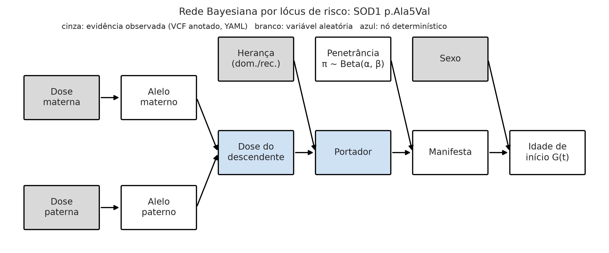
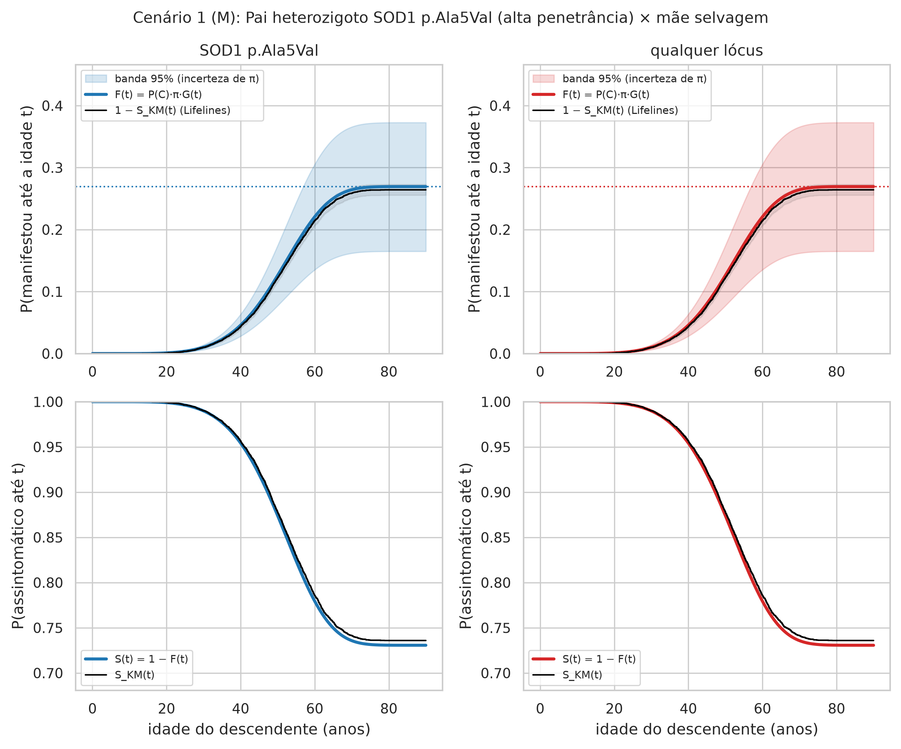
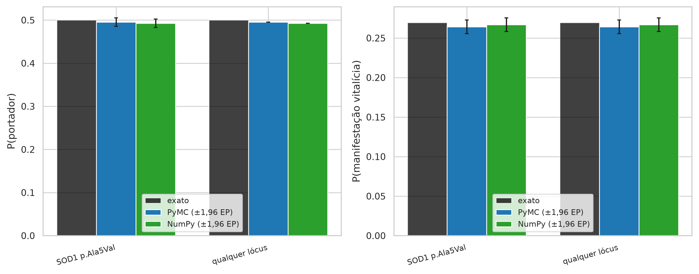
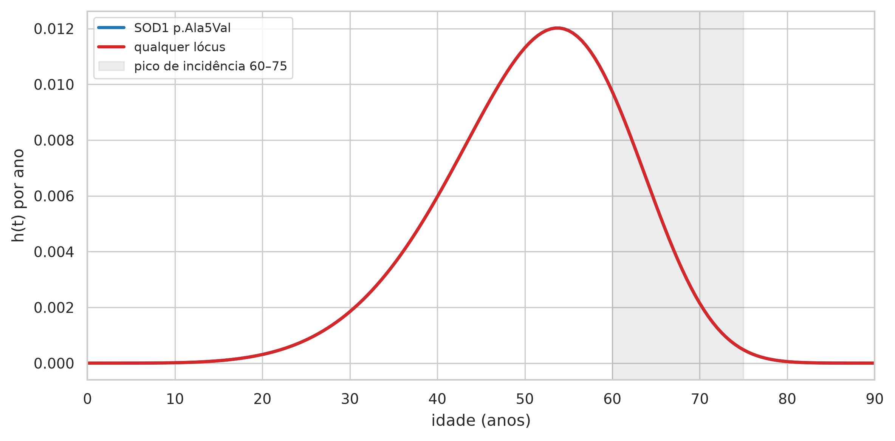
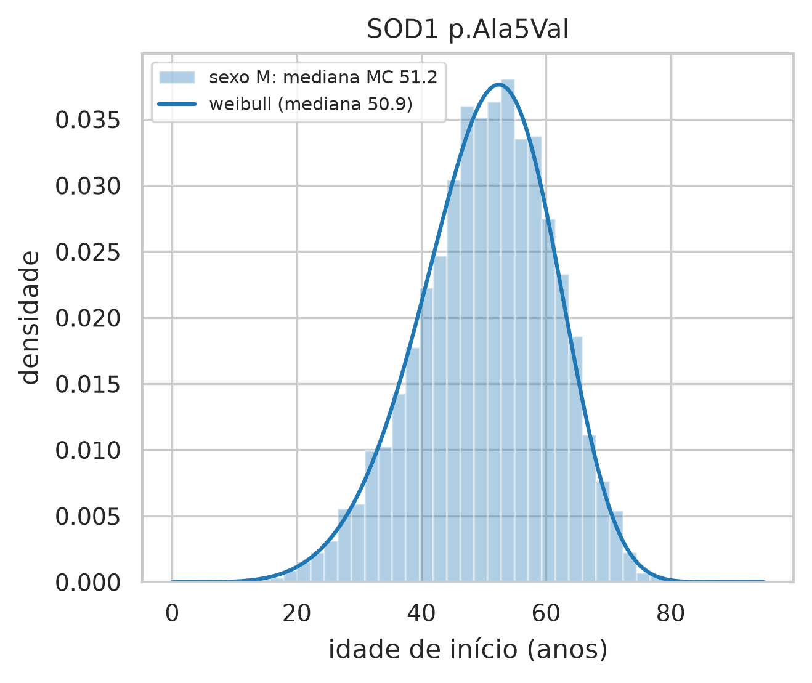
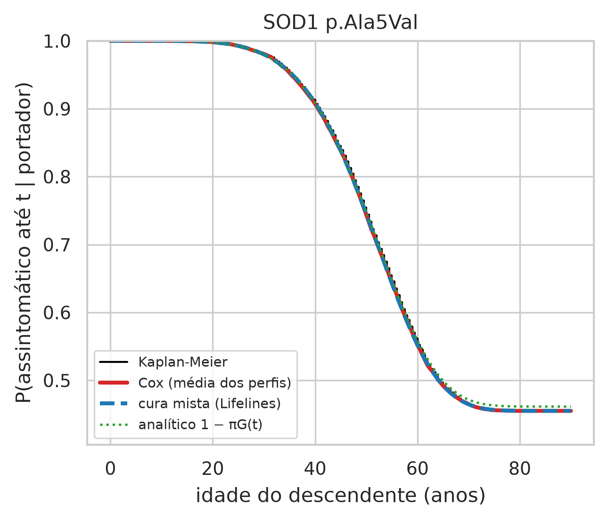

# Relatório do artefato — Cenário 1 (M): Pai heterozigoto SOD1 p.Ala5Val (alta penetrância) × mãe selvagem

> AVISO: instrumento experimental de apoio à decisão no aconselhamento genético preditivo da ELA, construído com dados sintéticos e parâmetros populacionais da literatura. Não constitui diagnóstico, não substitui o julgamento clínico e não deve ser usado isoladamente em decisões sobre pacientes.

## Entrada

VCF materno: `cenario_1_mae.vcf` (amostra MAE); VCF paterno: `cenario_1_pai.vcf` (amostra PAI); laudo do C9orf72: mãe: 23 repetições; pai: 23 repetições; sexo do descendente: M; idade atual sem sintomas: 30.0; motor: pymc; N = 10.000; seed = 42; horizonte = 90 anos.

## Qualidade dos dados (TCC 4.2.3)

- Mãe: montagem GRCh38 (coerente); 5/7 registros aprovados (71%); 2 aprovados encontrados na base de anotação (40%; estado de revisão 2★: 2); classes {'nao_anotada': 3, 'benigna': 1, 'risco': 1}; significado incerto: 0 (0% das anotadas); classificação conflitante: 0 (0%); risco com frequência > 1%: 0.
- Pai: montagem GRCh38 (coerente); 5/7 registros aprovados (71%); 2 aprovados encontrados na base de anotação (40%; estado de revisão 2★: 2); classes {'nao_anotada': 3, 'benigna': 1, 'risco': 1}; significado incerto: 0 (0% das anotadas); classificação conflitante: 0 (0%); risco com frequência > 1%: 0.
- Base de anotação: clinvar_base_consolidada; regra de classe: só Pathogenic/Likely pathogenic sustentam risco; significado incerto e classificações conflitantes não (TCC 4.2.2). Classificação conflitante só sustenta risco pela regra qualificada: mais da metade das classificações patogênicas ou provavelmente patogênicas e fenótipo de ELA com herança declarada.

## Resultado

- **SOD1 p.Ala5Val** (dominante; dosagens mãe/pai 0/1): P(portador) = 50.0% (MC 49.5%); penetrância média 53.9% [32.7%–74.4%]; risco vitalício (até os 90 anos) 26.9% [16.3%–37.2%]; idade mediana de início 50.9 anos (p10–p90 MC: 36–64).
- **Combinado (qualquer lócus, independência)**: P(portador de ≥ 1) = 50.0%; risco vitalício (até os 90 anos) 26.9% [16.5%–37.3%]; idade mediana do primeiro início 51.2 anos. Condicionando ao descendente assintomático aos 30 anos, P(portador de ≥ 1 lócus) passa de 50.0% para 49.5% e o risco residual (da idade atual até os 90 anos) é 26.2% [16.0%–36.4%]; idade provável de início a partir dessa idade: mediana 51.4 anos (25–75 %: 44.3–58.0). Valores exatos, os mesmos da Tabela 4 e dos indicadores; conferência por rejeição de 100 sorteios do Monte Carlo: 49.0% e 25.7%.

## Comparação com o modelo de Cox (CoxPHFitter)

`CoxPHFitter` (Lifelines) ajustado na coorte sintética de portadores (os dois sexos simulados com sementes independentes, derivadas da semente da execução; não portadores ficam fora porque nunca manifestam e separariam completamente a verossimilhança parcial). **SOD1 p.Ala5Val** (10054 portadores, 5480 eventos): HR sexo masculino = 1.05 [0.996–1.107], p = 0.070, riscos proporcionais p = 0.878; concordância 0.506; S(60): Cox 0.552, cura mista 0.552, Kaplan-Meier 0.552, analítico 0.559; S_Cox(horizonte) = 0.455 vs fração de cura da Lifelines 1 − π̂ = 0.455 (π de entrada 0.539); maior diferença Cox × cura mista 0.003. Leitura: a função de base de Cox é não paramétrica e acompanha o Kaplan-Meier, mas Cox não separa quem nunca manifestará (fração de cura) de quem ainda não manifestou nem estima π; o modelo de cura mista recupera π e G(t) separadamente (Tabela 7). O efeito do sexo entra em Cox como razão de riscos constante, embora no modelo seja um deslocamento de idade; na unidade combinada as HR entre lóci misturam diferenças de penetrância e de idade de início.

## Verificações

Aderência: maior desvio entre Monte Carlo e valor exato = 1.19 erros padrão (limite usual: 4). Coerência: risco vitalício por Kaplan-Meier = SOD1 p.Ala5Val: 26.4%, qualquer lócus: 26.4%. Recuperação Lifelines: erro relativo máximo em π = 1.0%. Tempo: 3.9 s no total (pymc: 1.37 s; motor cruzado: 0.00 s).

## Limitações desta execução

Parâmetros provisórios (confirmar: true) em: C9orf72, TARDBP. Independência entre lóci; sem fatores modificadores; penetrância populacional de coortes europeias/norte-americanas; dados sintéticos.

## Tabelas

**Tabela 1 — Variantes aprovadas no filtro de qualidade e sua anotação, por genitor**

| amostra | gene | cromossomo | posicao | ref | alt | id | tipo | dosagem | repeticoes | classe | clnsig | estrelas | nome_curto | heranca | regra_qualificada | fonte_anotacao |
|---|---|---|---|---|---|---|---|---|---|---|---|---|---|---|---|---|
| MAE | TARDBP | 1 | 11020000 | G | A |  | snv | 0 |  | nao_anotada |  |  |  |  |  |  |
| MAE | TARDBP | 1 | 11020000 | G | T |  | snv | 1 |  | nao_anotada |  |  |  |  |  |  |
| MAE | FUS | 16 | 31185000 | A | G |  | snv | 1 |  | nao_anotada |  |  |  |  |  |  |
| MAE | SOD1 | 21 | 31659509 | G | T | rs17883296 | snv | 1 |  | benigna | Likely benign | 2 | rs17883296 |  | não | clinvar_base_consolidada:posicao_alelos |
| MAE | SOD1 | 21 | 31659783 | C | T | rs121912442 | snv | 0 |  | risco | Pathogenic | 2 | p.Ala5Val | dominante | não | clinvar_base_consolidada:posicao_alelos |
| PAI | TARDBP | 1 | 11020000 | G | A |  | snv | 0 |  | nao_anotada |  |  |  |  |  |  |
| PAI | TARDBP | 1 | 11020000 | G | T |  | snv | 1 |  | nao_anotada |  |  |  |  |  |  |
| PAI | FUS | 16 | 31185000 | A | G |  | snv | 1 |  | nao_anotada |  |  |  |  |  |  |
| PAI | SOD1 | 21 | 31659509 | G | T | rs17883296 | snv | 1 |  | benigna | Likely benign | 2 | rs17883296 |  | não | clinvar_base_consolidada:posicao_alelos |
| PAI | SOD1 | 21 | 31659783 | C | T | rs121912442 | snv | 1 |  | risco | Pathogenic | 2 | p.Ala5Val | dominante | não | clinvar_base_consolidada:posicao_alelos |

*Fonte: elaborado pela autora (2026), a partir do artefato ela_preditivo.*

Registros lidos/aprovados: mãe 7/5, pai 7/5. Reprovações: mãe {'fora_das_regioes': 1, 'filtro_nao_pass': 1, 'dp_baixo': 1, 'gq_baixo': 1}, pai {'fora_das_regioes': 1, 'filtro_nao_pass': 1, 'dp_baixo': 1, 'gq_baixo': 1}. Base de anotação: clinvar_base_consolidada (1457 variantes do ClinVar + 1 da tabela curada; 1 registro da base fora da anotação, por ter alelo alternativo igual ao de referência).

**Tabela 1b — Vetor genotípico parental: dosagem alélica (0/1/2) por lócus de risco e P(portador) exata; lócus com genótipo não determinado num genitor fica marcado como descartado e não entra no cálculo (TCC 4.3)**

| gene | variante | rs | tipo | heranca | dosagem_mae | dosagem_pai | repeticoes_mae | repeticoes_pai | clnsig | estrelas | fonte | p_portador_exato | descartado | observacao |
|---|---|---|---|---|---|---|---|---|---|---|---|---|---|---|
| SOD1 | p.Ala5Val | rs121912442 | snv | dominante | 0 | 1 |  |  | Pathogenic | 2 | vcf | 0.5 | não |  |

*Fonte: elaborado pela autora (2026), a partir do artefato ela_preditivo.*

**Tabela 2 — Aderência teórica: probabilidades exatas vs Monte Carlo (PyMC e NumPy), erro padrão e qui-quadrado do genótipo do descendente**

| variante | n | p_portador_exato | p_portador_pymc | p_portador_numpy | ep_portador | desvio_portador_pymc_em_ep | desvio_portador_numpy_em_ep | p_manifesta_exato | p_manifesta_pymc | p_manifesta_numpy | ep_manifesta | desvio_manifesta_pymc_em_ep | desvio_manifesta_numpy_em_ep | qui2_genotipo_pymc | valor_p_genotipo_pymc | qui2_genotipo_numpy | valor_p_genotipo_numpy | idade_mediana_exata | idade_mediana_pymc | idade_mediana_numpy |
|---|---|---|---|---|---|---|---|---|---|---|---|---|---|---|---|---|---|---|---|---|
| SOD1 p.Ala5Val | 10000 | 0.5 | 0.4954 | 0.4923 | 0.005 | 0.92 | 1.5402 | 0.2694 | 0.2641 | 0.2669 | 0.0044 | 1.1938 | 0.5568 | 0.8464 | 0.3576 | 2.3716 | 0.1236 | 50.8673 | 51.1501 | 51.144 |
| qualquer lócus | 10000 | 0.5 | 0.4954 | 0.4923 |  |  |  | 0.2694 | 0.2641 | 0.2669 | 0.0044 | 1.1938 | 0.5568 |  |  |  |  |  | 51.1501 | 51.144 |

*Fonte: elaborado pela autora (2026), a partir do artefato ela_preditivo.*

**Tabela 3 — Probabilidade de transmissão (portador), penetrância e risco vitalício de manifestação (até o horizonte de 90 anos) por lócus e combinado, com intervalo de credibilidade de 95% (incerteza da penetrância) e idade de início**

| gene | variante | heranca | dosagem_mae | dosagem_pai | p_portador_exato | p_portador_mc | penetrancia_media | penetrancia_q025 | penetrancia_q975 | p_manifesta_exato | p_manifesta_mc | p_manifesta_q025 | p_manifesta_q975 | fração que manifesta em algum momento (sem limite de idade) | idade_mediana_exata | idade_mediana_mc | idade_p10_mc | idade_p90_mc |
|---|---|---|---|---|---|---|---|---|---|---|---|---|---|---|---|---|---|---|
| SOD1 | SOD1 p.Ala5Val | dominante | 0 | 1 | 0.5 | 0.4954 | 0.5387 | 0.3267 | 0.7436 | 0.2694 | 0.2641 | 0.1633 | 0.3718 | 0.2694 | 50.8673 | 51.1501 | 36.1682 | 63.6326 |
| — | qualquer lócus | independência |  |  | 0.5 | 0.4954 |  |  |  | 0.2694 | 0.2641 | 0.1649 | 0.3727 | 0.2694 |  | 51.1501 |  |  |

*Fonte: elaborado pela autora (2026), a partir do artefato ela_preditivo.*

p_manifesta_* = risco vitalício: probabilidade de manifestar até os 90 anos. A coluna "fração que manifesta em algum momento (sem limite de idade)" é F(∞) = P(portador)·E[π], usada só nas verificações de coerência.

**Tabela 4 — Risco condicional à idade atual sem sintomas: P(portador | assintomático), risco nos próximos 10 e 20 anos e risco residual (da idade atual até os 90 anos), com banda de 95%**

| unidade | idade_atual | p_portador_condicional | risco_10_anos | risco_10_anos_q025 | risco_10_anos_q975 | risco_20_anos | risco_20_anos_q025 | risco_20_anos_q975 | risco_residual | risco_residual_q025 | risco_residual_q975 |
|---|---|---|---|---|---|---|---|---|---|---|---|
| SOD1 p.Ala5Val | 0 | 0.5 | 2.57e-05 | 1.58e-05 | 3.56e-05 | 0.0011 | 0.0007 | 0.0016 | 0.2694 | 0.1649 | 0.3727 |
| SOD1 p.Ala5Val | 20 | 0.4994 | 0.0091 | 0.0056 | 0.0126 | 0.0447 | 0.0274 | 0.0619 | 0.2685 | 0.1643 | 0.3717 |
| SOD1 p.Ala5Val | 30 | 0.4948 | 0.0359 | 0.0219 | 0.0499 | 0.117 | 0.0714 | 0.1625 | 0.2618 | 0.1597 | 0.3637 |
| SOD1 p.Ala5Val | 40 | 0.476 | 0.0841 | 0.0505 | 0.1185 | 0.1832 | 0.1101 | 0.2582 | 0.2343 | 0.1408 | 0.3302 |
| SOD1 p.Ala5Val | 50 | 0.4279 | 0.1082 | 0.0627 | 0.1584 | 0.1582 | 0.0917 | 0.2316 | 0.164 | 0.0951 | 0.2402 |
| SOD1 p.Ala5Val | 60 | 0.3585 | 0.056 | 0.0309 | 0.087 | 0.0625 | 0.0345 | 0.097 | 0.0626 | 0.0345 | 0.0971 |
| SOD1 p.Ala5Val | 70 | 0.3204 | 0.0068 | 0.0037 | 0.011 | 0.0069 | 0.0037 | 0.0111 | 0.0069 | 0.0037 | 0.0111 |

*Fonte: elaborado pela autora (2026), a partir do artefato ela_preditivo.*

risco_residual: probabilidade de manifestar entre a idade atual e o horizonte, para quem chegou a essa idade sem sintomas. Na idade 0 é o risco vitalício da Tabela 3.

**Tabela 10 — Sobrevivência (assintomático) estimada por Kaplan-Meier na coorte simulada, com IC 95% (Greenwood); mediana não atingida quando o risco vitalício é inferior a 50%**

| unidade | n | eventos | risco_vitalicio_km | S(40) | IC95 S(40) | S(50) | IC95 S(50) | S(60) | IC95 S(60) | S(70) | IC95 S(70) | S(80) | IC95 S(80) | mediana_sobrevivencia | idade_90pct_do_risco |
|---|---|---|---|---|---|---|---|---|---|---|---|---|---|---|---|
| SOD1 p.Ala5Val | 10000 | 2641 | 0.2641 | 0.9568 | 0.953–0.961 | 0.8778 | 0.871–0.884 | 0.7858 | 0.778–0.794 | 0.7413 | 0.733–0.750 | 0.7359 | 0.727–0.744 | não atingida | 63.6 |
| qualquer lócus | 10000 | 2641 | 0.2641 | 0.9568 | 0.953–0.961 | 0.8778 | 0.871–0.884 | 0.7858 | 0.778–0.794 | 0.7413 | 0.733–0.750 | 0.7359 | 0.727–0.744 | não atingida | 63.6 |

*Fonte: elaborado pela autora (2026), a partir do artefato ela_preditivo.*

**Tabela 7 — Recuperação dos parâmetros de entrada (π, λ, ρ) pelo ajustador de cura mista da Lifelines na coorte simulada de portadores**

| variante | n_portadores | eventos | pi_entrada | lambda_entrada | rho_entrada | delta_sexo | pi_lifelines | lambda_lifelines | rho_lifelines | erro_rel_pi | erro_rel_lambda | erro_rel_rho | weibull_lambda_manifestantes | weibull_rho_manifestantes | mediana_weibull_manifestantes |
|---|---|---|---|---|---|---|---|---|---|---|---|---|---|---|---|
| SOD1 p.Ala5Val | 4954 | 2641 | 0.5387 | 54.3959 | 5.4648 | 0 | 0.5331 | 54.6606 | 5.5251 | 0.0104 | 0.0049 | 0.011 | 54.6606 | 5.5251 | 51.1522 |

*Fonte: elaborado pela autora (2026), a partir do artefato ela_preditivo.*

**Tabela 11 — Modelo de Cox (CoxPHFitter) na coorte sintética de portadores: razões de risco, concordância, teste de riscos proporcionais e S(t) por Cox, cura mista, Kaplan-Meier e curva analítica**

| unidade | n_portadores | eventos | cox | HR[sexo masculino] | IC95 HR[sexo masculino] | p[sexo masculino] | p_riscos_proporcionais[sexo masculino] | concordancia | log_verossimilhanca_parcial | S_cox(50) | S_cura_mista(50) | S_km(50) | S_analitico(50) | S_cox(60) | S_cura_mista(60) | S_km(60) | S_analitico(60) | S_cox(70) | S_cura_mista(70) | S_km(70) | S_analitico(70) | S_cox(horizonte) | fracao_cura_lifelines | pi_lifelines | pi_entrada | dif_max_cox_cura_mista | dif_max_cox_km |
|---|---|---|---|---|---|---|---|---|---|---|---|---|---|---|---|---|---|---|---|---|---|---|---|---|---|---|---|
| SOD1 p.Ala5Val | 10054 | 5480 | ajustado | 1.0501 | 0.996–1.107 | 0.0702 | 0.8778 | 0.506 | -48.623 | 0.7442 | 0.7453 | 0.7443 | 0.7479 | 0.5517 | 0.5523 | 0.5517 | 0.5588 | 0.465 | 0.4646 | 0.465 | 0.4715 | 0.455 | 0.4549 | 0.5451 | 0.5387 | 0.0032 | 9.95e-05 |

*Fonte: elaborado pela autora (2026), a partir do artefato ela_preditivo.*

**Tabela 4b — Risco condicional não paramétrico (Kaplan-Meier) para um descendente assintomático aos 30 anos**

| unidade | idade_atual | risco_10_anos_km | risco_20_anos_km | risco_residual_km |
|---|---|---|---|---|
| SOD1 p.Ala5Val | 30 | 0.0335 | 0.1133 | 0.2567 |
| qualquer lócus | 30 | 0.0335 | 0.1133 | 0.2567 |

*Fonte: elaborado pela autora (2026), a partir do artefato ela_preditivo.*

## Figuras

*Figura 1 — Rede Bayesiana (DAG) do núcleo estocástico. Fonte: elaborado pela autora (2026), a partir do artefato ela_preditivo.*

*Figura 4 — Risco acumulado de manifestação F(t) e sobrevivência S(t) do descendente, com banda de credibilidade de 95% e Kaplan-Meier da coorte simulada. Fonte: elaborado pela autora (2026), a partir do artefato ela_preditivo.*

*Figura 6 — Aderência teórica: probabilidades exatas vs Monte Carlo (PyMC e NumPy), com erro padrão. Fonte: elaborado pela autora (2026), a partir do artefato ela_preditivo.*

*Figura 8 — Função de risco instantâneo h(t) por lócus; faixa sombreada = pico de incidência 60–75 anos (Feldman et al., 2022). Fonte: elaborado pela autora (2026), a partir do artefato ela_preditivo.*

*Figura 5 — Distribuição simulada da idade de início entre os descendentes que manifestam, por lócus. Fonte: elaborado pela autora (2026), a partir do artefato ela_preditivo.*

*Figura 9 — Sobrevivência (assintomático) entre portadores: Cox (marginal), cura mista, Kaplan-Meier e curva analítica, por unidade. Fonte: elaborado pela autora (2026), a partir do artefato ela_preditivo.*
