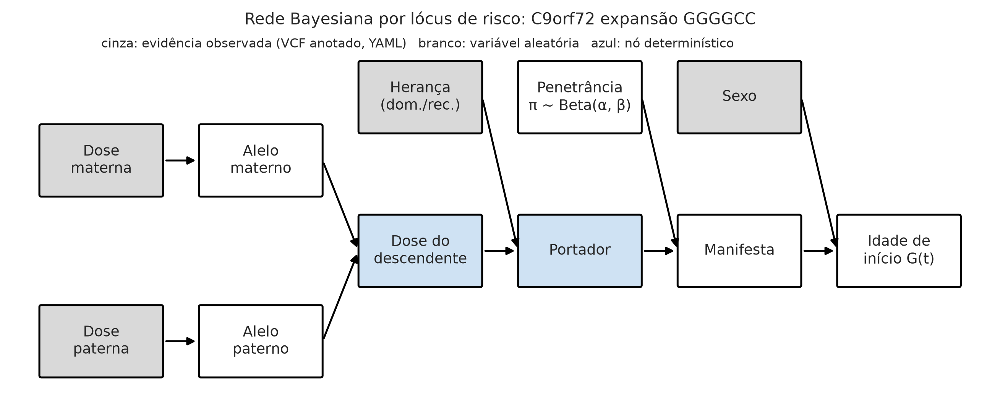
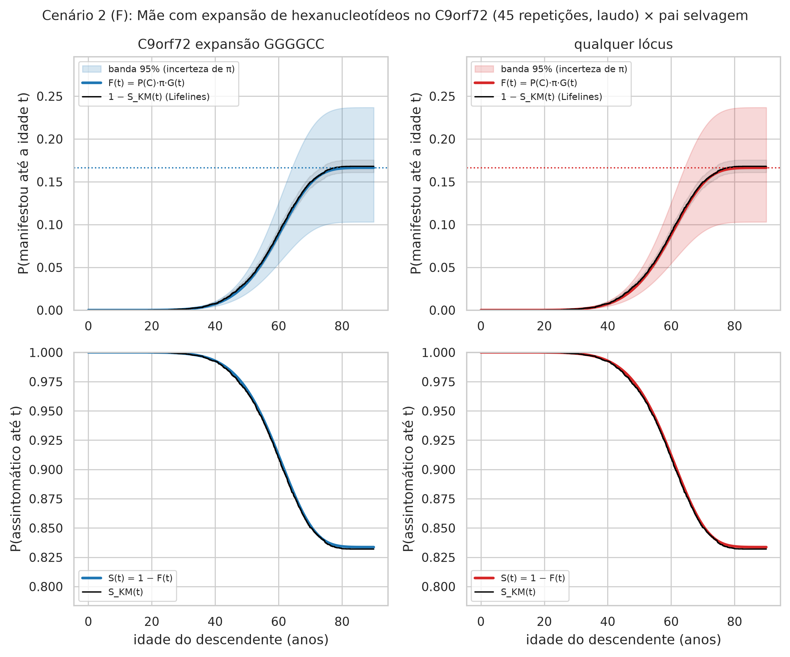
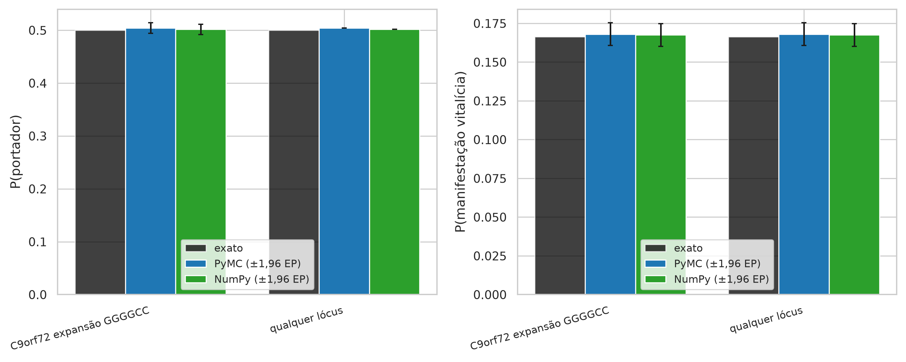
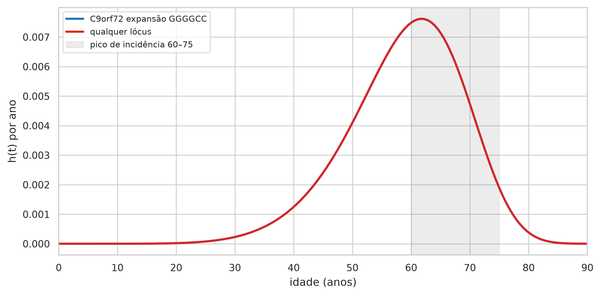
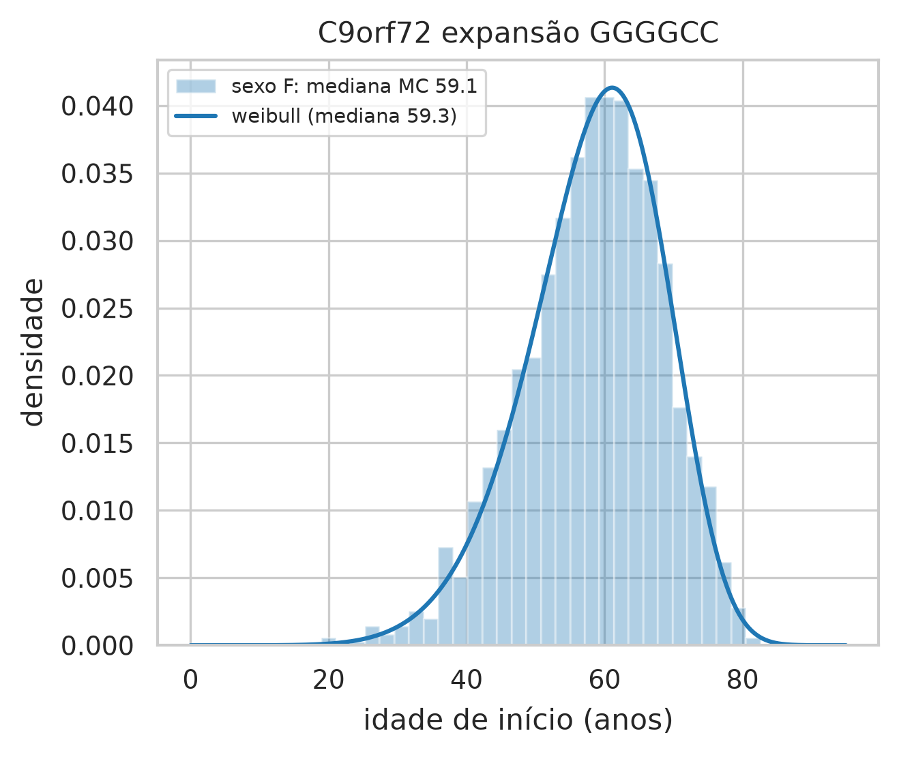
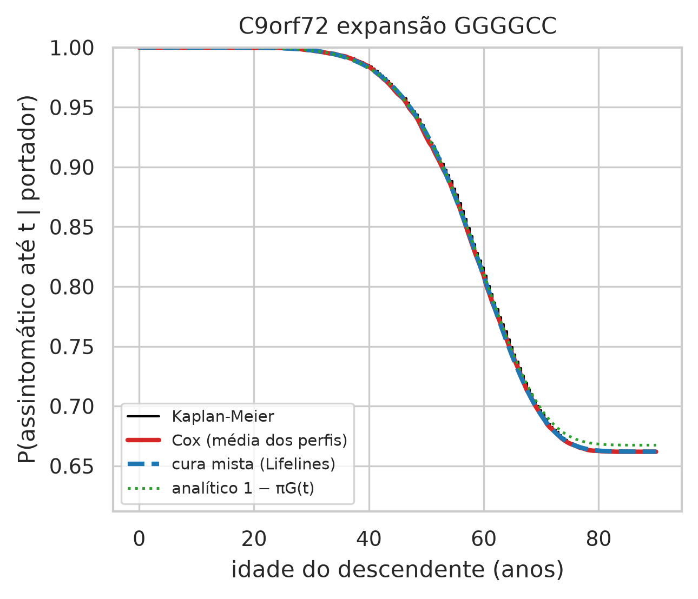

# Relatório do artefato — Cenário 2 (F): Mãe com expansão de hexanucleotídeos no C9orf72 (45 repetições, laudo) × pai selvagem

> AVISO: instrumento experimental de apoio à decisão no aconselhamento genético preditivo da ELA, construído com dados sintéticos e parâmetros populacionais da literatura. Não constitui diagnóstico, não substitui o julgamento clínico e não deve ser usado isoladamente em decisões sobre pacientes.

## Entrada

VCF materno: `cenario_2_mae.vcf` (amostra MAE); VCF paterno: `cenario_2_pai.vcf` (amostra PAI); laudo do C9orf72: mãe: 45 repetições; pai: 23 repetições; sexo do descendente: F; idade atual sem sintomas: 30.0; motor: pymc; N = 10.000; seed = 42; horizonte = 90 anos.

## Qualidade dos dados (TCC 4.2.3)

- Mãe: montagem GRCh38 (coerente); 4/6 registros aprovados (67%); 1 aprovados encontrados na base de anotação (25%; estado de revisão 2★: 1); classes {'nao_anotada': 3, 'benigna': 1}; significado incerto: 0 (0% das anotadas); classificação conflitante: 0 (0%); risco com frequência > 1%: 0.
- Pai: montagem GRCh38 (coerente); 4/6 registros aprovados (67%); 1 aprovados encontrados na base de anotação (25%; estado de revisão 2★: 1); classes {'nao_anotada': 3, 'benigna': 1}; significado incerto: 0 (0% das anotadas); classificação conflitante: 0 (0%); risco com frequência > 1%: 0.
- Base de anotação: clinvar_base_consolidada; regra de classe: só Pathogenic/Likely pathogenic sustentam risco; significado incerto e classificações conflitantes não (TCC 4.2.2). Classificação conflitante só sustenta risco pela regra qualificada: mais da metade das classificações patogênicas ou provavelmente patogênicas e fenótipo de ELA com herança declarada.

## Resultado

- **C9orf72 expansão GGGGCC** (dominante; dosagens mãe/pai 1/0): P(portador) = 50.0% (MC 50.4%); penetrância média 33.3% [20.5%–47.5%]; risco vitalício (até os 90 anos) 16.6% [10.2%–23.7%]; idade mediana de início 59.3 anos (p10–p90 MC: 45–71).
- **Combinado (qualquer lócus, independência)**: P(portador de ≥ 1) = 50.0%; risco vitalício (até os 90 anos) 16.6% [10.3%–23.7%]; idade mediana do primeiro início 59.1 anos. Condicionando ao descendente assintomático aos 30 anos, P(portador de ≥ 1 lócus) passa de 50.0% para 50.0% e o risco residual (da idade atual até os 90 anos) é 16.6% [10.2%–23.6%]; idade provável de início a partir dessa idade: mediana 59.4 anos (25–75 %: 52.4–65.6). Valores exatos, os mesmos da Tabela 4 e dos indicadores; conferência por rejeição de 12 sorteios do Monte Carlo: 50.4% e 16.7%.

## Comparação com o modelo de Cox (CoxPHFitter)

`CoxPHFitter` (Lifelines) ajustado na coorte sintética de portadores (os dois sexos simulados com sementes independentes, derivadas da semente da execução; não portadores ficam fora porque nunca manifestam e separariam completamente a verossimilhança parcial). **C9orf72 expansão GGGGCC** (10138 portadores, 3428 eventos): HR sexo masculino = 1.08 [1.014–1.159], p = 0.019, riscos proporcionais p = 0.000; concordância 0.513; S(60): Cox 0.809, cura mista 0.808, Kaplan-Meier 0.809, analítico 0.810; S_Cox(horizonte) = 0.662 vs fração de cura da Lifelines 1 − π̂ = 0.662 (π de entrada 0.333); maior diferença Cox × cura mista 0.003. Leitura: a função de base de Cox é não paramétrica e acompanha o Kaplan-Meier, mas Cox não separa quem nunca manifestará (fração de cura) de quem ainda não manifestou nem estima π; o modelo de cura mista recupera π e G(t) separadamente (Tabela 7). O efeito do sexo entra em Cox como razão de riscos constante, embora no modelo seja um deslocamento de idade; na unidade combinada as HR entre lóci misturam diferenças de penetrância e de idade de início.

## Verificações

Aderência: maior desvio entre Monte Carlo e valor exato = 0.44 erros padrão (limite usual: 4). Coerência: risco vitalício por Kaplan-Meier = C9orf72 expansão GGGGCC: 16.8%, qualquer lócus: 16.8%. Recuperação Lifelines: erro relativo máximo em π = 0.1%. Tempo: 4.1 s no total (pymc: 1.46 s; motor cruzado: 0.00 s).

## Limitações desta execução

Parâmetros provisórios (confirmar: true) em: C9orf72, TARDBP. Independência entre lóci; sem fatores modificadores; penetrância populacional de coortes europeias/norte-americanas; dados sintéticos.

## Tabelas

**Tabela 1 — Variantes aprovadas no filtro de qualidade e sua anotação, por genitor**

| amostra | gene | cromossomo | posicao | ref | alt | id | tipo | dosagem | repeticoes | classe | clnsig | estrelas | nome_curto | heranca | regra_qualificada | fonte_anotacao |
|---|---|---|---|---|---|---|---|---|---|---|---|---|---|---|---|---|
| MAE | TARDBP | 1 | 11020000 | G | A |  | snv | 0 |  | nao_anotada |  |  |  |  |  |  |
| MAE | TARDBP | 1 | 11020000 | G | T |  | snv | 1 |  | nao_anotada |  |  |  |  |  |  |
| MAE | FUS | 16 | 31185000 | A | G |  | snv | 1 |  | nao_anotada |  |  |  |  |  |  |
| MAE | SOD1 | 21 | 31659509 | G | T | rs17883296 | snv | 1 |  | benigna | Likely benign | 2 | rs17883296 |  | não | clinvar_base_consolidada:posicao_alelos |
| PAI | TARDBP | 1 | 11020000 | G | A |  | snv | 0 |  | nao_anotada |  |  |  |  |  |  |
| PAI | TARDBP | 1 | 11020000 | G | T |  | snv | 1 |  | nao_anotada |  |  |  |  |  |  |
| PAI | FUS | 16 | 31185000 | A | G |  | snv | 1 |  | nao_anotada |  |  |  |  |  |  |
| PAI | SOD1 | 21 | 31659509 | G | T | rs17883296 | snv | 1 |  | benigna | Likely benign | 2 | rs17883296 |  | não | clinvar_base_consolidada:posicao_alelos |

*Fonte: elaborado pela autora (2026), a partir do artefato ela_preditivo.*

Registros lidos/aprovados: mãe 6/4, pai 6/4. Reprovações: mãe {'fora_das_regioes': 1, 'filtro_nao_pass': 1, 'dp_baixo': 1, 'gq_baixo': 1}, pai {'fora_das_regioes': 1, 'filtro_nao_pass': 1, 'dp_baixo': 1, 'gq_baixo': 1}. Base de anotação: clinvar_base_consolidada (1457 variantes do ClinVar + 1 da tabela curada; 1 registro da base fora da anotação, por ter alelo alternativo igual ao de referência).

**Tabela 1b — Vetor genotípico parental: dosagem alélica (0/1/2) por lócus de risco e P(portador) exata; lócus com genótipo não determinado num genitor fica marcado como descartado e não entra no cálculo (TCC 4.3)**

| gene | variante | rs | tipo | heranca | dosagem_mae | dosagem_pai | repeticoes_mae | repeticoes_pai | clnsig | estrelas | fonte | p_portador_exato | descartado | observacao |
|---|---|---|---|---|---|---|---|---|---|---|---|---|---|---|
| C9orf72 | expansão GGGGCC |  | repeticao | dominante | 1 | 0 | 45 | 23 | Pathogenic | 1 | laudo | 0.5 | não |  |

*Fonte: elaborado pela autora (2026), a partir do artefato ela_preditivo.*

**Tabela 2 — Aderência teórica: probabilidades exatas vs Monte Carlo (PyMC e NumPy), erro padrão e qui-quadrado do genótipo do descendente**

| variante | n | p_portador_exato | p_portador_pymc | p_portador_numpy | ep_portador | desvio_portador_pymc_em_ep | desvio_portador_numpy_em_ep | p_manifesta_exato | p_manifesta_pymc | p_manifesta_numpy | ep_manifesta | desvio_manifesta_pymc_em_ep | desvio_manifesta_numpy_em_ep | qui2_genotipo_pymc | valor_p_genotipo_pymc | qui2_genotipo_numpy | valor_p_genotipo_numpy | idade_mediana_exata | idade_mediana_pymc | idade_mediana_numpy |
|---|---|---|---|---|---|---|---|---|---|---|---|---|---|---|---|---|---|---|---|---|
| C9orf72 expansão GGGGCC | 10000 | 0.5 | 0.5042 | 0.5015 | 0.005 | 0.84 | 0.3 | 0.1664 | 0.168 | 0.1675 | 0.0037 | 0.4399 | 0.3065 | 0.7056 | 0.4009 | 0.09 | 0.7642 | 59.3045 | 59.0751 | 59.3939 |
| qualquer lócus | 10000 | 0.5 | 0.5042 | 0.5015 |  |  |  | 0.1664 | 0.168 | 0.1675 | 0.0037 | 0.4399 | 0.3065 |  |  |  |  |  | 59.0751 | 59.3939 |

*Fonte: elaborado pela autora (2026), a partir do artefato ela_preditivo.*

**Tabela 3 — Probabilidade de transmissão (portador), penetrância e risco vitalício de manifestação (até o horizonte de 90 anos) por lócus e combinado, com intervalo de credibilidade de 95% (incerteza da penetrância) e idade de início**

| gene | variante | heranca | dosagem_mae | dosagem_pai | p_portador_exato | p_portador_mc | penetrancia_media | penetrancia_q025 | penetrancia_q975 | p_manifesta_exato | p_manifesta_mc | p_manifesta_q025 | p_manifesta_q975 | fração que manifesta em algum momento (sem limite de idade) | idade_mediana_exata | idade_mediana_mc | idade_p10_mc | idade_p90_mc |
|---|---|---|---|---|---|---|---|---|---|---|---|---|---|---|---|---|---|---|
| C9orf72 | C9orf72 expansão GGGGCC | dominante | 1 | 0 | 0.5 | 0.5042 | 0.3327 | 0.2048 | 0.4746 | 0.1664 | 0.168 | 0.1024 | 0.2373 | 0.1664 | 59.3045 | 59.0751 | 44.6875 | 70.6903 |
| — | qualquer lócus | independência |  |  | 0.5 | 0.5042 |  |  |  | 0.1664 | 0.168 | 0.103 | 0.2368 | 0.1664 |  | 59.0751 |  |  |

*Fonte: elaborado pela autora (2026), a partir do artefato ela_preditivo.*

p_manifesta_* = risco vitalício: probabilidade de manifestar até os 90 anos. A coluna "fração que manifesta em algum momento (sem limite de idade)" é F(∞) = P(portador)·E[π], usada só nas verificações de coerência.

**Tabela 4 — Risco condicional à idade atual sem sintomas: P(portador | assintomático), risco nos próximos 10 e 20 anos e risco residual (da idade atual até os 90 anos), com banda de 95%**

| unidade | idade_atual | p_portador_condicional | risco_10_anos | risco_10_anos_q025 | risco_10_anos_q975 | risco_20_anos | risco_20_anos_q025 | risco_20_anos_q975 | risco_residual | risco_residual_q025 | risco_residual_q975 |
|---|---|---|---|---|---|---|---|---|---|---|---|
| C9orf72 expansão GGGGCC | 0 | 0.5 | 3.29e-07 | 2.04e-07 | 4.68e-07 | 5.42e-05 | 3.36e-05 | 7.72e-05 | 0.1664 | 0.103 | 0.2368 |
| C9orf72 expansão GGGGCC | 20 | 0.5 | 0.0009 | 0.0006 | 0.0013 | 0.0072 | 0.0044 | 0.0102 | 0.1663 | 0.103 | 0.2367 |
| C9orf72 expansão GGGGCC | 30 | 0.4995 | 0.0063 | 0.0039 | 0.0089 | 0.0307 | 0.019 | 0.0438 | 0.1655 | 0.1025 | 0.2357 |
| C9orf72 expansão GGGGCC | 40 | 0.4964 | 0.0246 | 0.0152 | 0.0352 | 0.0813 | 0.0502 | 0.116 | 0.1603 | 0.099 | 0.2288 |
| C9orf72 expansão GGGGCC | 50 | 0.4836 | 0.0581 | 0.0355 | 0.0838 | 0.1199 | 0.0733 | 0.173 | 0.1391 | 0.0851 | 0.2007 |
| C9orf72 expansão GGGGCC | 60 | 0.4518 | 0.0656 | 0.0392 | 0.0974 | 0.0853 | 0.0509 | 0.1265 | 0.086 | 0.0514 | 0.1276 |
| C9orf72 expansão GGGGCC | 70 | 0.4133 | 0.021 | 0.0122 | 0.0323 | 0.0218 | 0.0127 | 0.0335 | 0.0218 | 0.0127 | 0.0335 |

*Fonte: elaborado pela autora (2026), a partir do artefato ela_preditivo.*

risco_residual: probabilidade de manifestar entre a idade atual e o horizonte, para quem chegou a essa idade sem sintomas. Na idade 0 é o risco vitalício da Tabela 3.

**Tabela 10 — Sobrevivência (assintomático) estimada por Kaplan-Meier na coorte simulada, com IC 95% (Greenwood); mediana não atingida quando o risco vitalício é inferior a 50%**

| unidade | n | eventos | risco_vitalicio_km | S(40) | IC95 S(40) | S(50) | IC95 S(50) | S(60) | IC95 S(60) | S(70) | IC95 S(70) | S(80) | IC95 S(80) | mediana_sobrevivencia | idade_90pct_do_risco |
|---|---|---|---|---|---|---|---|---|---|---|---|---|---|---|---|
| C9orf72 expansão GGGGCC | 10000 | 1680 | 0.168 | 0.9925 | 0.991–0.994 | 0.9663 | 0.963–0.970 | 0.9098 | 0.904–0.915 | 0.8503 | 0.843–0.857 | 0.8323 | 0.825–0.839 | não atingida | 70.7 |
| qualquer lócus | 10000 | 1680 | 0.168 | 0.9925 | 0.991–0.994 | 0.9663 | 0.963–0.970 | 0.9098 | 0.904–0.915 | 0.8503 | 0.843–0.857 | 0.8323 | 0.825–0.839 | não atingida | 70.7 |

*Fonte: elaborado pela autora (2026), a partir do artefato ela_preditivo.*

**Tabela 7 — Recuperação dos parâmetros de entrada (π, λ, ρ) pelo ajustador de cura mista da Lifelines na coorte simulada de portadores**

| variante | n_portadores | eventos | pi_entrada | lambda_entrada | rho_entrada | delta_sexo | pi_lifelines | lambda_lifelines | rho_lifelines | erro_rel_pi | erro_rel_lambda | erro_rel_rho | weibull_lambda_manifestantes | weibull_rho_manifestantes | mediana_weibull_manifestantes |
|---|---|---|---|---|---|---|---|---|---|---|---|---|---|---|---|
| C9orf72 expansão GGGGCC | 5042 | 1680 | 0.3327 | 61.5171 | 6.8334 | 1 | 0.3332 | 62.3694 | 6.8018 | 0.0015 | 0.0024 | 0.0046 | 62.3692 | 6.8024 | 59.0977 |

*Fonte: elaborado pela autora (2026), a partir do artefato ela_preditivo.*

**Tabela 11 — Modelo de Cox (CoxPHFitter) na coorte sintética de portadores: razões de risco, concordância, teste de riscos proporcionais e S(t) por Cox, cura mista, Kaplan-Meier e curva analítica**

| unidade | n_portadores | eventos | cox | HR[sexo masculino] | IC95 HR[sexo masculino] | p[sexo masculino] | p_riscos_proporcionais[sexo masculino] | concordancia | log_verossimilhanca_parcial | S_cox(50) | S_cura_mista(50) | S_km(50) | S_analitico(50) | S_cox(60) | S_cura_mista(60) | S_km(60) | S_analitico(60) | S_cox(70) | S_cura_mista(70) | S_km(70) | S_analitico(70) | S_cox(horizonte) | fracao_cura_lifelines | pi_lifelines | pi_entrada | dif_max_cox_cura_mista | dif_max_cox_km |
|---|---|---|---|---|---|---|---|---|---|---|---|---|---|---|---|---|---|---|---|---|---|---|---|---|---|---|---|
| C9orf72 expansão GGGGCC | 10138 | 3428 | ajustado | 1.0838 | 1.014–1.159 | 0.0186 | 2.40e-07 | 0.5126 | -30.959 | 0.9251 | 0.9281 | 0.9251 | 0.928 | 0.8089 | 0.8085 | 0.809 | 0.8104 | 0.6927 | 0.6923 | 0.6928 | 0.6975 | 0.6618 | 0.6619 | 0.3381 | 0.3327 | 0.0031 | 0.0002 |

*Fonte: elaborado pela autora (2026), a partir do artefato ela_preditivo.*

**Tabela 4b — Risco condicional não paramétrico (Kaplan-Meier) para um descendente assintomático aos 30 anos**

| unidade | idade_atual | risco_10_anos_km | risco_20_anos_km | risco_residual_km |
|---|---|---|---|---|
| C9orf72 expansão GGGGCC | 30 | 0.0063 | 0.0325 | 0.167 |
| qualquer lócus | 30 | 0.0063 | 0.0325 | 0.167 |

*Fonte: elaborado pela autora (2026), a partir do artefato ela_preditivo.*

## Figuras

*Figura 1 — Rede Bayesiana (DAG) do núcleo estocástico. Fonte: elaborado pela autora (2026), a partir do artefato ela_preditivo.*

*Figura 4 — Risco acumulado de manifestação F(t) e sobrevivência S(t) do descendente, com banda de credibilidade de 95% e Kaplan-Meier da coorte simulada. Fonte: elaborado pela autora (2026), a partir do artefato ela_preditivo.*

*Figura 6 — Aderência teórica: probabilidades exatas vs Monte Carlo (PyMC e NumPy), com erro padrão. Fonte: elaborado pela autora (2026), a partir do artefato ela_preditivo.*

*Figura 8 — Função de risco instantâneo h(t) por lócus; faixa sombreada = pico de incidência 60–75 anos (Feldman et al., 2022). Fonte: elaborado pela autora (2026), a partir do artefato ela_preditivo.*

*Figura 5 — Distribuição simulada da idade de início entre os descendentes que manifestam, por lócus. Fonte: elaborado pela autora (2026), a partir do artefato ela_preditivo.*

*Figura 9 — Sobrevivência (assintomático) entre portadores: Cox (marginal), cura mista, Kaplan-Meier e curva analítica, por unidade. Fonte: elaborado pela autora (2026), a partir do artefato ela_preditivo.*
