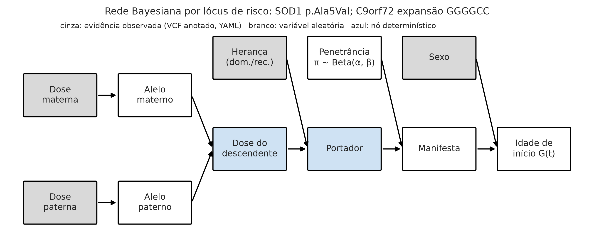
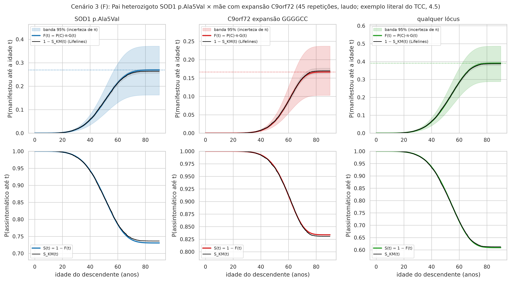
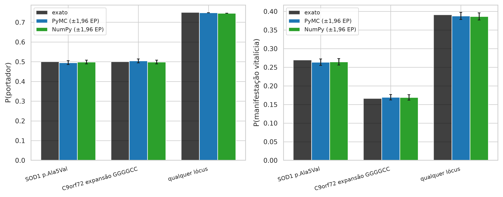
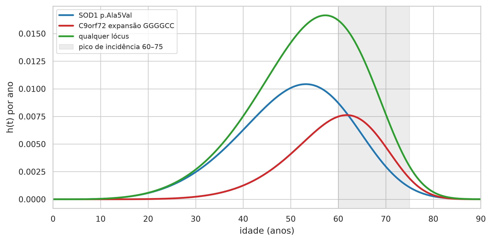
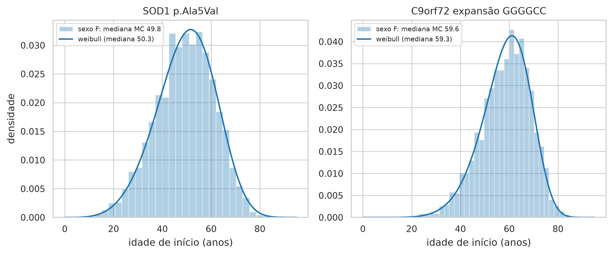

# Relatório do artefato — Cenário 3 (F): Pai heterozigoto SOD1 p.Ala5Val × mãe com expansão C9orf72 (45 repetições, laudo; exemplo literal do TCC, 4.5)

> AVISO: instrumento experimental de apoio à decisão no aconselhamento genético preditivo da ELA, construído com dados sintéticos e parâmetros populacionais da literatura. Não constitui diagnóstico, não substitui o julgamento clínico e não deve ser usado isoladamente em decisões sobre pacientes.

## Entrada

VCF materno: `cenario_3_mae.vcf` (amostra MAE); VCF paterno: `cenario_3_pai.vcf` (amostra PAI); laudo do C9orf72: mae: 45 repetições; sexo do descendente: F; idade atual sem sintomas: 30.0; motor: pymc; N = 10.000; seed = 42; horizonte = 90 anos.

## Qualidade dos dados (TCC 4.2.3)

- Mãe: montagem GRCh38 (coerente); 5/7 registros aprovados (71%); 2 aprovados encontrados na base de anotação (40%; estado de revisão 2★: 2); classes {'nao_anotada': 3, 'benigna': 1, 'risco': 1}; significado incerto/conflitante: 0 (0% das anotadas); risco com frequência > 1%: 0.
- Pai: montagem GRCh38 (coerente); 5/7 registros aprovados (71%); 2 aprovados encontrados na base de anotação (40%; estado de revisão 2★: 2); classes {'nao_anotada': 3, 'benigna': 1, 'risco': 1}; significado incerto/conflitante: 0 (0% das anotadas); risco com frequência > 1%: 0.
- Base de anotação: clinvar_base_consolidada; regra de classe: só Pathogenic/Likely pathogenic sustentam risco; significado incerto e classificações conflitantes não (TCC 4.2.2).

## Resultado

- **SOD1 p.Ala5Val** (dominante; dosagens mãe/pai 0/1): P(portador) = 50.0% (MC 49.5%); penetrância média 53.9% [32.7%–74.4%]; risco vitalício 26.9% [16.3%–37.2%]; idade mediana de início 50.3 anos (p10–p90 MC: 33–64).
- **C9orf72 expansão GGGGCC** (dominante; dosagens mãe/pai 1/0): P(portador) = 50.0% (MC 50.4%); penetrância média 33.3% [20.5%–47.5%]; risco vitalício 16.6% [10.2%–23.7%]; idade mediana de início 59.3 anos (p10–p90 MC: 45–71).
- **Combinado (qualquer lócus, independência)**: P(portador de ≥ 1) = 75.0%; risco vitalício 39.1% [24.9%–52.1%]; idade mediana do primeiro início 52.6 anos. Condicionando ao descendente assintomático aos 30 anos (rejeição de 180 sorteios), P(portador de ≥ 1 lócus) passa de 74.8% para 74.4% e o risco vitalício residual é 37.6%.

## Verificações

Aderência: maior desvio entre Monte Carlo e valor exato = 1.26 erros padrão (limite usual: 4). Coerência: risco vitalício por Kaplan-Meier = SOD1 p.Ala5Val: 26.4%, C9orf72 expansão GGGGCC: 16.9%, qualquer lócus: 38.8%. Recuperação Lifelines: erro relativo máximo em π = 1.2%. Tempo: 4.8 s no total (pymc: 2.41 s; motor cruzado: 0.00 s).

## Limitações desta execução

Parâmetros provisórios (confirmar: true) em: SOD1, C9orf72, TARDBP, FUS. Independência entre lóci; sem fatores modificadores; penetrância populacional de coortes europeias/norte-americanas; dados sintéticos.

## Tabelas

**Tabela 1 — Variantes aprovadas no filtro de qualidade e sua anotação, por genitor**

| amostra | gene | cromossomo | posicao | ref | alt | id | tipo | dosagem | repeticoes | classe | clnsig | estrelas | nome_curto | heranca | fonte_anotacao |
|---|---|---|---|---|---|---|---|---|---|---|---|---|---|---|---|
| MAE | TARDBP | 1 | 11020000 | G | A |  | snv | 0 |  | nao_anotada |  |  |  |  |  |
| MAE | TARDBP | 1 | 11020000 | G | T |  | snv | 1 |  | nao_anotada |  |  |  |  |  |
| MAE | FUS | 16 | 31185000 | A | G |  | snv | 1 |  | nao_anotada |  |  |  |  |  |
| MAE | SOD1 | 21 | 31659509 | G | T | rs17883296 | snv | 1 |  | benigna | Likely benign | 2 | rs17883296 |  | clinvar_base_consolidada:posicao_alelos |
| MAE | SOD1 | 21 | 31659783 | C | T | rs121912442 | snv | 0 |  | risco | Pathogenic | 2 | p.Ala5Val | dominante | clinvar_base_consolidada:posicao_alelos |
| PAI | TARDBP | 1 | 11020000 | G | A |  | snv | 0 |  | nao_anotada |  |  |  |  |  |
| PAI | TARDBP | 1 | 11020000 | G | T |  | snv | 1 |  | nao_anotada |  |  |  |  |  |
| PAI | FUS | 16 | 31185000 | A | G |  | snv | 1 |  | nao_anotada |  |  |  |  |  |
| PAI | SOD1 | 21 | 31659509 | G | T | rs17883296 | snv | 1 |  | benigna | Likely benign | 2 | rs17883296 |  | clinvar_base_consolidada:posicao_alelos |
| PAI | SOD1 | 21 | 31659783 | C | T | rs121912442 | snv | 1 |  | risco | Pathogenic | 2 | p.Ala5Val | dominante | clinvar_base_consolidada:posicao_alelos |

*Fonte: elaborado pela autora (2026), a partir do artefato ela_preditivo.*

Registros lidos/aprovados: mãe 7/5, pai 7/5. Reprovações: mãe {'fora_das_regioes': 1, 'filtro_nao_pass': 1, 'dp_baixo': 1, 'gq_baixo': 1}, pai {'fora_das_regioes': 1, 'filtro_nao_pass': 1, 'dp_baixo': 1, 'gq_baixo': 1}. Base de anotação: clinvar_base_consolidada (1458 variantes do ClinVar + 1 da tabela curada).

**Tabela 1b — Vetor genotípico parental: dosagem alélica (0/1/2) por lócus de risco e P(portador) exata**

| gene | variante | rs | tipo | heranca | dosagem_mae | dosagem_pai | repeticoes_mae | repeticoes_pai | clnsig | estrelas | fonte | p_portador_exato | observacao |
|---|---|---|---|---|---|---|---|---|---|---|---|---|---|
| SOD1 | p.Ala5Val | rs121912442 | snv | dominante | 0 | 1 |  |  | Pathogenic | 2 | vcf | 0.5 |  |
| C9orf72 | expansão GGGGCC |  | repeticao | dominante | 1 | 0 | 45 |  | Pathogenic | 1 | laudo | 0.5 |  |

*Fonte: elaborado pela autora (2026), a partir do artefato ela_preditivo.*

**Tabela 2 — Aderência teórica: probabilidades exatas vs Monte Carlo (PyMC e NumPy), erro padrão e qui-quadrado do genótipo do descendente**

| variante | n | p_portador_exato | p_portador_pymc | p_portador_numpy | ep_portador | desvio_portador_pymc_em_ep | desvio_portador_numpy_em_ep | p_manifesta_exato | p_manifesta_pymc | p_manifesta_numpy | ep_manifesta | desvio_manifesta_pymc_em_ep | desvio_manifesta_numpy_em_ep | qui2_genotipo_pymc | valor_p_genotipo_pymc | qui2_genotipo_numpy | valor_p_genotipo_numpy | idade_mediana_exata | idade_mediana_pymc | idade_mediana_numpy |
|---|---|---|---|---|---|---|---|---|---|---|---|---|---|---|---|---|---|---|---|---|
| SOD1 p.Ala5Val | 10000 | 0.5 | 0.4954 | 0.4986 | 0.005 | 0.92 | 0.28 | 0.2694 | 0.2638 | 0.2645 | 0.0044 | 1.2624 | 1.1026 | 0.8464 | 0.3576 | 0.0784 | 0.7795 | 50.2576 | 49.767 | 50.0647 |
| C9orf72 expansão GGGGCC | 10000 | 0.5 | 0.5042 | 0.4985 | 0.005 | 0.84 | 0.3 | 0.1664 | 0.1694 | 0.1691 | 0.0038 | 0.8115 | 0.732 | 0.7056 | 0.4009 | 0.09 | 0.7642 | 59.3045 | 59.5757 | 59.32 |
| qualquer lócus | 10000 | 0.75 | 0.7483 | 0.7463 |  |  |  | 0.3909 | 0.3877 | 0.3865 | 0.0049 | 0.6586 | 0.9055 |  |  |  |  |  | 52.5956 | 52.8637 |

*Fonte: elaborado pela autora (2026), a partir do artefato ela_preditivo.*

**Tabela 3 — Probabilidade de transmissão (portador), penetrância e risco vitalício de manifestação por lócus e combinado, com intervalo de credibilidade de 95% (incerteza da penetrância) e idade de início**

| gene | variante | heranca | dosagem_mae | dosagem_pai | p_portador_exato | p_portador_mc | penetrancia_media | penetrancia_q025 | penetrancia_q975 | p_manifesta_exato | p_manifesta_mc | p_manifesta_q025 | p_manifesta_q975 | idade_mediana_exata | idade_mediana_mc | idade_p10_mc | idade_p90_mc |
|---|---|---|---|---|---|---|---|---|---|---|---|---|---|---|---|---|---|
| SOD1 | SOD1 p.Ala5Val | dominante | 0 | 1 | 0.5 | 0.4954 | 0.5387 | 0.3267 | 0.7436 | 0.2694 | 0.2638 | 0.1633 | 0.3718 | 50.2576 | 49.767 | 33.2974 | 64.4411 |
| C9orf72 | C9orf72 expansão GGGGCC | dominante | 1 | 0 | 0.5 | 0.5042 | 0.3327 | 0.2048 | 0.4746 | 0.1664 | 0.1694 | 0.1024 | 0.2373 | 59.3045 | 59.5757 | 45.2364 | 70.8388 |
| — | qualquer lócus | independência |  |  | 0.75 | 0.7483 |  |  |  | 0.3909 | 0.3877 | 0.249 | 0.5209 |  | 52.5956 |  |  |

*Fonte: elaborado pela autora (2026), a partir do artefato ela_preditivo.*

**Tabela 4 — Risco condicional à idade atual sem sintomas: P(portador | assintomático), risco nos próximos 10 e 20 anos e risco vitalício residual, com banda de 95%**

| unidade | idade_atual | p_portador_condicional | risco_10_anos | risco_10_anos_q025 | risco_10_anos_q975 | risco_20_anos | risco_20_anos_q025 | risco_20_anos_q975 | risco_vitalicio | risco_vitalicio_q025 | risco_vitalicio_q975 |
|---|---|---|---|---|---|---|---|---|---|---|---|
| SOD1 p.Ala5Val | 0 | 0.5 | 9.17e-05 | 5.54e-05 | 0.0001 | 0.0024 | 0.0015 | 0.0033 | 0.2694 | 0.1626 | 0.3708 |
| C9orf72 expansão GGGGCC | 0 | 0.5 | 3.29e-07 | 2.04e-07 | 4.68e-07 | 5.42e-05 | 3.36e-05 | 7.72e-05 | 0.1664 | 0.103 | 0.2368 |
| qualquer lócus | 0 |  | 9.21e-05 | 5.57e-05 | 0.0001 | 0.0025 | 0.0015 | 0.0034 | 0.3909 | 0.2879 | 0.4861 |
| SOD1 p.Ala5Val | 20 | 0.4988 | 0.0135 | 0.0081 | 0.0186 | 0.0544 | 0.0328 | 0.0749 | 0.2676 | 0.1613 | 0.3687 |
| C9orf72 expansão GGGGCC | 20 | 0.5 | 0.0009 | 0.0006 | 0.0013 | 0.0072 | 0.0044 | 0.0102 | 0.1663 | 0.103 | 0.2367 |
| qualquer lócus | 20 |  | 0.0144 | 0.009 | 0.0195 | 0.0611 | 0.0396 | 0.0816 | 0.3894 | 0.2868 | 0.4845 |
| SOD1 p.Ala5Val | 30 | 0.4919 | 0.0414 | 0.0248 | 0.0574 | 0.1184 | 0.071 | 0.164 | 0.2576 | 0.1545 | 0.3568 |
| C9orf72 expansão GGGGCC | 30 | 0.4995 | 0.0063 | 0.0039 | 0.0089 | 0.0307 | 0.019 | 0.0438 | 0.1655 | 0.1025 | 0.2357 |
| qualquer lócus | 30 |  | 0.0474 | 0.0308 | 0.0634 | 0.1455 | 0.0985 | 0.191 | 0.3805 | 0.2797 | 0.4745 |
| SOD1 p.Ala5Val | 40 | 0.47 | 0.0803 | 0.0474 | 0.1132 | 0.1678 | 0.0989 | 0.2364 | 0.2255 | 0.1329 | 0.3176 |
| C9orf72 expansão GGGGCC | 40 | 0.4964 | 0.0246 | 0.0152 | 0.0352 | 0.0813 | 0.0502 | 0.116 | 0.1603 | 0.099 | 0.2288 |
| qualquer lócus | 40 |  | 0.103 | 0.0697 | 0.1362 | 0.2354 | 0.1661 | 0.3036 | 0.3496 | 0.2561 | 0.4396 |
| SOD1 p.Ala5Val | 50 | 0.4237 | 0.0951 | 0.0541 | 0.1389 | 0.1465 | 0.0834 | 0.214 | 0.1578 | 0.0898 | 0.2305 |
| C9orf72 expansão GGGGCC | 50 | 0.4836 | 0.0581 | 0.0355 | 0.0838 | 0.1199 | 0.0733 | 0.173 | 0.1391 | 0.0851 | 0.2007 |
| qualquer lócus | 50 |  | 0.1476 | 0.1034 | 0.1939 | 0.2488 | 0.1787 | 0.3205 | 0.275 | 0.1988 | 0.3526 |
| SOD1 p.Ala5Val | 60 | 0.3631 | 0.0568 | 0.0309 | 0.0872 | 0.0686 | 0.0374 | 0.1054 | 0.0693 | 0.0377 | 0.1064 |
| C9orf72 expansão GGGGCC | 60 | 0.4518 | 0.0656 | 0.0392 | 0.0974 | 0.0853 | 0.0509 | 0.1265 | 0.086 | 0.0514 | 0.1276 |
| qualquer lócus | 60 |  | 0.1187 | 0.0832 | 0.1586 | 0.1481 | 0.1041 | 0.1972 | 0.1494 | 0.105 | 0.1989 |
| SOD1 p.Ala5Val | 70 | 0.3248 | 0.0126 | 0.0067 | 0.0199 | 0.0133 | 0.007 | 0.0211 | 0.0133 | 0.007 | 0.0211 |
| C9orf72 expansão GGGGCC | 70 | 0.4133 | 0.021 | 0.0122 | 0.0323 | 0.0218 | 0.0127 | 0.0335 | 0.0218 | 0.0127 | 0.0335 |
| qualquer lócus | 70 |  | 0.0333 | 0.0227 | 0.0462 | 0.0348 | 0.0237 | 0.0482 | 0.0348 | 0.0237 | 0.0482 |

*Fonte: elaborado pela autora (2026), a partir do artefato ela_preditivo.*

**Tabela 10 — Sobrevivência (assintomático) estimada por Kaplan-Meier na coorte simulada, com IC 95% (Greenwood); mediana não atingida quando o risco vitalício é inferior a 50%**

| unidade | n | eventos | risco_vitalicio_km | S(40) | IC95 S(40) | S(50) | IC95 S(50) | S(60) | IC95 S(60) | S(70) | IC95 S(70) | S(80) | IC95 S(80) | mediana_sobrevivencia | idade_90pct_do_risco |
|---|---|---|---|---|---|---|---|---|---|---|---|---|---|---|---|
| SOD1 p.Ala5Val | 10000 | 2637 | 0.2637 | 0.9418 | 0.937–0.946 | 0.8665 | 0.860–0.873 | 0.7862 | 0.778–0.794 | 0.7446 | 0.736–0.753 | 0.7367 | 0.728–0.745 | não atingida | 64.4 |
| C9orf72 expansão GGGGCC | 10000 | 1694 | 0.1694 | 0.9922 | 0.990–0.994 | 0.9674 | 0.964–0.971 | 0.913 | 0.907–0.918 | 0.8509 | 0.844–0.858 | 0.8314 | 0.824–0.839 | não atingida | 70.8 |
| qualquer lócus | 10000 | 3876 | 0.3876 | 0.9343 | 0.929–0.939 | 0.8372 | 0.830–0.844 | 0.7169 | 0.708–0.726 | 0.6336 | 0.624–0.643 | 0.6132 | 0.604–0.623 | não atingida | 66.9 |

*Fonte: elaborado pela autora (2026), a partir do artefato ela_preditivo.*

**Tabela 7 — Recuperação dos parâmetros de entrada (π, λ, ρ) pelo ajustador de cura mista da Lifelines na coorte simulada de portadores**

| variante | n_portadores | eventos | pi_entrada | lambda_entrada | rho_entrada | delta_sexo | pi_lifelines | lambda_lifelines | rho_lifelines | erro_rel_pi | erro_rel_lambda | erro_rel_rho | weibull_lambda_manifestantes | weibull_rho_manifestantes | mediana_weibull_manifestantes |
|---|---|---|---|---|---|---|---|---|---|---|---|---|---|---|---|
| SOD1 p.Ala5Val | 4954 | 2637 | 0.5387 | 54.3171 | 4.7185 | 0 | 0.5323 | 53.8753 | 4.7158 | 0.0119 | 0.0081 | 0.0006 | 53.8745 | 4.7167 | 49.8466 |
| C9orf72 expansão GGGGCC | 5042 | 1694 | 0.3327 | 61.5171 | 6.8334 | 1 | 0.336 | 62.7422 | 6.8934 | 0.0098 | 0.0037 | 0.0088 | 62.7419 | 6.894 | 59.4934 |

*Fonte: elaborado pela autora (2026), a partir do artefato ela_preditivo.*

**Tabela 4b — Risco condicional não paramétrico (Kaplan-Meier) para um descendente assintomático aos 30 anos**

| unidade | idade_atual | risco_10_anos_km | risco_20_anos_km | risco_vitalicio_km |
|---|---|---|---|---|
| SOD1 p.Ala5Val | 30 | 0.0418 | 0.1184 | 0.2509 |
| C9orf72 expansão GGGGCC | 30 | 0.0069 | 0.0317 | 0.1687 |
| qualquer lócus | 30 | 0.0486 | 0.1475 | 0.3764 |

*Fonte: elaborado pela autora (2026), a partir do artefato ela_preditivo.*

## Figuras

*Figura 1 — Rede Bayesiana (DAG) do núcleo estocástico. Fonte: elaborado pela autora (2026), a partir do artefato ela_preditivo.*

*Figura 4 — Risco acumulado de manifestação F(t) e sobrevivência S(t) do descendente, com banda de credibilidade de 95% e Kaplan-Meier da coorte simulada. Fonte: elaborado pela autora (2026), a partir do artefato ela_preditivo.*

*Figura 6 — Aderência teórica: probabilidades exatas vs Monte Carlo (PyMC e NumPy), com erro padrão. Fonte: elaborado pela autora (2026), a partir do artefato ela_preditivo.*

*Figura 8 — Função de risco instantâneo h(t) por lócus; faixa sombreada = pico de incidência 60–75 anos (Feldman et al., 2022). Fonte: elaborado pela autora (2026), a partir do artefato ela_preditivo.*

*Figura 5 — Distribuição simulada da idade de início entre os descendentes que manifestam, por lócus. Fonte: elaborado pela autora (2026), a partir do artefato ela_preditivo.*
