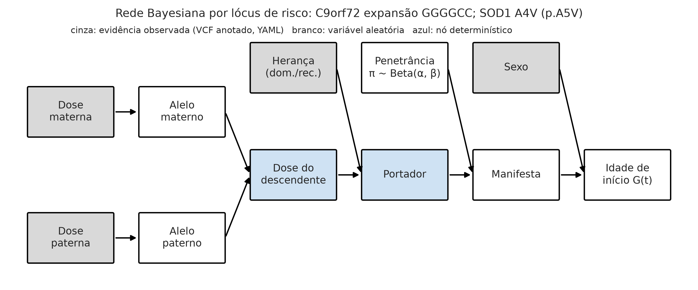
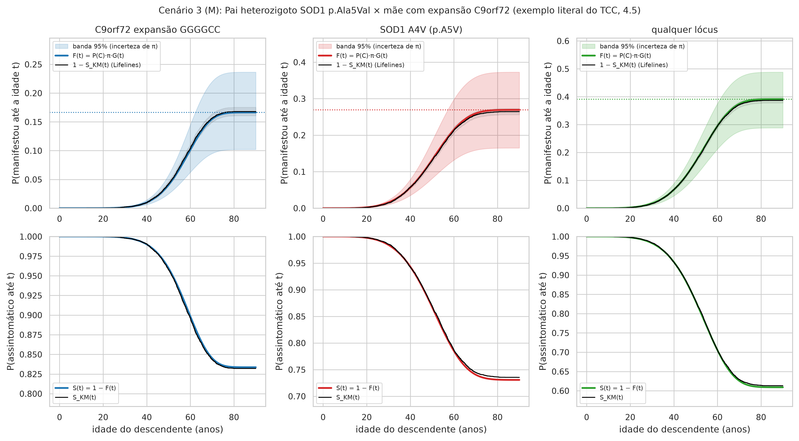
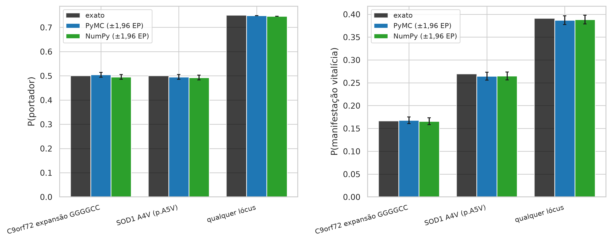
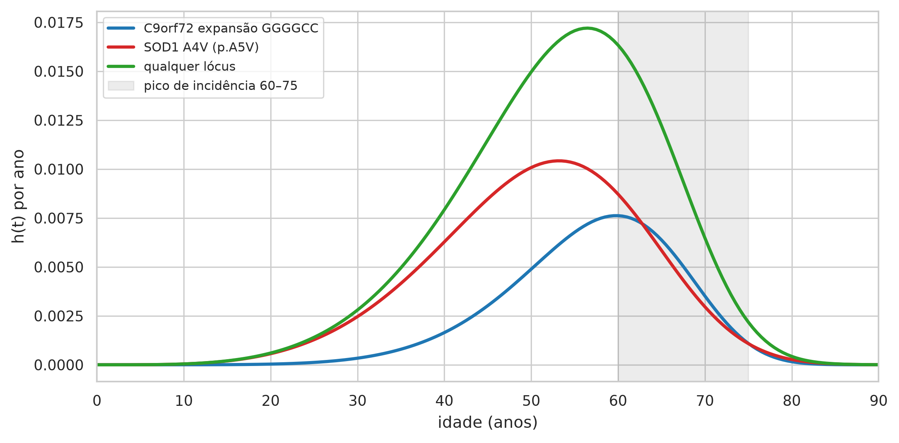
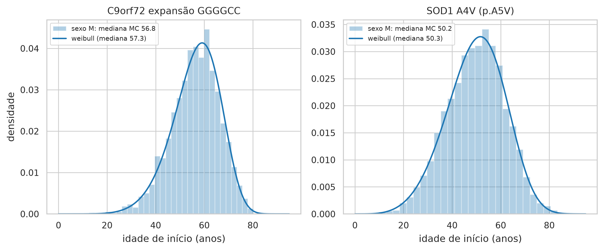

# Relatório do artefato — Cenário 3 (M): Pai heterozigoto SOD1 p.Ala5Val × mãe com expansão C9orf72 (exemplo literal do TCC, 4.5)

> AVISO: instrumento experimental de apoio à decisão no aconselhamento genético preditivo da ELA, construído com dados sintéticos e parâmetros populacionais da literatura. Não constitui diagnóstico, não substitui o julgamento clínico e não deve ser usado isoladamente em decisões sobre pacientes.

## Entrada

VCF materno: `cenario_3_mae.vcf`; VCF paterno: `cenario_3_pai.vcf`; sexo do descendente: M; idade atual sem sintomas: 30.0; motor: pymc; N = 10.000; seed = 42; horizonte = 90 anos.

## Resultado

- **C9orf72 expansão GGGGCC** (dominante; dosagens mãe/pai 1/0): P(portador) = 50.0% (MC 50.4%); penetrância média 33.3% [20.5%–47.5%]; risco vitalício 16.6% [10.2%–23.7%]; idade mediana de início 57.3 anos (p10–p90 MC: 43–68).
- **SOD1 A4V (p.A5V)** (dominante; dosagens mãe/pai 0/1): P(portador) = 50.0% (MC 49.5%); penetrância média 53.9% [32.7%–74.4%]; risco vitalício 26.9% [16.3%–37.2%]; idade mediana de início 50.3 anos (p10–p90 MC: 34–65).
- **Combinado (qualquer lócus, independência)**: P(portador de ≥ 1) = 75.0%; risco vitalício 39.1% [24.9%–52.1%]; idade mediana do primeiro início 52.3 anos. Condicionando ao descendente assintomático aos 30 anos (rejeição de 165 sorteios), P(portador de ≥ 1 lócus) passa de 74.8% para 74.4% e o risco vitalício residual é 37.7%.

## Verificações

Aderência: maior desvio entre Monte Carlo e valor exato = 1.08 erros padrão (limite usual: 4). Coerência: risco vitalício por Kaplan-Meier = C9orf72 expansão GGGGCC: 16.8%, SOD1 A4V (p.A5V): 26.5%, qualquer lócus: 38.7%. Recuperação Lifelines: erro relativo máximo em π = 0.9%. Tempo: 3.7 s no total (pymc: 1.82 s; motor cruzado: 0.00 s).

## Limitações desta execução

Parâmetros provisórios (confirmar: true) em: SOD1, C9orf72, TARDBP, FUS. Independência entre lóci; sem fatores modificadores; penetrância populacional de coortes europeias/norte-americanas; dados sintéticos.

## Tabelas

**Tabela 1 — Variantes aprovadas no filtro de qualidade e sua anotação, por genitor**

| amostra | gene | cromossomo | posicao | ref | alt | id | tipo | dosagem | repeticoes | classe | clnsig | estrelas | nome_curto | heranca | fonte_anotacao |
|---|---|---|---|---|---|---|---|---|---|---|---|---|---|---|---|
| MAE | TARDBP | 1 | 11020000 | G | A |  | snv | 0 |  | nao_anotada |  |  |  |  |  |
| MAE | TARDBP | 1 | 11020000 | G | T |  | snv | 1 |  | nao_anotada |  |  |  |  |  |
| MAE | FUS | 16 | 31185000 | A | G |  | snv | 1 |  | nao_anotada |  |  |  |  |  |
| MAE | SOD1 | 21 | 31659509 | G | T | rs17883296 | snv | 1 |  | benigna | Likely_benign | 1 | rs17883296 |  | tabela_curada:posicao_alelos |
| MAE | SOD1 | 21 | 31659783 | C | T | rs121912442 | snv | 0 |  | risco | Pathogenic | 2 | A4V (p.A5V) | dominante | tabela_curada:posicao_alelos |
| MAE | C9orf72 | 9 | 27573529 | GGGGCC | <STR45> |  | repeticao | 1 | 45 | risco | Pathogenic | 1 | expansão GGGGCC | dominante | tabela_curada |
| PAI | TARDBP | 1 | 11020000 | G | A |  | snv | 0 |  | nao_anotada |  |  |  |  |  |
| PAI | TARDBP | 1 | 11020000 | G | T |  | snv | 1 |  | nao_anotada |  |  |  |  |  |
| PAI | FUS | 16 | 31185000 | A | G |  | snv | 1 |  | nao_anotada |  |  |  |  |  |
| PAI | SOD1 | 21 | 31659509 | G | T | rs17883296 | snv | 1 |  | benigna | Likely_benign | 1 | rs17883296 |  | tabela_curada:posicao_alelos |
| PAI | SOD1 | 21 | 31659783 | C | T | rs121912442 | snv | 1 |  | risco | Pathogenic | 2 | A4V (p.A5V) | dominante | tabela_curada:posicao_alelos |
| PAI | C9orf72 | 9 | 27573529 | GGGGCC | <STR45> |  | repeticao | 0 |  | risco | Pathogenic | 1 | expansão GGGGCC | dominante | tabela_curada |

*Fonte: elaborado pela autora (2026), a partir do artefato ela_preditivo.*

Registros lidos/aprovados: mãe 8/6, pai 8/6. Reprovações: mãe {'fora_das_regioes': 1, 'filtro_nao_pass': 1, 'dp_baixo': 1, 'gq_baixo': 1}, pai {'fora_das_regioes': 1, 'filtro_nao_pass': 1, 'dp_baixo': 1, 'gq_baixo': 1}.

**Tabela 1b — Vetor genotípico parental: dosagem alélica (0/1/2) por lócus de risco e P(portador) exata**

| gene | variante | rs | tipo | heranca | dosagem_mae | dosagem_pai | repeticoes_mae | repeticoes_pai | clnsig | estrelas | p_portador_exato | observacao |
|---|---|---|---|---|---|---|---|---|---|---|---|---|
| C9orf72 | expansão GGGGCC |  | repeticao | dominante | 1 | 0 | 45 |  | Pathogenic | 1 | 0.5 |  |
| SOD1 | A4V (p.A5V) | rs121912442 | snv | dominante | 0 | 1 |  |  | Pathogenic | 2 | 0.5 |  |

*Fonte: elaborado pela autora (2026), a partir do artefato ela_preditivo.*

**Tabela 2 — Aderência teórica: probabilidades exatas vs Monte Carlo (PyMC e NumPy), erro padrão e qui-quadrado do genótipo do descendente**

| variante | n | p_portador_exato | p_portador_pymc | p_portador_numpy | ep_portador | desvio_portador_pymc_em_ep | desvio_portador_numpy_em_ep | p_manifesta_exato | p_manifesta_pymc | p_manifesta_numpy | ep_manifesta | desvio_manifesta_pymc_em_ep | desvio_manifesta_numpy_em_ep | qui2_genotipo_pymc | valor_p_genotipo_pymc | qui2_genotipo_numpy | valor_p_genotipo_numpy | idade_mediana_exata | idade_mediana_pymc | idade_mediana_numpy |
|---|---|---|---|---|---|---|---|---|---|---|---|---|---|---|---|---|---|---|---|---|
| C9orf72 expansão GGGGCC | 10000 | 0.5 | 0.5042 | 0.4953 | 0.005 | 0.84 | 0.94 | 0.1664 | 0.1679 | 0.1658 | 0.0037 | 0.413 | 0.1495 | 0.7056 | 0.4009 | 0.8836 | 0.3472 | 57.3045 | 56.8356 | 56.9174 |
| SOD1 A4V (p.A5V) | 10000 | 0.5 | 0.4954 | 0.4929 | 0.005 | 0.92 | 1.4201 | 0.2694 | 0.2646 | 0.265 | 0.0044 | 1.0798 | 0.9886 | 0.8464 | 0.3576 | 2.0164 | 0.1556 | 50.2576 | 50.2047 | 50.363 |
| qualquer lócus | 10000 | 0.75 | 0.7483 | 0.7458 |  |  |  | 0.3909 | 0.3869 | 0.3883 | 0.0049 | 0.8232 | 0.5353 |  |  |  |  |  | 52.2824 | 52.1124 |

*Fonte: elaborado pela autora (2026), a partir do artefato ela_preditivo.*

**Tabela 3 — Probabilidade de transmissão (portador), penetrância e risco vitalício de manifestação por lócus e combinado, com intervalo de credibilidade de 95% (incerteza da penetrância) e idade de início**

| gene | variante | heranca | dosagem_mae | dosagem_pai | p_portador_exato | p_portador_mc | penetrancia_media | penetrancia_q025 | penetrancia_q975 | p_manifesta_exato | p_manifesta_mc | p_manifesta_q025 | p_manifesta_q975 | idade_mediana_exata | idade_mediana_mc | idade_p10_mc | idade_p90_mc |
|---|---|---|---|---|---|---|---|---|---|---|---|---|---|---|---|---|---|
| C9orf72 | C9orf72 expansão GGGGCC | dominante | 1 | 0 | 0.5 | 0.5042 | 0.3327 | 0.2048 | 0.4746 | 0.1664 | 0.1679 | 0.1024 | 0.2373 | 57.3045 | 56.8356 | 42.9583 | 68.4086 |
| SOD1 | SOD1 A4V (p.A5V) | dominante | 0 | 1 | 0.5 | 0.4954 | 0.5387 | 0.3267 | 0.7436 | 0.2694 | 0.2646 | 0.1633 | 0.3718 | 50.2576 | 50.2047 | 33.8625 | 64.9938 |
| — | qualquer lócus | independência |  |  | 0.75 | 0.7483 |  |  |  | 0.3909 | 0.3869 | 0.249 | 0.5209 |  | 52.2824 |  |  |

*Fonte: elaborado pela autora (2026), a partir do artefato ela_preditivo.*

**Tabela 4 — Risco condicional à idade atual sem sintomas: P(portador | assintomático), risco nos próximos 10 e 20 anos e risco vitalício residual, com banda de 95%**

| unidade | idade_atual | p_portador_condicional | risco_10_anos | risco_10_anos_q025 | risco_10_anos_q975 | risco_20_anos | risco_20_anos_q025 | risco_20_anos_q975 | risco_vitalicio | risco_vitalicio_q025 | risco_vitalicio_q975 |
|---|---|---|---|---|---|---|---|---|---|---|---|
| C9orf72 expansão GGGGCC | 0 | 0.5 | 1.30e-06 | 7.95e-07 | 1.84e-06 | 0.0001 | 6.60e-05 | 0.0002 | 0.1664 | 0.1021 | 0.2364 |
| SOD1 A4V (p.A5V) | 0 | 0.5 | 9.17e-05 | 5.62e-05 | 0.0001 | 0.0024 | 0.0015 | 0.0033 | 0.2694 | 0.1649 | 0.3727 |
| qualquer lócus | 0 |  | 9.30e-05 | 5.74e-05 | 0.0001 | 0.0025 | 0.0016 | 0.0034 | 0.3909 | 0.2881 | 0.488 |
| C9orf72 expansão GGGGCC | 20 | 0.4999 | 0.0014 | 0.0009 | 0.002 | 0.01 | 0.0061 | 0.0142 | 0.1663 | 0.102 | 0.2363 |
| SOD1 A4V (p.A5V) | 20 | 0.4988 | 0.0135 | 0.0083 | 0.0187 | 0.0544 | 0.0333 | 0.0753 | 0.2676 | 0.1637 | 0.3706 |
| qualquer lócus | 20 |  | 0.0149 | 0.0096 | 0.0202 | 0.0638 | 0.0424 | 0.0849 | 0.3894 | 0.2869 | 0.4861 |
| C9orf72 expansão GGGGCC | 30 | 0.4992 | 0.0086 | 0.0053 | 0.0122 | 0.0389 | 0.0238 | 0.0553 | 0.1651 | 0.1013 | 0.2348 |
| SOD1 A4V (p.A5V) | 30 | 0.4919 | 0.0414 | 0.0252 | 0.0577 | 0.1184 | 0.0721 | 0.1649 | 0.2576 | 0.1567 | 0.3586 |
| qualquer lócus | 30 |  | 0.0496 | 0.0331 | 0.066 | 0.1527 | 0.1056 | 0.1991 | 0.3801 | 0.2798 | 0.4756 |
| C9orf72 expansão GGGGCC | 40 | 0.4949 | 0.0306 | 0.0187 | 0.0436 | 0.0925 | 0.0565 | 0.132 | 0.1579 | 0.0965 | 0.2253 |
| SOD1 A4V (p.A5V) | 40 | 0.47 | 0.0803 | 0.0481 | 0.1138 | 0.1678 | 0.1004 | 0.2376 | 0.2255 | 0.1349 | 0.3193 |
| qualquer lócus | 40 |  | 0.1084 | 0.0749 | 0.1425 | 0.2448 | 0.1749 | 0.3145 | 0.3478 | 0.254 | 0.4391 |
| C9orf72 expansão GGGGCC | 50 | 0.479 | 0.0639 | 0.0386 | 0.0924 | 0.1192 | 0.072 | 0.1725 | 0.1313 | 0.0793 | 0.19 |
| SOD1 A4V (p.A5V) | 50 | 0.4237 | 0.0951 | 0.055 | 0.1398 | 0.1465 | 0.0847 | 0.2153 | 0.1578 | 0.0912 | 0.2319 |
| qualquer lócus | 50 |  | 0.1529 | 0.1076 | 0.2009 | 0.2483 | 0.178 | 0.3219 | 0.2684 | 0.1929 | 0.3469 |
| C9orf72 expansão GGGGCC | 60 | 0.4434 | 0.0591 | 0.0348 | 0.0883 | 0.0718 | 0.0422 | 0.1071 | 0.072 | 0.0424 | 0.1075 |
| SOD1 A4V (p.A5V) | 60 | 0.3631 | 0.0568 | 0.0314 | 0.0878 | 0.0686 | 0.038 | 0.1061 | 0.0693 | 0.0384 | 0.1072 |
| qualquer lócus | 60 |  | 0.1126 | 0.0782 | 0.1516 | 0.1355 | 0.0943 | 0.182 | 0.1364 | 0.0949 | 0.1831 |
| C9orf72 expansão GGGGCC | 70 | 0.4085 | 0.0134 | 0.0077 | 0.0207 | 0.0137 | 0.0079 | 0.0211 | 0.0137 | 0.0079 | 0.0211 |
| SOD1 A4V (p.A5V) | 70 | 0.3248 | 0.0126 | 0.0068 | 0.0201 | 0.0133 | 0.0072 | 0.0212 | 0.0133 | 0.0072 | 0.0212 |
| qualquer lócus | 70 |  | 0.0258 | 0.0175 | 0.0359 | 0.0268 | 0.0182 | 0.0373 | 0.0268 | 0.0182 | 0.0373 |

*Fonte: elaborado pela autora (2026), a partir do artefato ela_preditivo.*

**Tabela 10 — Sobrevivência (assintomático) estimada por Kaplan-Meier na coorte simulada, com IC 95% (Greenwood); mediana não atingida quando o risco vitalício é inferior a 50%**

| unidade | n | eventos | risco_vitalicio_km | S(40) | IC95 S(40) | S(50) | IC95 S(50) | S(60) | IC95 S(60) | S(70) | IC95 S(70) | S(80) | IC95 S(80) | mediana_sobrevivencia | idade_90pct_do_risco |
|---|---|---|---|---|---|---|---|---|---|---|---|---|---|---|---|
| C9orf72 expansão GGGGCC | 10000 | 1679 | 0.1679 | 0.9906 | 0.989–0.992 | 0.9577 | 0.954–0.961 | 0.8961 | 0.890–0.902 | 0.8435 | 0.836–0.850 | 0.8322 | 0.825–0.839 | não atingida | 68.4 |
| SOD1 A4V (p.A5V) | 10000 | 2646 | 0.2646 | 0.9426 | 0.938–0.947 | 0.8699 | 0.863–0.876 | 0.7867 | 0.779–0.795 | 0.7448 | 0.736–0.753 | 0.7363 | 0.728–0.745 | não atingida | 65 |
| qualquer lócus | 10000 | 3869 | 0.3869 | 0.9339 | 0.929–0.939 | 0.8336 | 0.826–0.841 | 0.7057 | 0.697–0.715 | 0.6293 | 0.620–0.639 | 0.614 | 0.604–0.623 | não atingida | 66.1 |

*Fonte: elaborado pela autora (2026), a partir do artefato ela_preditivo.*

**Tabela 7 — Recuperação dos parâmetros de entrada (π, λ, ρ) pelo ajustador de cura mista da Lifelines na coorte simulada de portadores**

| variante | n_portadores | eventos | pi_entrada | lambda_entrada | rho_entrada | delta_sexo | pi_lifelines | lambda_lifelines | rho_lifelines | erro_rel_pi | erro_rel_lambda | erro_rel_rho | weibull_lambda_manifestantes | weibull_rho_manifestantes | mediana_weibull_manifestantes |
|---|---|---|---|---|---|---|---|---|---|---|---|---|---|---|---|
| C9orf72 expansão GGGGCC | 5042 | 1679 | 0.3327 | 61.5171 | 6.8334 | -1 | 0.333 | 60.2351 | 6.6639 | 0.0009 | 0.0046 | 0.0248 | 60.2351 | 6.664 | 57.0117 |
| SOD1 A4V (p.A5V) | 4954 | 2646 | 0.5387 | 54.3171 | 4.7185 | 0 | 0.5341 | 54.302 | 4.7054 | 0.0085 | 0.0003 | 0.0028 | 54.3007 | 4.7066 | 50.2326 |

*Fonte: elaborado pela autora (2026), a partir do artefato ela_preditivo.*

**Tabela 4b — Risco condicional não paramétrico (Kaplan-Meier) para um descendente assintomático aos 30 anos**

| unidade | idade_atual | risco_10_anos_km | risco_20_anos_km | risco_vitalicio_km |
|---|---|---|---|---|
| C9orf72 expansão GGGGCC | 30 | 0.0073 | 0.0403 | 0.1661 |
| SOD1 A4V (p.A5V) | 30 | 0.0436 | 0.1174 | 0.2539 |
| qualquer lócus | 30 | 0.0504 | 0.1524 | 0.3766 |

*Fonte: elaborado pela autora (2026), a partir do artefato ela_preditivo.*

## Figuras

*Figura 1 — Rede Bayesiana (DAG) do núcleo estocástico. Fonte: elaborado pela autora (2026), a partir do artefato ela_preditivo.*

*Figura 4 — Risco acumulado de manifestação F(t) e sobrevivência S(t) do descendente, com banda de credibilidade de 95% e Kaplan-Meier da coorte simulada. Fonte: elaborado pela autora (2026), a partir do artefato ela_preditivo.*

*Figura 6 — Aderência teórica: probabilidades exatas vs Monte Carlo (PyMC e NumPy), com erro padrão. Fonte: elaborado pela autora (2026), a partir do artefato ela_preditivo.*

*Figura 8 — Função de risco instantâneo h(t) por lócus; faixa sombreada = pico de incidência 60–75 anos (Feldman et al., 2022). Fonte: elaborado pela autora (2026), a partir do artefato ela_preditivo.*

*Figura 5 — Distribuição simulada da idade de início entre os descendentes que manifestam, por lócus. Fonte: elaborado pela autora (2026), a partir do artefato ela_preditivo.*
