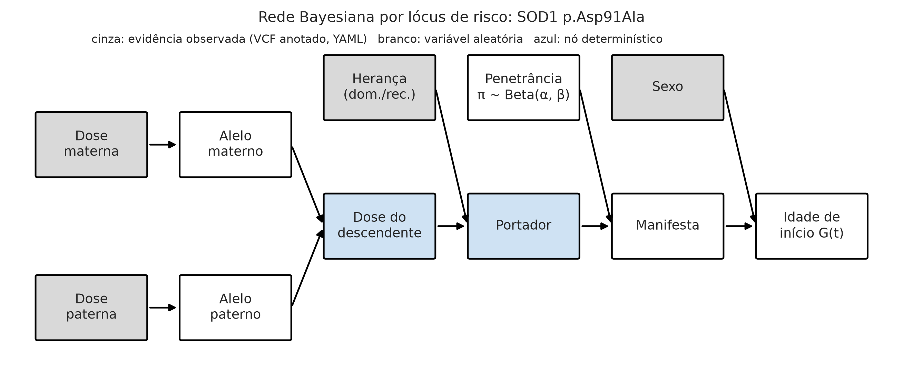
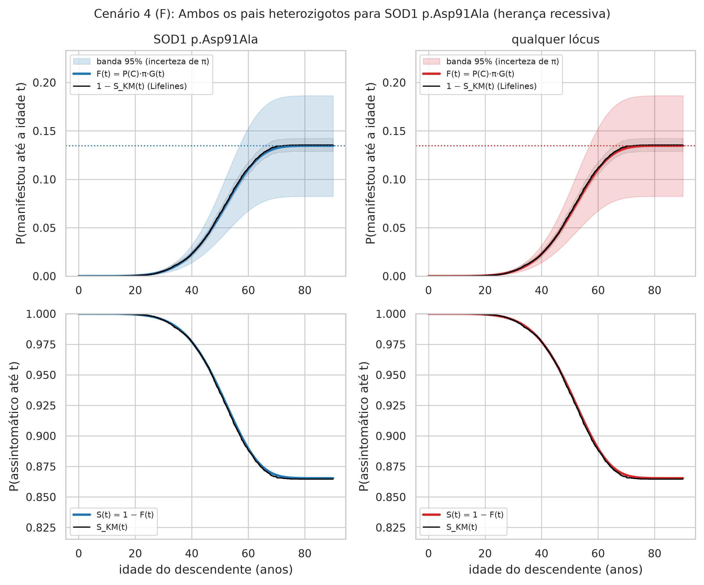
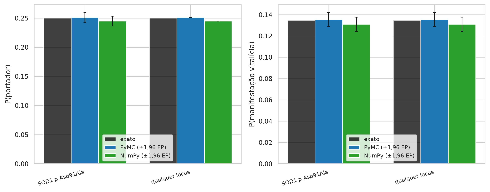
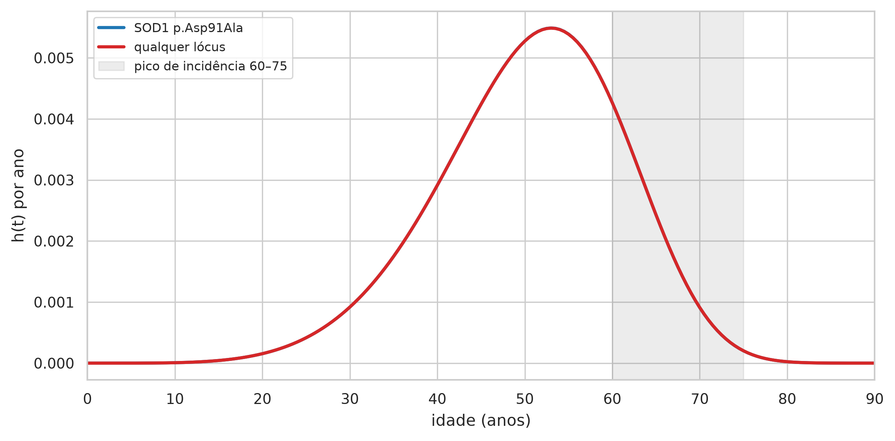
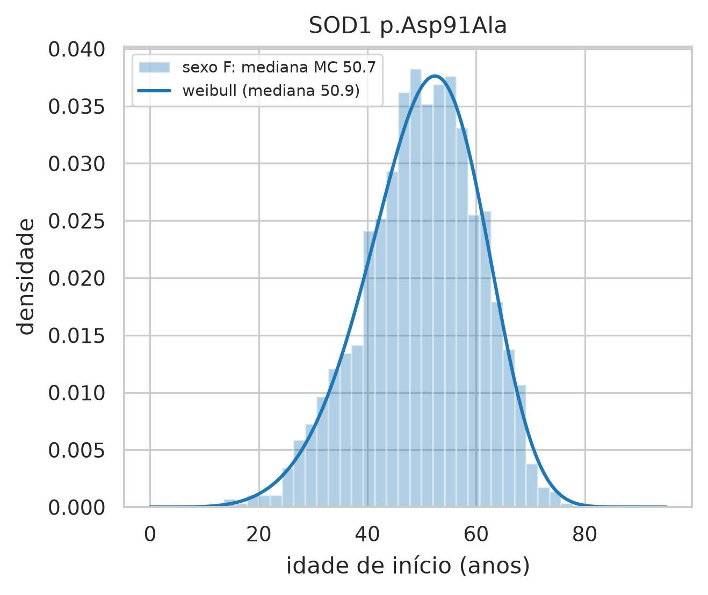
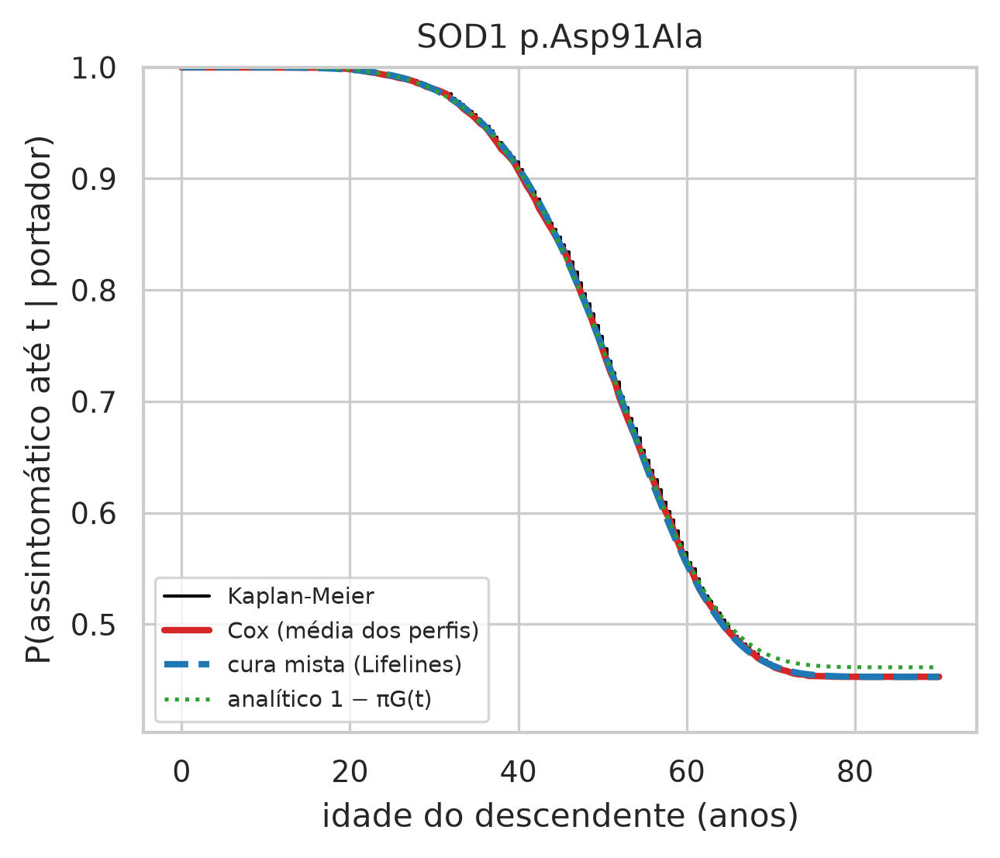

# Relatório do artefato — Cenário 4 (F): Ambos os pais heterozigotos para SOD1 p.Asp91Ala (herança recessiva)

> AVISO: instrumento experimental de apoio à decisão no aconselhamento genético preditivo da ELA, construído com dados sintéticos e parâmetros populacionais da literatura. Não constitui diagnóstico, não substitui o julgamento clínico e não deve ser usado isoladamente em decisões sobre pacientes.

## Entrada

VCF materno: `cenario_4_mae.vcf` (amostra MAE); VCF paterno: `cenario_4_pai.vcf` (amostra PAI); laudo do C9orf72: mãe: 23 repetições; pai: 23 repetições; sexo do descendente: F; idade atual sem sintomas: 30.0; motor: pymc; N = 10.000; seed = 42; horizonte = 90 anos.

## Qualidade dos dados (TCC 4.2.3)

- Mãe: montagem GRCh38 (coerente); 5/7 registros aprovados (71%); 2 aprovados encontrados na base de anotação (40%; estado de revisão 1★: 1, 2★: 1); classes {'nao_anotada': 3, 'benigna': 1, 'risco': 1}; significado incerto: 0 (0% das anotadas); classificação conflitante: 0 (0%); risco com frequência > 1%: 0.
- Pai: montagem GRCh38 (coerente); 5/7 registros aprovados (71%); 2 aprovados encontrados na base de anotação (40%; estado de revisão 1★: 1, 2★: 1); classes {'nao_anotada': 3, 'benigna': 1, 'risco': 1}; significado incerto: 0 (0% das anotadas); classificação conflitante: 0 (0%); risco com frequência > 1%: 0.
- Base de anotação: clinvar_base_consolidada; regra de classe: só Pathogenic/Likely pathogenic sustentam risco; significado incerto e classificações conflitantes não (TCC 4.2.2). Classificação conflitante só sustenta risco pela regra qualificada: mais da metade das classificações patogênicas ou provavelmente patogênicas e fenótipo de ELA com herança declarada.

## Resultado

- **SOD1 p.Asp91Ala** (recessiva; dosagens mãe/pai 1/1): P(portador) = 25.0% (MC 25.1%); penetrância média 53.9% [32.7%–74.4%]; risco vitalício (até os 90 anos) 13.5% [8.2%–18.6%]; idade mediana de início 50.9 anos (p10–p90 MC: 36–63).
- **Combinado (qualquer lócus, independência)**: P(portador de ≥ 1) = 25.0%; risco vitalício (até os 90 anos) 13.5% [8.2%–18.6%]; idade mediana do primeiro início 50.7 anos. Condicionando ao descendente assintomático aos 30 anos, P(portador de ≥ 1 lócus) passa de 25.0% para 24.6% e o risco residual (da idade atual até os 90 anos) é 13.0% [8.0%–18.1%]; idade provável de início a partir dessa idade: mediana 51.4 anos (25–75 %: 44.3–58.0). Valores exatos, os mesmos da Tabela 4 e dos indicadores; conferência por rejeição de 53 sorteios do Monte Carlo: 24.7% e 13.1%. Variantes aceitas pela regra qualificada para classificação conflitante (TCC 4.2.2): SOD1 p.Asp91Ala — classe risco pela regra qualificada para classificação conflitante (TCC 4.2.2): Pathogenic (5)|Likely pathogenic (9)|Uncertain significance (5)|Likely benign (1); 70 % patogênico ou provavelmente patogênico; herança declarada no PhenotypeList: recessiva.

## Comparação com o modelo de Cox (CoxPHFitter)

`CoxPHFitter` (Lifelines) ajustado na coorte sintética de portadores (os dois sexos simulados com sementes independentes, derivadas da semente da execução; não portadores ficam fora porque nunca manifestam e separariam completamente a verossimilhança parcial). **SOD1 p.Asp91Ala** (5096 portadores, 2789 eventos): HR sexo masculino = 1.06 [0.981–1.138], p = 0.148, riscos proporcionais p = 0.220; concordância 0.506; S(60): Cox 0.555, cura mista 0.555, Kaplan-Meier 0.555, analítico 0.559; S_Cox(horizonte) = 0.453 vs fração de cura da Lifelines 1 − π̂ = 0.453 (π de entrada 0.539); maior diferença Cox × cura mista 0.005. Leitura: a função de base de Cox é não paramétrica e acompanha o Kaplan-Meier, mas Cox não separa quem nunca manifestará (fração de cura) de quem ainda não manifestou nem estima π; o modelo de cura mista recupera π e G(t) separadamente (Tabela 7). O efeito do sexo entra em Cox como razão de riscos constante, embora no modelo seja um deslocamento de idade; na unidade combinada as HR entre lóci misturam diferenças de penetrância e de idade de início.

## Verificações

Aderência: maior desvio entre Monte Carlo e valor exato = 1.09 erros padrão (limite usual: 4). Coerência: risco vitalício por Kaplan-Meier = SOD1 p.Asp91Ala: 13.5%, qualquer lócus: 13.5%. Recuperação Lifelines: erro relativo máximo em π = 0.0%. Tempo: 3.6 s no total (pymc: 1.55 s; motor cruzado: 0.00 s).

## Limitações desta execução

Parâmetros provisórios (confirmar: true) em: C9orf72, TARDBP. Independência entre lóci; sem fatores modificadores; penetrância populacional de coortes europeias/norte-americanas; dados sintéticos. Aproximação de penetrância: SOD1 p.Asp91Ala: DOUGLAS; BARALLE (2024) excluíram a p.Asp91Ala (D90A) da estimativa de penetrância do SOD1; a penetrância do gene é usada como aproximação para homozigotos D91A, sem valor próprio na literatura consultada (confirmar: true).

## Tabelas

**Tabela 1 — Variantes aprovadas no filtro de qualidade e sua anotação, por genitor**

| amostra | gene | cromossomo | posicao | ref | alt | id | tipo | dosagem | repeticoes | classe | clnsig | estrelas | nome_curto | heranca | regra_qualificada | fonte_anotacao |
|---|---|---|---|---|---|---|---|---|---|---|---|---|---|---|---|---|
| MAE | TARDBP | 1 | 11020000 | G | A |  | snv | 0 |  | nao_anotada |  |  |  |  |  |  |
| MAE | TARDBP | 1 | 11020000 | G | T |  | snv | 1 |  | nao_anotada |  |  |  |  |  |  |
| MAE | FUS | 16 | 31185000 | A | G |  | snv | 1 |  | nao_anotada |  |  |  |  |  |  |
| MAE | SOD1 | 21 | 31659509 | G | T | rs17883296 | snv | 1 |  | benigna | Likely benign | 2 | rs17883296 |  | não | clinvar_base_consolidada:posicao_alelos |
| MAE | SOD1 | 21 | 31667290 | A | C | rs80265967 | snv | 1 |  | risco | Conflicting classifications of pathogenicity | 1 | p.Asp91Ala | recessiva | sim | clinvar_base_consolidada:posicao_alelos |
| PAI | TARDBP | 1 | 11020000 | G | A |  | snv | 0 |  | nao_anotada |  |  |  |  |  |  |
| PAI | TARDBP | 1 | 11020000 | G | T |  | snv | 1 |  | nao_anotada |  |  |  |  |  |  |
| PAI | FUS | 16 | 31185000 | A | G |  | snv | 1 |  | nao_anotada |  |  |  |  |  |  |
| PAI | SOD1 | 21 | 31659509 | G | T | rs17883296 | snv | 1 |  | benigna | Likely benign | 2 | rs17883296 |  | não | clinvar_base_consolidada:posicao_alelos |
| PAI | SOD1 | 21 | 31667290 | A | C | rs80265967 | snv | 1 |  | risco | Conflicting classifications of pathogenicity | 1 | p.Asp91Ala | recessiva | sim | clinvar_base_consolidada:posicao_alelos |

*Fonte: elaborado pela autora (2026), a partir do artefato ela_preditivo.*

Registros lidos/aprovados: mãe 7/5, pai 7/5. Reprovações: mãe {'fora_das_regioes': 1, 'filtro_nao_pass': 1, 'dp_baixo': 1, 'gq_baixo': 1}, pai {'fora_das_regioes': 1, 'filtro_nao_pass': 1, 'dp_baixo': 1, 'gq_baixo': 1}. Base de anotação: clinvar_base_consolidada (1457 variantes do ClinVar + 1 da tabela curada; 1 registro da base fora da anotação, por ter alelo alternativo igual ao de referência).

**Tabela 1b — Vetor genotípico parental: dosagem alélica (0/1/2) por lócus de risco e P(portador) exata; lócus com genótipo não determinado num genitor fica marcado como descartado e não entra no cálculo (TCC 4.3)**

| gene | variante | rs | tipo | heranca | dosagem_mae | dosagem_pai | repeticoes_mae | repeticoes_pai | clnsig | estrelas | fonte | p_portador_exato | descartado | observacao |
|---|---|---|---|---|---|---|---|---|---|---|---|---|---|---|
| SOD1 | p.Asp91Ala | rs80265967 | snv | recessiva | 1 | 1 |  |  | Conflicting classifications of pathogenicity | 1 | vcf | 0.25 | não | classe risco pela regra qualificada para classificação conflitante (TCC 4.2.2): Pathogenic (5)\|Likely pathogenic (9)\|Uncertain significance (5)\|Likely benign (1); 70 % patogênico ou provavelmente patogênico; herança declarada no PhenotypeList: recessiva |

*Fonte: elaborado pela autora (2026), a partir do artefato ela_preditivo.*

**Tabela 2 — Aderência teórica: probabilidades exatas vs Monte Carlo (PyMC e NumPy), erro padrão e qui-quadrado do genótipo do descendente**

| variante | n | p_portador_exato | p_portador_pymc | p_portador_numpy | ep_portador | desvio_portador_pymc_em_ep | desvio_portador_numpy_em_ep | p_manifesta_exato | p_manifesta_pymc | p_manifesta_numpy | ep_manifesta | desvio_manifesta_pymc_em_ep | desvio_manifesta_numpy_em_ep | qui2_genotipo_pymc | valor_p_genotipo_pymc | qui2_genotipo_numpy | valor_p_genotipo_numpy | idade_mediana_exata | idade_mediana_pymc | idade_mediana_numpy |
|---|---|---|---|---|---|---|---|---|---|---|---|---|---|---|---|---|---|---|---|---|
| SOD1 p.Asp91Ala | 10000 | 0.25 | 0.2513 | 0.2448 | 0.0043 | 0.2997 | 1.2094 | 0.1347 | 0.1354 | 0.131 | 0.0034 | 0.21 | 1.0912 | 0.3632 | 0.8339 | 1.4744 | 0.4785 | 50.8673 | 50.7447 | 51.3893 |
| qualquer lócus | 10000 | 0.25 | 0.2513 | 0.2448 |  |  |  | 0.1347 | 0.1354 | 0.131 | 0.0034 | 0.21 | 1.0912 |  |  |  |  |  | 50.7447 | 51.3893 |

*Fonte: elaborado pela autora (2026), a partir do artefato ela_preditivo.*

**Tabela 3 — Probabilidade de transmissão (portador), penetrância e risco vitalício de manifestação (até o horizonte de 90 anos) por lócus e combinado, com intervalo de credibilidade de 95% (incerteza da penetrância) e idade de início**

| gene | variante | heranca | dosagem_mae | dosagem_pai | p_portador_exato | p_portador_mc | penetrancia_media | penetrancia_q025 | penetrancia_q975 | p_manifesta_exato | p_manifesta_mc | p_manifesta_q025 | p_manifesta_q975 | fração que manifesta em algum momento (sem limite de idade) | idade_mediana_exata | idade_mediana_mc | idade_p10_mc | idade_p90_mc |
|---|---|---|---|---|---|---|---|---|---|---|---|---|---|---|---|---|---|---|
| SOD1 | SOD1 p.Asp91Ala | recessiva | 1 | 1 | 0.25 | 0.2513 | 0.5387 | 0.3267 | 0.7436 | 0.1347 | 0.1354 | 0.0817 | 0.1859 | 0.1347 | 50.8673 | 50.7447 | 35.6812 | 63.2434 |
| — | qualquer lócus | independência |  |  | 0.25 | 0.2513 |  |  |  | 0.1347 | 0.1354 | 0.0825 | 0.1863 | 0.1347 |  | 50.7447 |  |  |

*Fonte: elaborado pela autora (2026), a partir do artefato ela_preditivo.*

p_manifesta_* = risco vitalício: probabilidade de manifestar até os 90 anos. A coluna "fração que manifesta em algum momento (sem limite de idade)" é F(∞) = P(portador)·E[π], usada só nas verificações de coerência.

**Tabela 4 — Risco condicional à idade atual sem sintomas: P(portador | assintomático), risco nos próximos 10 e 20 anos e risco residual (da idade atual até os 90 anos), com banda de 95%**

| unidade | idade_atual | p_portador_condicional | risco_10_anos | risco_10_anos_q025 | risco_10_anos_q975 | risco_20_anos | risco_20_anos_q025 | risco_20_anos_q975 | risco_residual | risco_residual_q025 | risco_residual_q975 |
|---|---|---|---|---|---|---|---|---|---|---|---|
| SOD1 p.Asp91Ala | 0 | 0.25 | 1.29e-05 | 7.88e-06 | 1.78e-05 | 0.0006 | 0.0003 | 0.0008 | 0.1347 | 0.0825 | 0.1863 |
| SOD1 p.Asp91Ala | 20 | 0.2496 | 0.0045 | 0.0028 | 0.0063 | 0.0223 | 0.0137 | 0.0309 | 0.1342 | 0.0821 | 0.1857 |
| SOD1 p.Asp91Ala | 30 | 0.2461 | 0.0179 | 0.0109 | 0.0248 | 0.0582 | 0.0356 | 0.0807 | 0.1302 | 0.0796 | 0.1805 |
| SOD1 p.Asp91Ala | 40 | 0.2324 | 0.0411 | 0.0249 | 0.0573 | 0.0894 | 0.0543 | 0.1249 | 0.1144 | 0.0694 | 0.1597 |
| SOD1 p.Asp91Ala | 50 | 0.1996 | 0.0505 | 0.0301 | 0.0717 | 0.0738 | 0.044 | 0.1048 | 0.0765 | 0.0456 | 0.1086 |
| SOD1 p.Asp91Ala | 60 | 0.157 | 0.0245 | 0.0143 | 0.0357 | 0.0274 | 0.016 | 0.0398 | 0.0274 | 0.016 | 0.0398 |
| SOD1 p.Asp91Ala | 70 | 0.1358 | 0.0029 | 0.0017 | 0.0043 | 0.0029 | 0.0017 | 0.0043 | 0.0029 | 0.0017 | 0.0043 |

*Fonte: elaborado pela autora (2026), a partir do artefato ela_preditivo.*

risco_residual: probabilidade de manifestar entre a idade atual e o horizonte, para quem chegou a essa idade sem sintomas. Na idade 0 é o risco vitalício da Tabela 3.

**Tabela 10 — Sobrevivência (assintomático) estimada por Kaplan-Meier na coorte simulada, com IC 95% (Greenwood); mediana não atingida quando o risco vitalício é inferior a 50%**

| unidade | n | eventos | risco_vitalicio_km | S(40) | IC95 S(40) | S(50) | IC95 S(50) | S(60) | IC95 S(60) | S(70) | IC95 S(70) | S(80) | IC95 S(80) | mediana_sobrevivencia | idade_90pct_do_risco |
|---|---|---|---|---|---|---|---|---|---|---|---|---|---|---|---|
| SOD1 p.Asp91Ala | 10000 | 1354 | 0.1354 | 0.9772 | 0.974–0.980 | 0.9351 | 0.930–0.940 | 0.8883 | 0.882–0.894 | 0.8662 | 0.859–0.873 | 0.8646 | 0.858–0.871 | não atingida | 63.3 |
| qualquer lócus | 10000 | 1354 | 0.1354 | 0.9772 | 0.974–0.980 | 0.9351 | 0.930–0.940 | 0.8883 | 0.882–0.894 | 0.8662 | 0.859–0.873 | 0.8646 | 0.858–0.871 | não atingida | 63.3 |

*Fonte: elaborado pela autora (2026), a partir do artefato ela_preditivo.*

**Tabela 7 — Recuperação dos parâmetros de entrada (π, λ, ρ) pelo ajustador de cura mista da Lifelines na coorte simulada de portadores**

| variante | n_portadores | eventos | pi_entrada | lambda_entrada | rho_entrada | delta_sexo | pi_lifelines | lambda_lifelines | rho_lifelines | erro_rel_pi | erro_rel_lambda | erro_rel_rho | weibull_lambda_manifestantes | weibull_rho_manifestantes | mediana_weibull_manifestantes |
|---|---|---|---|---|---|---|---|---|---|---|---|---|---|---|---|
| SOD1 p.Asp91Ala | 2513 | 1354 | 0.5387 | 54.3959 | 5.4648 | 0 | 0.5388 | 54.1503 | 5.5664 | 0.0001 | 0.0045 | 0.0186 | 54.1504 | 5.5664 | 50.6998 |

*Fonte: elaborado pela autora (2026), a partir do artefato ela_preditivo.*

**Tabela 11 — Modelo de Cox (CoxPHFitter) na coorte sintética de portadores: razões de risco, concordância, teste de riscos proporcionais e S(t) por Cox, cura mista, Kaplan-Meier e curva analítica**

| unidade | n_portadores | eventos | cox | HR[sexo masculino] | IC95 HR[sexo masculino] | p[sexo masculino] | p_riscos_proporcionais[sexo masculino] | concordancia | log_verossimilhanca_parcial | S_cox(50) | S_cura_mista(50) | S_km(50) | S_analitico(50) | S_cox(60) | S_cura_mista(60) | S_km(60) | S_analitico(60) | S_cox(70) | S_cura_mista(70) | S_km(70) | S_analitico(70) | S_cox(horizonte) | fracao_cura_lifelines | pi_lifelines | pi_entrada | dif_max_cox_cura_mista | dif_max_cox_km |
|---|---|---|---|---|---|---|---|---|---|---|---|---|---|---|---|---|---|---|---|---|---|---|---|---|---|---|---|
| SOD1 p.Asp91Ala | 5096 | 2789 | ajustado | 1.0564 | 0.981–1.138 | 0.1476 | 0.2198 | 0.5056 | -22.846 | 0.747 | 0.7482 | 0.7471 | 0.7479 | 0.555 | 0.5546 | 0.5549 | 0.5588 | 0.4633 | 0.4635 | 0.4633 | 0.4715 | 0.4528 | 0.4527 | 0.5473 | 0.5387 | 0.0054 | 0.0002 |

*Fonte: elaborado pela autora (2026), a partir do artefato ela_preditivo.*

**Tabela 4b — Risco condicional não paramétrico (Kaplan-Meier) para um descendente assintomático aos 30 anos**

| unidade | idade_atual | risco_10_anos_km | risco_20_anos_km | risco_residual_km |
|---|---|---|---|---|
| SOD1 p.Asp91Ala | 30 | 0.0176 | 0.0599 | 0.1308 |
| qualquer lócus | 30 | 0.0176 | 0.0599 | 0.1308 |

*Fonte: elaborado pela autora (2026), a partir do artefato ela_preditivo.*

## Figuras

*Figura 1 — Rede Bayesiana (DAG) do núcleo estocástico. Fonte: elaborado pela autora (2026), a partir do artefato ela_preditivo.*

*Figura 4 — Risco acumulado de manifestação F(t) e sobrevivência S(t) do descendente, com banda de credibilidade de 95% e Kaplan-Meier da coorte simulada. Fonte: elaborado pela autora (2026), a partir do artefato ela_preditivo.*

*Figura 6 — Aderência teórica: probabilidades exatas vs Monte Carlo (PyMC e NumPy), com erro padrão. Fonte: elaborado pela autora (2026), a partir do artefato ela_preditivo.*

*Figura 8 — Função de risco instantâneo h(t) por lócus; faixa sombreada = pico de incidência 60–75 anos (Feldman et al., 2022). Fonte: elaborado pela autora (2026), a partir do artefato ela_preditivo.*

*Figura 5 — Distribuição simulada da idade de início entre os descendentes que manifestam, por lócus. Fonte: elaborado pela autora (2026), a partir do artefato ela_preditivo.*

*Figura 9 — Sobrevivência (assintomático) entre portadores: Cox (marginal), cura mista, Kaplan-Meier e curva analítica, por unidade. Fonte: elaborado pela autora (2026), a partir do artefato ela_preditivo.*
