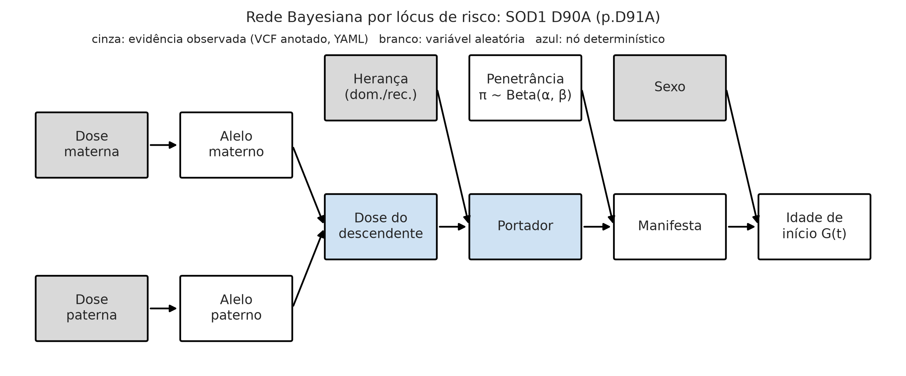
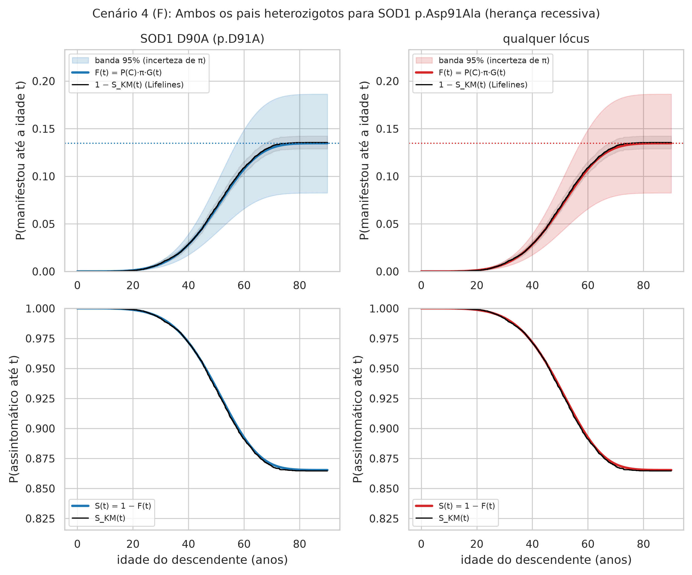
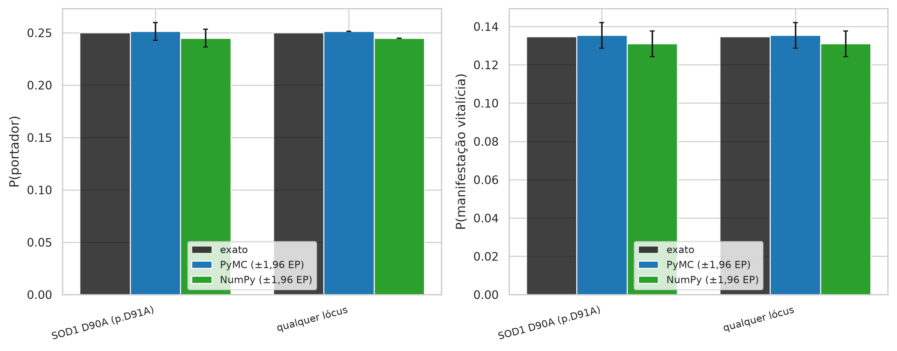
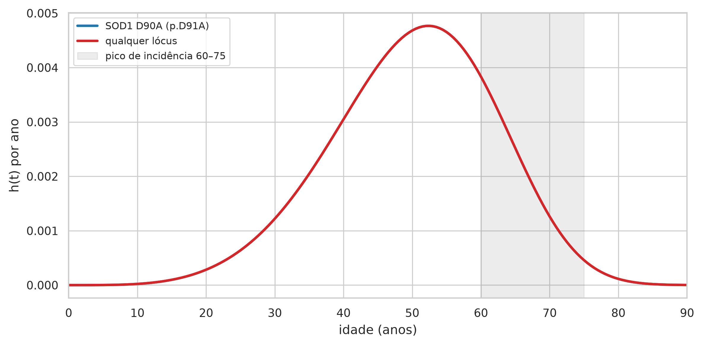
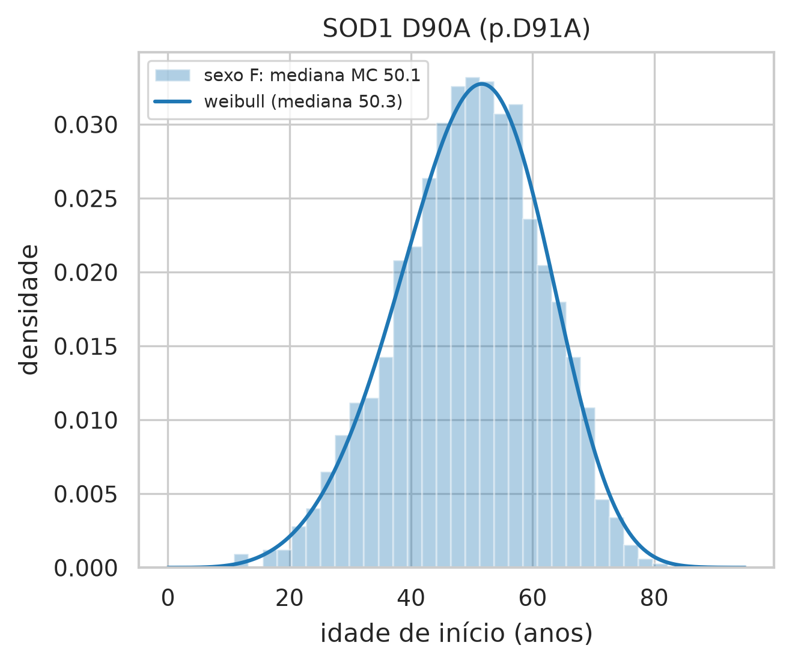

# Relatório do artefato — Cenário 4 (F): Ambos os pais heterozigotos para SOD1 p.Asp91Ala (herança recessiva)

> AVISO: instrumento experimental de apoio à decisão no aconselhamento genético preditivo da ELA, construído com dados sintéticos e parâmetros populacionais da literatura. Não constitui diagnóstico, não substitui o julgamento clínico e não deve ser usado isoladamente em decisões sobre pacientes.

## Entrada

VCF materno: `cenario_4_mae.vcf`; VCF paterno: `cenario_4_pai.vcf`; sexo do descendente: F; idade atual sem sintomas: 30.0; motor: pymc; N = 10.000; seed = 42; horizonte = 90 anos.

## Resultado

- **SOD1 D90A (p.D91A)** (recessiva; dosagens mãe/pai 1/1): P(portador) = 25.0% (MC 25.1%); penetrância média 53.9% [32.7%–74.4%]; risco vitalício 13.5% [8.2%–18.6%]; idade mediana de início 50.3 anos (p10–p90 MC: 33–65).
- **Combinado (qualquer lócus, independência)**: P(portador de ≥ 1) = 25.0%; risco vitalício 13.5% [8.2%–18.6%]; idade mediana do primeiro início 50.1 anos. Condicionando ao descendente assintomático aos 30 anos (rejeição de 83 sorteios), P(portador de ≥ 1 lócus) passa de 25.1% para 24.5% e o risco vitalício residual é 12.8%.

## Verificações

Aderência: maior desvio entre Monte Carlo e valor exato = 1.09 erros padrão (limite usual: 4). Coerência: risco vitalício por Kaplan-Meier = SOD1 D90A (p.D91A): 13.5%, qualquer lócus: 13.5%. Recuperação Lifelines: erro relativo máximo em π = 0.0%. Tempo: 2.6 s no total (pymc: 1.29 s; motor cruzado: 0.00 s).

## Limitações desta execução

Parâmetros provisórios (confirmar: true) em: SOD1, C9orf72, TARDBP, FUS. Independência entre lóci; sem fatores modificadores; penetrância populacional de coortes europeias/norte-americanas; dados sintéticos.

## Tabelas

**Tabela 1 — Variantes aprovadas no filtro de qualidade e sua anotação, por genitor**

| amostra | gene | cromossomo | posicao | ref | alt | id | tipo | dosagem | repeticoes | classe | clnsig | estrelas | nome_curto | heranca | fonte_anotacao |
|---|---|---|---|---|---|---|---|---|---|---|---|---|---|---|---|
| MAE | TARDBP | 1 | 11020000 | G | A |  | snv | 0 |  | nao_anotada |  |  |  |  |  |
| MAE | TARDBP | 1 | 11020000 | G | T |  | snv | 1 |  | nao_anotada |  |  |  |  |  |
| MAE | FUS | 16 | 31185000 | A | G |  | snv | 1 |  | nao_anotada |  |  |  |  |  |
| MAE | SOD1 | 21 | 31659509 | G | T | rs17883296 | snv | 1 |  | benigna | Likely_benign | 1 | rs17883296 |  | tabela_curada:posicao_alelos |
| MAE | SOD1 | 21 | 31667290 | A | C | rs80265967 | snv | 1 |  | risco | Pathogenic | 1 | D90A (p.D91A) | recessiva | tabela_curada:posicao_alelos |
| PAI | TARDBP | 1 | 11020000 | G | A |  | snv | 0 |  | nao_anotada |  |  |  |  |  |
| PAI | TARDBP | 1 | 11020000 | G | T |  | snv | 1 |  | nao_anotada |  |  |  |  |  |
| PAI | FUS | 16 | 31185000 | A | G |  | snv | 1 |  | nao_anotada |  |  |  |  |  |
| PAI | SOD1 | 21 | 31659509 | G | T | rs17883296 | snv | 1 |  | benigna | Likely_benign | 1 | rs17883296 |  | tabela_curada:posicao_alelos |
| PAI | SOD1 | 21 | 31667290 | A | C | rs80265967 | snv | 1 |  | risco | Pathogenic | 1 | D90A (p.D91A) | recessiva | tabela_curada:posicao_alelos |

*Fonte: elaborado pela autora (2026), a partir do artefato ela_preditivo.*

Registros lidos/aprovados: mãe 7/5, pai 7/5. Reprovações: mãe {'fora_das_regioes': 1, 'filtro_nao_pass': 1, 'dp_baixo': 1, 'gq_baixo': 1}, pai {'fora_das_regioes': 1, 'filtro_nao_pass': 1, 'dp_baixo': 1, 'gq_baixo': 1}.

**Tabela 1b — Vetor genotípico parental: dosagem alélica (0/1/2) por lócus de risco e P(portador) exata**

| gene | variante | rs | tipo | heranca | dosagem_mae | dosagem_pai | repeticoes_mae | repeticoes_pai | clnsig | estrelas | p_portador_exato | observacao |
|---|---|---|---|---|---|---|---|---|---|---|---|---|
| SOD1 | D90A (p.D91A) | rs80265967 | snv | recessiva | 1 | 1 |  |  | Pathogenic | 1 | 0.25 |  |

*Fonte: elaborado pela autora (2026), a partir do artefato ela_preditivo.*

**Tabela 2 — Aderência teórica: probabilidades exatas vs Monte Carlo (PyMC e NumPy), erro padrão e qui-quadrado do genótipo do descendente**

| variante | n | p_portador_exato | p_portador_pymc | p_portador_numpy | ep_portador | desvio_portador_pymc_em_ep | desvio_portador_numpy_em_ep | p_manifesta_exato | p_manifesta_pymc | p_manifesta_numpy | ep_manifesta | desvio_manifesta_pymc_em_ep | desvio_manifesta_numpy_em_ep | qui2_genotipo_pymc | valor_p_genotipo_pymc | qui2_genotipo_numpy | valor_p_genotipo_numpy | idade_mediana_exata | idade_mediana_pymc | idade_mediana_numpy |
|---|---|---|---|---|---|---|---|---|---|---|---|---|---|---|---|---|---|---|---|---|
| SOD1 D90A (p.D91A) | 10000 | 0.25 | 0.2513 | 0.2448 | 0.0043 | 0.2997 | 1.2094 | 0.1347 | 0.1354 | 0.131 | 0.0034 | 0.21 | 1.0912 | 0.3632 | 0.8339 | 1.4744 | 0.4785 | 50.2576 | 50.1174 | 50.8555 |
| qualquer lócus | 10000 | 0.25 | 0.2513 | 0.2448 |  |  |  | 0.1347 | 0.1354 | 0.131 | 0.0034 | 0.21 | 1.0912 |  |  |  |  |  | 50.1174 | 50.8555 |

*Fonte: elaborado pela autora (2026), a partir do artefato ela_preditivo.*

**Tabela 3 — Probabilidade de transmissão (portador), penetrância e risco vitalício de manifestação por lócus e combinado, com intervalo de credibilidade de 95% (incerteza da penetrância) e idade de início**

| gene | variante | heranca | dosagem_mae | dosagem_pai | p_portador_exato | p_portador_mc | penetrancia_media | penetrancia_q025 | penetrancia_q975 | p_manifesta_exato | p_manifesta_mc | p_manifesta_q025 | p_manifesta_q975 | idade_mediana_exata | idade_mediana_mc | idade_p10_mc | idade_p90_mc |
|---|---|---|---|---|---|---|---|---|---|---|---|---|---|---|---|---|---|
| SOD1 | SOD1 D90A (p.D91A) | recessiva | 1 | 1 | 0.25 | 0.2513 | 0.5387 | 0.3267 | 0.7436 | 0.1347 | 0.1354 | 0.0817 | 0.1859 | 50.2576 | 50.1174 | 33.3308 | 64.6751 |
| — | qualquer lócus | independência |  |  | 0.25 | 0.2513 |  |  |  | 0.1347 | 0.1354 | 0.0817 | 0.1859 |  | 50.1174 |  |  |

*Fonte: elaborado pela autora (2026), a partir do artefato ela_preditivo.*

**Tabela 4 — Risco condicional à idade atual sem sintomas: P(portador | assintomático), risco nos próximos 10 e 20 anos e risco vitalício residual, com banda de 95%**

| unidade | idade_atual | p_portador_condicional | risco_10_anos | risco_10_anos_q025 | risco_10_anos_q975 | risco_20_anos | risco_20_anos_q025 | risco_20_anos_q975 | risco_vitalicio | risco_vitalicio_q025 | risco_vitalicio_q975 |
|---|---|---|---|---|---|---|---|---|---|---|---|
| SOD1 D90A (p.D91A) | 0 | 0.25 | 4.59e-05 | 2.81e-05 | 6.35e-05 | 0.0012 | 0.0007 | 0.0017 | 0.1347 | 0.0825 | 0.1863 |
| SOD1 D90A (p.D91A) | 20 | 0.2491 | 0.0067 | 0.0041 | 0.0093 | 0.0271 | 0.0166 | 0.0376 | 0.1336 | 0.0818 | 0.185 |
| SOD1 D90A (p.D91A) | 30 | 0.244 | 0.0205 | 0.0125 | 0.0285 | 0.0587 | 0.0359 | 0.0815 | 0.1278 | 0.078 | 0.1773 |
| SOD1 D90A (p.D91A) | 40 | 0.2281 | 0.039 | 0.0236 | 0.0546 | 0.0815 | 0.0493 | 0.114 | 0.1095 | 0.0663 | 0.1532 |
| SOD1 D90A (p.D91A) | 50 | 0.1968 | 0.0442 | 0.0263 | 0.0628 | 0.0681 | 0.0406 | 0.0968 | 0.0733 | 0.0437 | 0.1043 |
| SOD1 D90A (p.D91A) | 60 | 0.1597 | 0.025 | 0.0146 | 0.0362 | 0.0302 | 0.0177 | 0.0438 | 0.0305 | 0.0178 | 0.0442 |
| SOD1 D90A (p.D91A) | 70 | 0.1382 | 0.0053 | 0.0031 | 0.0078 | 0.0056 | 0.0033 | 0.0083 | 0.0056 | 0.0033 | 0.0083 |

*Fonte: elaborado pela autora (2026), a partir do artefato ela_preditivo.*

**Tabela 10 — Sobrevivência (assintomático) estimada por Kaplan-Meier na coorte simulada, com IC 95% (Greenwood); mediana não atingida quando o risco vitalício é inferior a 50%**

| unidade | n | eventos | risco_vitalicio_km | S(40) | IC95 S(40) | S(50) | IC95 S(50) | S(60) | IC95 S(60) | S(70) | IC95 S(70) | S(80) | IC95 S(80) | mediana_sobrevivencia | idade_90pct_do_risco |
|---|---|---|---|---|---|---|---|---|---|---|---|---|---|---|---|
| SOD1 D90A (p.D91A) | 10000 | 1354 | 0.1354 | 0.9715 | 0.968–0.975 | 0.9324 | 0.927–0.937 | 0.891 | 0.885–0.897 | 0.8688 | 0.862–0.875 | 0.8647 | 0.858–0.871 | não atingida | 64.7 |
| qualquer lócus | 10000 | 1354 | 0.1354 | 0.9715 | 0.968–0.975 | 0.9324 | 0.927–0.937 | 0.891 | 0.885–0.897 | 0.8688 | 0.862–0.875 | 0.8647 | 0.858–0.871 | não atingida | 64.7 |

*Fonte: elaborado pela autora (2026), a partir do artefato ela_preditivo.*

**Tabela 7 — Recuperação dos parâmetros de entrada (π, λ, ρ) pelo ajustador de cura mista da Lifelines na coorte simulada de portadores**

| variante | n_portadores | eventos | pi_entrada | lambda_entrada | rho_entrada | delta_sexo | pi_lifelines | lambda_lifelines | rho_lifelines | erro_rel_pi | erro_rel_lambda | erro_rel_rho | weibull_lambda_manifestantes | weibull_rho_manifestantes | mediana_weibull_manifestantes |
|---|---|---|---|---|---|---|---|---|---|---|---|---|---|---|---|
| SOD1 D90A (p.D91A) | 2513 | 1354 | 0.5387 | 54.3171 | 4.7185 | 0 | 0.5388 | 54.0338 | 4.8056 | 0.0001 | 0.0052 | 0.0185 | 54.0332 | 4.8062 | 50.0659 |

*Fonte: elaborado pela autora (2026), a partir do artefato ela_preditivo.*

**Tabela 4b — Risco condicional não paramétrico (Kaplan-Meier) para um descendente assintomático aos 30 anos**

| unidade | idade_atual | risco_10_anos_km | risco_20_anos_km | risco_vitalicio_km |
|---|---|---|---|---|
| SOD1 D90A (p.D91A) | 30 | 0.0204 | 0.0598 | 0.1282 |
| qualquer lócus | 30 | 0.0204 | 0.0598 | 0.1282 |

*Fonte: elaborado pela autora (2026), a partir do artefato ela_preditivo.*

## Figuras

*Figura 1 — Rede Bayesiana (DAG) do núcleo estocástico. Fonte: elaborado pela autora (2026), a partir do artefato ela_preditivo.*

*Figura 4 — Risco acumulado de manifestação F(t) e sobrevivência S(t) do descendente, com banda de credibilidade de 95% e Kaplan-Meier da coorte simulada. Fonte: elaborado pela autora (2026), a partir do artefato ela_preditivo.*

*Figura 6 — Aderência teórica: probabilidades exatas vs Monte Carlo (PyMC e NumPy), com erro padrão. Fonte: elaborado pela autora (2026), a partir do artefato ela_preditivo.*

*Figura 8 — Função de risco instantâneo h(t) por lócus; faixa sombreada = pico de incidência 60–75 anos (Feldman et al., 2022). Fonte: elaborado pela autora (2026), a partir do artefato ela_preditivo.*

*Figura 5 — Distribuição simulada da idade de início entre os descendentes que manifestam, por lócus. Fonte: elaborado pela autora (2026), a partir do artefato ela_preditivo.*
