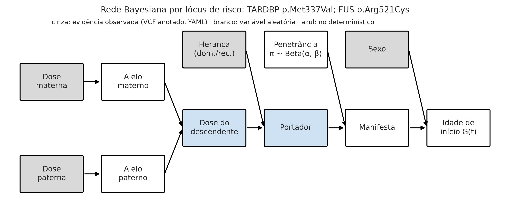
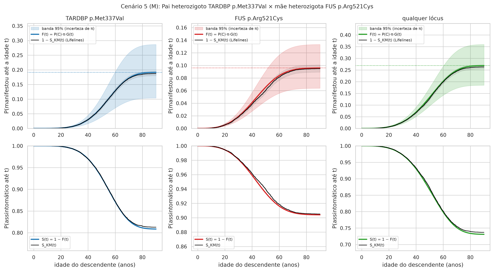
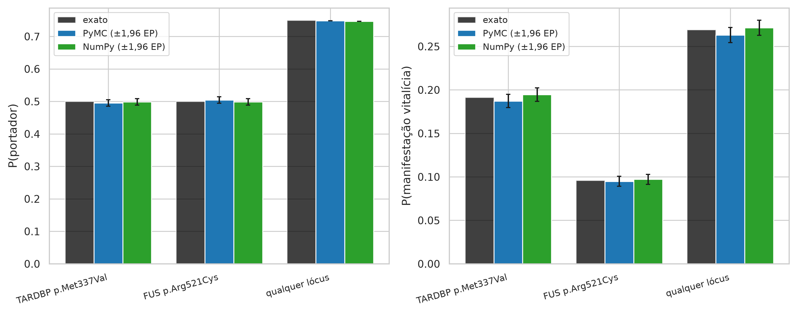
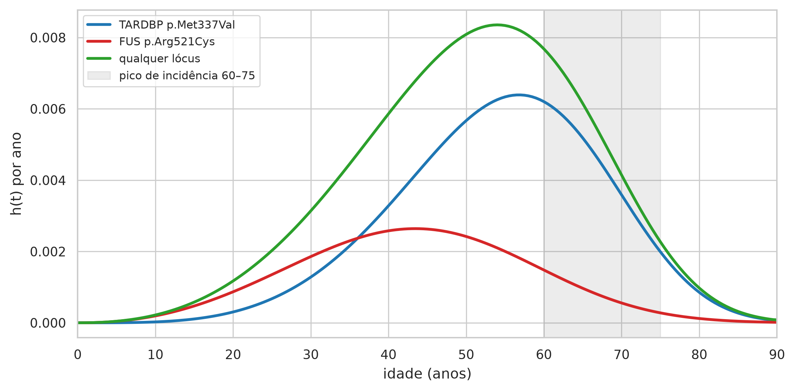
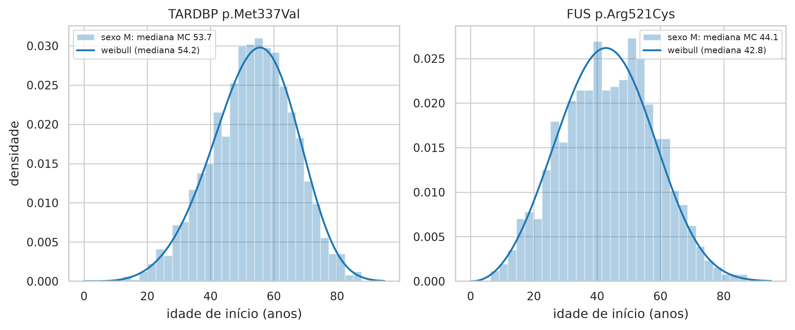

# Relatório do artefato — Cenário 5 (M): Pai heterozigoto TARDBP p.Met337Val × mãe heterozigota FUS p.Arg521Cys

> AVISO: instrumento experimental de apoio à decisão no aconselhamento genético preditivo da ELA, construído com dados sintéticos e parâmetros populacionais da literatura. Não constitui diagnóstico, não substitui o julgamento clínico e não deve ser usado isoladamente em decisões sobre pacientes.

## Entrada

VCF materno: `cenario_5_mae.vcf` (amostra MAE); VCF paterno: `cenario_5_pai.vcf` (amostra PAI); laudo do C9orf72: não informado; sexo do descendente: M; idade atual sem sintomas: 30.0; motor: pymc; N = 10.000; seed = 42; horizonte = 90 anos.

## Qualidade dos dados (TCC 4.2.3)

- Mãe: montagem GRCh38 (coerente); 6/8 registros aprovados (75%); 3 aprovados encontrados na base de anotação (50%; estado de revisão 2★: 3); classes {'nao_anotada': 3, 'risco': 2, 'benigna': 1}; significado incerto/conflitante: 0 (0% das anotadas); risco com frequência > 1%: 0.
- Pai: montagem GRCh38 (coerente); 6/8 registros aprovados (75%); 3 aprovados encontrados na base de anotação (50%; estado de revisão 2★: 3); classes {'nao_anotada': 3, 'risco': 2, 'benigna': 1}; significado incerto/conflitante: 0 (0% das anotadas); risco com frequência > 1%: 0.
- Base de anotação: clinvar_base_consolidada; regra de classe: só Pathogenic/Likely pathogenic sustentam risco; significado incerto e classificações conflitantes não (TCC 4.2.2).

## Resultado

- **TARDBP p.Met337Val** (dominante; dosagens mãe/pai 0/1): P(portador) = 50.0% (MC 49.5%); penetrância média 38.3% [21.0%–57.4%]; risco vitalício 19.2% [10.5%–28.7%]; idade mediana de início 54.2 anos (p10–p90 MC: 36–69).
- **FUS p.Arg521Cys** (dominante; dosagens mãe/pai 1/0): P(portador) = 50.0% (MC 50.4%); penetrância média 19.2% [12.7%–26.7%]; risco vitalício 9.6% [6.3%–13.3%]; idade mediana de início 42.8 anos (p10–p90 MC: 24–63).
- **Combinado (qualquer lócus, independência)**: P(portador de ≥ 1) = 75.0%; risco vitalício 26.9% [16.2%–38.2%]; idade mediana do primeiro início 50.5 anos. Condicionando ao descendente assintomático aos 30 anos (rejeição de 264 sorteios), P(portador de ≥ 1 lócus) passa de 74.8% para 74.1% e o risco vitalício residual é 24.3%.

## Verificações

Aderência: maior desvio entre Monte Carlo e valor exato = 1.39 erros padrão (limite usual: 4). Coerência: risco vitalício por Kaplan-Meier = TARDBP p.Met337Val: 18.7%, FUS p.Arg521Cys: 9.5%, qualquer lócus: 26.3%. Recuperação Lifelines: erro relativo máximo em π = 2.0%. Tempo: 4.5 s no total (pymc: 2.12 s; motor cruzado: 0.00 s).

## Limitações desta execução

Parâmetros provisórios (confirmar: true) em: SOD1, C9orf72, TARDBP, FUS. Independência entre lóci; sem fatores modificadores; penetrância populacional de coortes europeias/norte-americanas; dados sintéticos.

## Tabelas

**Tabela 1 — Variantes aprovadas no filtro de qualidade e sua anotação, por genitor**

| amostra | gene | cromossomo | posicao | ref | alt | id | tipo | dosagem | repeticoes | classe | clnsig | estrelas | nome_curto | heranca | fonte_anotacao |
|---|---|---|---|---|---|---|---|---|---|---|---|---|---|---|---|
| MAE | TARDBP | 1 | 11020000 | G | A |  | snv | 0 |  | nao_anotada |  |  |  |  |  |
| MAE | TARDBP | 1 | 11020000 | G | T |  | snv | 1 |  | nao_anotada |  |  |  |  |  |
| MAE | TARDBP | 1 | 11022418 | A | G | rs80356730 | snv | 0 |  | risco | Pathogenic/Likely pathogenic | 2 | p.Met337Val | dominante | clinvar_base_consolidada:posicao_alelos |
| MAE | FUS | 16 | 31185000 | A | G |  | snv | 1 |  | nao_anotada |  |  |  |  |  |
| MAE | FUS | 16 | 31191418 | C | T | rs121909668 | snv | 1 |  | risco | Pathogenic | 2 | p.Arg521Cys | dominante | clinvar_base_consolidada:posicao_alelos |
| MAE | SOD1 | 21 | 31659509 | G | T | rs17883296 | snv | 1 |  | benigna | Likely benign | 2 | rs17883296 |  | clinvar_base_consolidada:posicao_alelos |
| PAI | TARDBP | 1 | 11020000 | G | A |  | snv | 0 |  | nao_anotada |  |  |  |  |  |
| PAI | TARDBP | 1 | 11020000 | G | T |  | snv | 1 |  | nao_anotada |  |  |  |  |  |
| PAI | TARDBP | 1 | 11022418 | A | G | rs80356730 | snv | 1 |  | risco | Pathogenic/Likely pathogenic | 2 | p.Met337Val | dominante | clinvar_base_consolidada:posicao_alelos |
| PAI | FUS | 16 | 31185000 | A | G |  | snv | 1 |  | nao_anotada |  |  |  |  |  |
| PAI | FUS | 16 | 31191418 | C | T | rs121909668 | snv | 0 |  | risco | Pathogenic | 2 | p.Arg521Cys | dominante | clinvar_base_consolidada:posicao_alelos |
| PAI | SOD1 | 21 | 31659509 | G | T | rs17883296 | snv | 1 |  | benigna | Likely benign | 2 | rs17883296 |  | clinvar_base_consolidada:posicao_alelos |

*Fonte: elaborado pela autora (2026), a partir do artefato ela_preditivo.*

Registros lidos/aprovados: mãe 8/6, pai 8/6. Reprovações: mãe {'fora_das_regioes': 1, 'filtro_nao_pass': 1, 'dp_baixo': 1, 'gq_baixo': 1}, pai {'fora_das_regioes': 1, 'filtro_nao_pass': 1, 'dp_baixo': 1, 'gq_baixo': 1}. Base de anotação: clinvar_base_consolidada (1458 variantes do ClinVar + 1 da tabela curada).

**Tabela 1b — Vetor genotípico parental: dosagem alélica (0/1/2) por lócus de risco e P(portador) exata**

| gene | variante | rs | tipo | heranca | dosagem_mae | dosagem_pai | repeticoes_mae | repeticoes_pai | clnsig | estrelas | fonte | p_portador_exato | observacao |
|---|---|---|---|---|---|---|---|---|---|---|---|---|---|
| TARDBP | p.Met337Val | rs80356730 | snv | dominante | 0 | 1 |  |  | Pathogenic/Likely pathogenic | 2 | vcf | 0.5 |  |
| FUS | p.Arg521Cys | rs121909668 | snv | dominante | 1 | 0 |  |  | Pathogenic | 2 | vcf | 0.5 |  |

*Fonte: elaborado pela autora (2026), a partir do artefato ela_preditivo.*

**Tabela 2 — Aderência teórica: probabilidades exatas vs Monte Carlo (PyMC e NumPy), erro padrão e qui-quadrado do genótipo do descendente**

| variante | n | p_portador_exato | p_portador_pymc | p_portador_numpy | ep_portador | desvio_portador_pymc_em_ep | desvio_portador_numpy_em_ep | p_manifesta_exato | p_manifesta_pymc | p_manifesta_numpy | ep_manifesta | desvio_manifesta_pymc_em_ep | desvio_manifesta_numpy_em_ep | qui2_genotipo_pymc | valor_p_genotipo_pymc | qui2_genotipo_numpy | valor_p_genotipo_numpy | idade_mediana_exata | idade_mediana_pymc | idade_mediana_numpy |
|---|---|---|---|---|---|---|---|---|---|---|---|---|---|---|---|---|---|---|---|---|
| TARDBP p.Met337Val | 10000 | 0.5 | 0.4954 | 0.4986 | 0.005 | 0.92 | 0.28 | 0.1916 | 0.1872 | 0.1945 | 0.0039 | 1.1192 | 0.7413 | 0.8464 | 0.3576 | 0.0784 | 0.7795 | 54.1776 | 53.7309 | 53.5818 |
| FUS p.Arg521Cys | 10000 | 0.5 | 0.5042 | 0.4985 | 0.005 | 0.84 | 0.3 | 0.096 | 0.0948 | 0.0972 | 0.0029 | 0.3946 | 0.4199 | 0.7056 | 0.4009 | 0.09 | 0.7642 | 42.8269 | 44.0827 | 43.1725 |
| qualquer lócus | 10000 | 0.75 | 0.7483 | 0.7463 |  |  |  | 0.2691 | 0.263 | 0.2715 | 0.0044 | 1.3946 | 0.5307 |  |  |  |  |  | 50.4905 | 49.8924 |

*Fonte: elaborado pela autora (2026), a partir do artefato ela_preditivo.*

**Tabela 3 — Probabilidade de transmissão (portador), penetrância e risco vitalício de manifestação por lócus e combinado, com intervalo de credibilidade de 95% (incerteza da penetrância) e idade de início**

| gene | variante | heranca | dosagem_mae | dosagem_pai | p_portador_exato | p_portador_mc | penetrancia_media | penetrancia_q025 | penetrancia_q975 | p_manifesta_exato | p_manifesta_mc | p_manifesta_q025 | p_manifesta_q975 | idade_mediana_exata | idade_mediana_mc | idade_p10_mc | idade_p90_mc |
|---|---|---|---|---|---|---|---|---|---|---|---|---|---|---|---|---|---|
| TARDBP | TARDBP p.Met337Val | dominante | 0 | 1 | 0.5 | 0.4954 | 0.3831 | 0.2095 | 0.5739 | 0.1916 | 0.1872 | 0.1048 | 0.287 | 54.1776 | 53.7309 | 35.7173 | 69.2388 |
| FUS | FUS p.Arg521Cys | dominante | 1 | 0 | 0.5 | 0.5042 | 0.1919 | 0.1269 | 0.2666 | 0.096 | 0.0948 | 0.0635 | 0.1333 | 42.8269 | 44.0827 | 24.4655 | 62.7577 |
| — | qualquer lócus | independência |  |  | 0.75 | 0.7483 |  |  |  | 0.2691 | 0.263 | 0.1616 | 0.382 |  | 50.4905 |  |  |

*Fonte: elaborado pela autora (2026), a partir do artefato ela_preditivo.*

**Tabela 4 — Risco condicional à idade atual sem sintomas: P(portador | assintomático), risco nos próximos 10 e 20 anos e risco vitalício residual, com banda de 95%**

| unidade | idade_atual | p_portador_condicional | risco_10_anos | risco_10_anos_q025 | risco_10_anos_q975 | risco_20_anos | risco_20_anos_q025 | risco_20_anos_q975 | risco_vitalicio | risco_vitalicio_q025 | risco_vitalicio_q975 |
|---|---|---|---|---|---|---|---|---|---|---|---|
| TARDBP p.Met337Val | 0 | 0.5 | 5.33e-05 | 2.89e-05 | 7.97e-05 | 0.0013 | 0.0007 | 0.002 | 0.1914 | 0.1038 | 0.2865 |
| FUS p.Arg521Cys | 0 | 0.5 | 0.0006 | 0.0004 | 0.0008 | 0.0055 | 0.0037 | 0.0076 | 0.0959 | 0.0637 | 0.1331 |
| qualquer lócus | 0 |  | 0.0007 | 0.0004 | 0.0009 | 0.0068 | 0.0048 | 0.009 | 0.269 | 0.1848 | 0.3592 |
| TARDBP p.Met337Val | 20 | 0.4993 | 0.0071 | 0.0039 | 0.0107 | 0.0287 | 0.0156 | 0.043 | 0.1904 | 0.1032 | 0.2851 |
| FUS p.Arg521Cys | 20 | 0.4972 | 0.0135 | 0.0089 | 0.0187 | 0.0356 | 0.0236 | 0.0495 | 0.0909 | 0.0603 | 0.1265 |
| qualquer lócus | 20 |  | 0.0205 | 0.0148 | 0.0267 | 0.0633 | 0.0458 | 0.0822 | 0.264 | 0.1804 | 0.354 |
| TARDBP p.Met337Val | 30 | 0.4958 | 0.0217 | 0.0117 | 0.0327 | 0.0649 | 0.0351 | 0.0976 | 0.1846 | 0.0997 | 0.2774 |
| FUS p.Arg521Cys | 30 | 0.4904 | 0.0225 | 0.0148 | 0.0314 | 0.0474 | 0.0313 | 0.0663 | 0.0785 | 0.0518 | 0.1098 |
| qualquer lócus | 30 |  | 0.0437 | 0.0312 | 0.0574 | 0.1092 | 0.0769 | 0.1444 | 0.2486 | 0.167 | 0.3372 |
| TARDBP p.Met337Val | 40 | 0.4845 | 0.0441 | 0.0236 | 0.0671 | 0.1016 | 0.0543 | 0.1544 | 0.1664 | 0.089 | 0.253 |
| FUS p.Arg521Cys | 40 | 0.4787 | 0.0255 | 0.0167 | 0.036 | 0.0447 | 0.0293 | 0.0631 | 0.0573 | 0.0376 | 0.0809 |
| qualquer lócus | 40 |  | 0.0685 | 0.0466 | 0.0927 | 0.1417 | 0.0944 | 0.1945 | 0.2142 | 0.1393 | 0.2986 |
| TARDBP p.Met337Val | 50 | 0.4607 | 0.0601 | 0.0315 | 0.0936 | 0.1067 | 0.0559 | 0.1662 | 0.1279 | 0.067 | 0.1992 |
| FUS p.Arg521Cys | 50 | 0.465 | 0.0197 | 0.0128 | 0.0281 | 0.0293 | 0.019 | 0.0418 | 0.0327 | 0.0212 | 0.0466 |
| qualquer lócus | 50 |  | 0.0786 | 0.0498 | 0.1126 | 0.1329 | 0.0829 | 0.192 | 0.1564 | 0.0969 | 0.2268 |
| TARDBP p.Met337Val | 60 | 0.4262 | 0.0496 | 0.0252 | 0.0801 | 0.0691 | 0.0351 | 0.1115 | 0.0722 | 0.0367 | 0.1165 |
| FUS p.Arg521Cys | 60 | 0.4543 | 0.0098 | 0.0063 | 0.0141 | 0.0127 | 0.0082 | 0.0183 | 0.0133 | 0.0086 | 0.0191 |
| qualquer lócus | 60 |  | 0.0589 | 0.0345 | 0.0897 | 0.0809 | 0.047 | 0.1237 | 0.0845 | 0.049 | 0.1291 |
| TARDBP p.Met337Val | 70 | 0.3963 | 0.0205 | 0.0101 | 0.0342 | 0.0238 | 0.0118 | 0.0396 | 0.0238 | 0.0118 | 0.0396 |
| FUS p.Arg521Cys | 70 | 0.4489 | 0.003 | 0.0019 | 0.0043 | 0.0035 | 0.0022 | 0.005 | 0.0035 | 0.0022 | 0.005 |
| qualquer lócus | 70 |  | 0.0234 | 0.013 | 0.0373 | 0.0272 | 0.0151 | 0.0433 | 0.0272 | 0.0151 | 0.0433 |

*Fonte: elaborado pela autora (2026), a partir do artefato ela_preditivo.*

**Tabela 10 — Sobrevivência (assintomático) estimada por Kaplan-Meier na coorte simulada, com IC 95% (Greenwood); mediana não atingida quando o risco vitalício é inferior a 50%**

| unidade | n | eventos | risco_vitalicio_km | S(40) | IC95 S(40) | S(50) | IC95 S(50) | S(60) | IC95 S(60) | S(70) | IC95 S(70) | S(80) | IC95 S(80) | mediana_sobrevivencia | idade_90pct_do_risco |
|---|---|---|---|---|---|---|---|---|---|---|---|---|---|---|---|
| TARDBP p.Met337Val | 10000 | 1872 | 0.1872 | 0.97 | 0.966–0.973 | 0.9281 | 0.923–0.933 | 0.8726 | 0.866–0.879 | 0.8298 | 0.822–0.837 | 0.8154 | 0.808–0.823 | não atingida | 69.2 |
| FUS p.Arg521Cys | 10000 | 948 | 0.0948 | 0.9617 | 0.958–0.965 | 0.9398 | 0.935–0.944 | 0.9187 | 0.913–0.924 | 0.9086 | 0.903–0.914 | 0.9057 | 0.900–0.911 | não atingida | 62.9 |
| qualquer lócus | 10000 | 2630 | 0.263 | 0.9331 | 0.928–0.938 | 0.8726 | 0.866–0.879 | 0.8016 | 0.794–0.809 | 0.7554 | 0.747–0.764 | 0.7398 | 0.731–0.748 | não atingida | 67.5 |

*Fonte: elaborado pela autora (2026), a partir do artefato ela_preditivo.*

**Tabela 7 — Recuperação dos parâmetros de entrada (π, λ, ρ) pelo ajustador de cura mista da Lifelines na coorte simulada de portadores**

| variante | n_portadores | eventos | pi_entrada | lambda_entrada | rho_entrada | delta_sexo | pi_lifelines | lambda_lifelines | rho_lifelines | erro_rel_pi | erro_rel_lambda | erro_rel_rho | weibull_lambda_manifestantes | weibull_rho_manifestantes | mediana_weibull_manifestantes |
|---|---|---|---|---|---|---|---|---|---|---|---|---|---|---|---|
| TARDBP p.Met337Val | 4954 | 1872 | 0.3831 | 58.6421 | 4.6285 | 0 | 0.3781 | 58.198 | 4.6756 | 0.0133 | 0.0076 | 0.0102 | 58.1722 | 4.6922 | 53.8012 |
| FUS p.Arg521Cys | 5042 | 948 | 0.1919 | 47.9652 | 3.2346 | 0 | 0.1881 | 48.9785 | 3.2698 | 0.0196 | 0.0211 | 0.0109 | 48.9349 | 3.2856 | 43.7697 |

*Fonte: elaborado pela autora (2026), a partir do artefato ela_preditivo.*

**Tabela 4b — Risco condicional não paramétrico (Kaplan-Meier) para um descendente assintomático aos 30 anos**

| unidade | idade_atual | risco_10_anos_km | risco_20_anos_km | risco_vitalicio_km |
|---|---|---|---|---|
| TARDBP p.Met337Val | 30 | 0.0217 | 0.0639 | 0.1802 |
| FUS p.Arg521Cys | 30 | 0.0208 | 0.0431 | 0.0783 |
| qualquer lócus | 30 | 0.0416 | 0.1037 | 0.243 |

*Fonte: elaborado pela autora (2026), a partir do artefato ela_preditivo.*

## Figuras

*Figura 1 — Rede Bayesiana (DAG) do núcleo estocástico. Fonte: elaborado pela autora (2026), a partir do artefato ela_preditivo.*

*Figura 4 — Risco acumulado de manifestação F(t) e sobrevivência S(t) do descendente, com banda de credibilidade de 95% e Kaplan-Meier da coorte simulada. Fonte: elaborado pela autora (2026), a partir do artefato ela_preditivo.*

*Figura 6 — Aderência teórica: probabilidades exatas vs Monte Carlo (PyMC e NumPy), com erro padrão. Fonte: elaborado pela autora (2026), a partir do artefato ela_preditivo.*

*Figura 8 — Função de risco instantâneo h(t) por lócus; faixa sombreada = pico de incidência 60–75 anos (Feldman et al., 2022). Fonte: elaborado pela autora (2026), a partir do artefato ela_preditivo.*

*Figura 5 — Distribuição simulada da idade de início entre os descendentes que manifestam, por lócus. Fonte: elaborado pela autora (2026), a partir do artefato ela_preditivo.*
