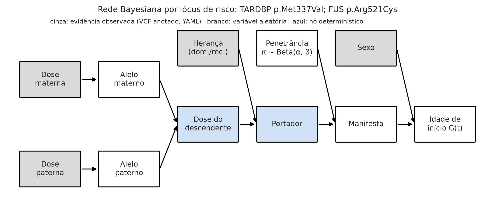
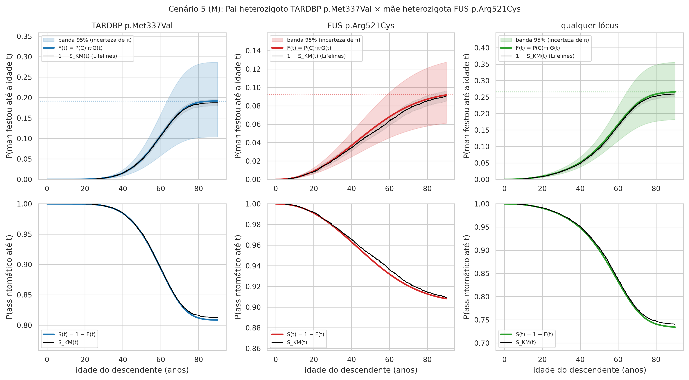
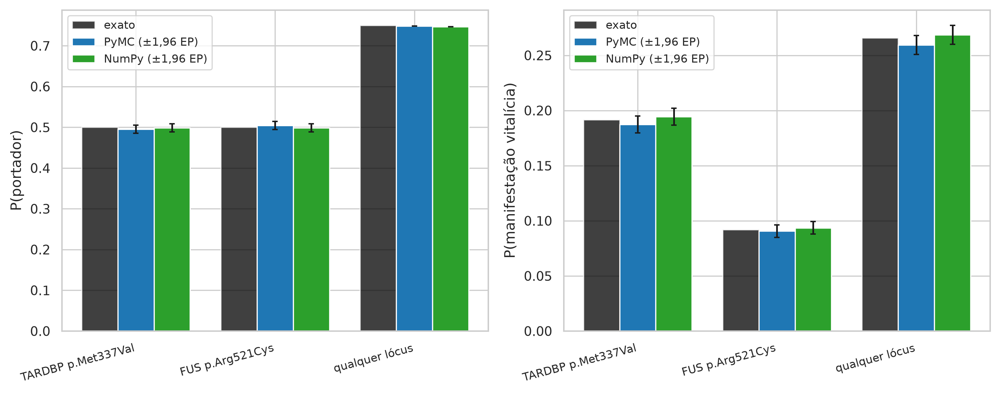
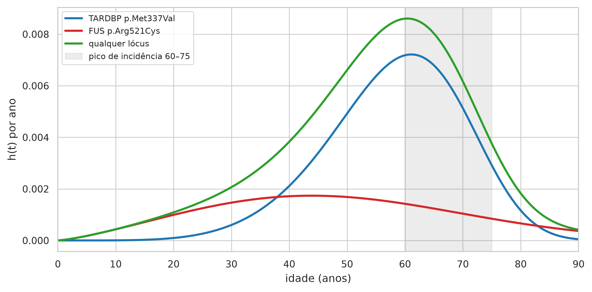
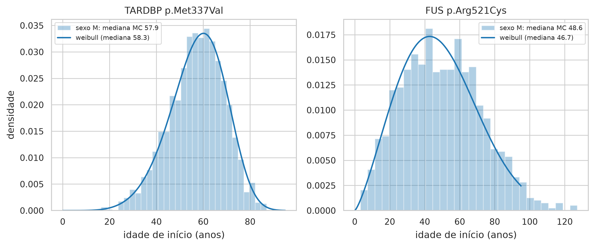
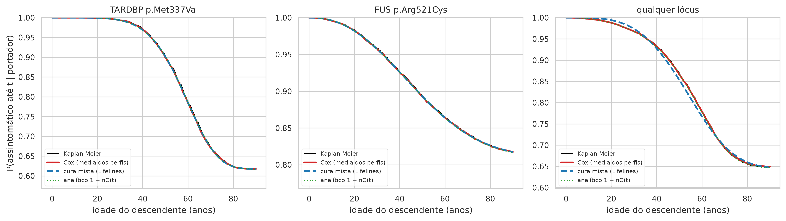

# Relatório do artefato — Cenário 5 (M): Pai heterozigoto TARDBP p.Met337Val × mãe heterozigota FUS p.Arg521Cys

> AVISO: instrumento experimental de apoio à decisão no aconselhamento genético preditivo da ELA, construído com dados sintéticos e parâmetros populacionais da literatura. Não constitui diagnóstico, não substitui o julgamento clínico e não deve ser usado isoladamente em decisões sobre pacientes.

## Entrada

VCF materno: `cenario_5_mae.vcf` (amostra MAE); VCF paterno: `cenario_5_pai.vcf` (amostra PAI); laudo do C9orf72: mãe: 23 repetições; pai: 23 repetições; sexo do descendente: M; idade atual sem sintomas: 30.0; motor: pymc; N = 10.000; seed = 42; horizonte = 90 anos.

## Qualidade dos dados (TCC 4.2.3)

- Mãe: montagem GRCh38 (coerente); 6/8 registros aprovados (75%); 3 aprovados encontrados na base de anotação (50%; estado de revisão 2★: 3); classes {'nao_anotada': 3, 'risco': 2, 'benigna': 1}; significado incerto: 0 (0% das anotadas); classificação conflitante: 0 (0%); risco com frequência > 1%: 0.
- Pai: montagem GRCh38 (coerente); 6/8 registros aprovados (75%); 3 aprovados encontrados na base de anotação (50%; estado de revisão 2★: 3); classes {'nao_anotada': 3, 'risco': 2, 'benigna': 1}; significado incerto: 0 (0% das anotadas); classificação conflitante: 0 (0%); risco com frequência > 1%: 0.
- Base de anotação: clinvar_base_consolidada; regra de classe: só Pathogenic/Likely pathogenic sustentam risco; significado incerto e classificações conflitantes não (TCC 4.2.2). Classificação conflitante só sustenta risco pela regra qualificada: mais da metade das classificações patogênicas ou provavelmente patogênicas e fenótipo de ELA com herança declarada.

## Resultado

- **TARDBP p.Met337Val** (dominante; dosagens mãe/pai 0/1): P(portador) = 50.0% (MC 49.5%); penetrância média 38.3% [21.0%–57.4%]; risco vitalício (até os 90 anos) 19.1% [10.5%–28.7%]; idade mediana de início 58.3 anos (p10–p90 MC: 41–71).
- **FUS p.Arg521Cys** (dominante; dosagens mãe/pai 1/0): P(portador) = 50.0% (MC 50.4%); penetrância média 19.2% [12.7%–26.7%]; risco vitalício (até os 90 anos) 9.2% [6.1%–12.8%]; idade mediana de início 46.7 anos (p10–p90 MC: 21–80).
- **Combinado (qualquer lócus, independência)**: P(portador de ≥ 1) = 75.0%; risco vitalício (até os 90 anos) 26.6% [18.2%–35.6%]; idade mediana do primeiro início 55.8 anos. Condicionando ao descendente assintomático aos 30 anos, P(portador de ≥ 1 lócus) passa de 75.0% para 74.4% e o risco residual (da idade atual até os 90 anos) é 24.7% [16.4%–33.8%]; idade provável de início a partir dessa idade: mediana 56.9 anos (25–75 %: 47.4–65.6). Valores exatos, os mesmos da Tabela 4 e dos indicadores; conferência por rejeição de 238 sorteios do Monte Carlo: 74.2% e 24.1%.

## Comparação com o modelo de Cox (CoxPHFitter)

`CoxPHFitter` (Lifelines) ajustado na coorte sintética de portadores (os dois sexos simulados com sementes independentes, derivadas da semente da execução; não portadores ficam fora porque nunca manifestam e separariam completamente a verossimilhança parcial). **TARDBP p.Met337Val** (9996 portadores, 3824 eventos): HR sexo masculino = 0.99 [0.925–1.050], p = 0.655, riscos proporcionais p = 0.366; concordância 0.502; S(60): Cox 0.785, cura mista 0.786, Kaplan-Meier 0.785, analítico 0.787; S_Cox(horizonte) = 0.617 vs fração de cura da Lifelines 1 − π̂ = 0.617 (π de entrada 0.383); maior diferença Cox × cura mista 0.003. **FUS p.Arg521Cys** (10051 portadores, 1835 eventos): HR sexo masculino = 0.99 [0.902–1.083], p = 0.796, riscos proporcionais p = 0.193; concordância 0.502; S(60): Cox 0.864, cura mista 0.864, Kaplan-Meier 0.864, analítico 0.864; S_Cox(horizonte) = 0.817 vs fração de cura da Lifelines 1 − π̂ = 0.810 (π de entrada 0.192); maior diferença Cox × cura mista 0.002. **qualquer lócus** (15053 portadores, 5309 eventos): HR sexo masculino = 0.99 [0.936–1.042], p = 0.654, riscos proporcionais p = 0.192; HR portador TARDBP p.Met337Val = 3.19 [2.955–3.439], p = 0.000, riscos proporcionais p = 0.000; HR portador FUS p.Arg521Cys = 1.37 [1.295–1.459], p = 0.000, riscos proporcionais p = 0.000; concordância 0.613; S(60): Cox 0.779, cura mista 0.768, Kaplan-Meier 0.777, analítico 0.777; S_Cox(horizonte) = 0.649 vs fração de cura da Lifelines 1 − π̂ = 0.645; maior diferença Cox × cura mista 0.017. Leitura: a função de base de Cox é não paramétrica e acompanha o Kaplan-Meier, mas Cox não separa quem nunca manifestará (fração de cura) de quem ainda não manifestou nem estima π; o modelo de cura mista recupera π e G(t) separadamente (Tabela 7). O efeito do sexo entra em Cox como razão de riscos constante, embora no modelo seja um deslocamento de idade; na unidade combinada as HR entre lóci misturam diferenças de penetrância e de idade de início.

## Verificações

Aderência: maior desvio entre Monte Carlo e valor exato = 1.42 erros padrão (limite usual: 4). Coerência: risco vitalício por Kaplan-Meier = TARDBP p.Met337Val: 18.7%, FUS p.Arg521Cys: 9.1%, qualquer lócus: 26.0%. Recuperação Lifelines: erro relativo máximo em π = 1.3%. Tempo: 6.8 s no total (pymc: 1.98 s; motor cruzado: 0.00 s).

## Limitações desta execução

Parâmetros provisórios (confirmar: true) em: C9orf72, TARDBP. Independência entre lóci; sem fatores modificadores; penetrância populacional de coortes europeias/norte-americanas; dados sintéticos.

## Tabelas

**Tabela 1 — Variantes aprovadas no filtro de qualidade e sua anotação, por genitor**

| amostra | gene | cromossomo | posicao | ref | alt | id | tipo | dosagem | repeticoes | classe | clnsig | estrelas | nome_curto | heranca | regra_qualificada | fonte_anotacao |
|---|---|---|---|---|---|---|---|---|---|---|---|---|---|---|---|---|
| MAE | TARDBP | 1 | 11020000 | G | A |  | snv | 0 |  | nao_anotada |  |  |  |  |  |  |
| MAE | TARDBP | 1 | 11020000 | G | T |  | snv | 1 |  | nao_anotada |  |  |  |  |  |  |
| MAE | TARDBP | 1 | 11022418 | A | G | rs80356730 | snv | 0 |  | risco | Pathogenic/Likely pathogenic | 2 | p.Met337Val | dominante | não | clinvar_base_consolidada:posicao_alelos |
| MAE | FUS | 16 | 31185000 | A | G |  | snv | 1 |  | nao_anotada |  |  |  |  |  |  |
| MAE | FUS | 16 | 31191418 | C | T | rs121909668 | snv | 1 |  | risco | Pathogenic | 2 | p.Arg521Cys | dominante | não | clinvar_base_consolidada:posicao_alelos |
| MAE | SOD1 | 21 | 31659509 | G | T | rs17883296 | snv | 1 |  | benigna | Likely benign | 2 | rs17883296 |  | não | clinvar_base_consolidada:posicao_alelos |
| PAI | TARDBP | 1 | 11020000 | G | A |  | snv | 0 |  | nao_anotada |  |  |  |  |  |  |
| PAI | TARDBP | 1 | 11020000 | G | T |  | snv | 1 |  | nao_anotada |  |  |  |  |  |  |
| PAI | TARDBP | 1 | 11022418 | A | G | rs80356730 | snv | 1 |  | risco | Pathogenic/Likely pathogenic | 2 | p.Met337Val | dominante | não | clinvar_base_consolidada:posicao_alelos |
| PAI | FUS | 16 | 31185000 | A | G |  | snv | 1 |  | nao_anotada |  |  |  |  |  |  |
| PAI | FUS | 16 | 31191418 | C | T | rs121909668 | snv | 0 |  | risco | Pathogenic | 2 | p.Arg521Cys | dominante | não | clinvar_base_consolidada:posicao_alelos |
| PAI | SOD1 | 21 | 31659509 | G | T | rs17883296 | snv | 1 |  | benigna | Likely benign | 2 | rs17883296 |  | não | clinvar_base_consolidada:posicao_alelos |

*Fonte: elaborado pela autora (2026), a partir do artefato ela_preditivo.*

Registros lidos/aprovados: mãe 8/6, pai 8/6. Reprovações: mãe {'fora_das_regioes': 1, 'filtro_nao_pass': 1, 'dp_baixo': 1, 'gq_baixo': 1}, pai {'fora_das_regioes': 1, 'filtro_nao_pass': 1, 'dp_baixo': 1, 'gq_baixo': 1}. Base de anotação: clinvar_base_consolidada (1457 variantes do ClinVar + 1 da tabela curada; 1 registro da base fora da anotação, por ter alelo alternativo igual ao de referência).

**Tabela 1b — Vetor genotípico parental: dosagem alélica (0/1/2) por lócus de risco e P(portador) exata; lócus com genótipo não determinado num genitor fica marcado como descartado e não entra no cálculo (TCC 4.3)**

| gene | variante | rs | tipo | heranca | dosagem_mae | dosagem_pai | repeticoes_mae | repeticoes_pai | clnsig | estrelas | fonte | p_portador_exato | descartado | observacao |
|---|---|---|---|---|---|---|---|---|---|---|---|---|---|---|
| TARDBP | p.Met337Val | rs80356730 | snv | dominante | 0 | 1 |  |  | Pathogenic/Likely pathogenic | 2 | vcf | 0.5 | não |  |
| FUS | p.Arg521Cys | rs121909668 | snv | dominante | 1 | 0 |  |  | Pathogenic | 2 | vcf | 0.5 | não |  |

*Fonte: elaborado pela autora (2026), a partir do artefato ela_preditivo.*

**Tabela 2 — Aderência teórica: probabilidades exatas vs Monte Carlo (PyMC e NumPy), erro padrão e qui-quadrado do genótipo do descendente**

| variante | n | p_portador_exato | p_portador_pymc | p_portador_numpy | ep_portador | desvio_portador_pymc_em_ep | desvio_portador_numpy_em_ep | p_manifesta_exato | p_manifesta_pymc | p_manifesta_numpy | ep_manifesta | desvio_manifesta_pymc_em_ep | desvio_manifesta_numpy_em_ep | qui2_genotipo_pymc | valor_p_genotipo_pymc | qui2_genotipo_numpy | valor_p_genotipo_numpy | idade_mediana_exata | idade_mediana_pymc | idade_mediana_numpy |
|---|---|---|---|---|---|---|---|---|---|---|---|---|---|---|---|---|---|---|---|---|
| TARDBP p.Met337Val | 10000 | 0.5 | 0.4954 | 0.4986 | 0.005 | 0.92 | 0.28 | 0.1915 | 0.1872 | 0.1943 | 0.0039 | 1.099 | 0.711 | 0.8464 | 0.3576 | 0.0784 | 0.7795 | 58.3 | 57.9005 | 57.7671 |
| FUS p.Arg521Cys | 10000 | 0.5 | 0.5042 | 0.4985 | 0.005 | 0.84 | 0.3 | 0.0918 | 0.0906 | 0.0935 | 0.0029 | 0.4286 | 0.5736 | 0.7056 | 0.4009 | 0.09 | 0.7642 | 46.7083 | 48.6402 | 47.2377 |
| qualquer lócus | 10000 | 0.75 | 0.7483 | 0.7463 |  |  |  | 0.2657 | 0.2595 | 0.2686 | 0.0044 | 1.4219 | 0.6469 |  |  |  |  |  | 55.7505 | 54.9438 |

*Fonte: elaborado pela autora (2026), a partir do artefato ela_preditivo.*

**Tabela 3 — Probabilidade de transmissão (portador), penetrância e risco vitalício de manifestação (até o horizonte de 90 anos) por lócus e combinado, com intervalo de credibilidade de 95% (incerteza da penetrância) e idade de início**

| gene | variante | heranca | dosagem_mae | dosagem_pai | p_portador_exato | p_portador_mc | penetrancia_media | penetrancia_q025 | penetrancia_q975 | p_manifesta_exato | p_manifesta_mc | p_manifesta_q025 | p_manifesta_q975 | fração que manifesta em algum momento (sem limite de idade) | idade_mediana_exata | idade_mediana_mc | idade_p10_mc | idade_p90_mc |
|---|---|---|---|---|---|---|---|---|---|---|---|---|---|---|---|---|---|---|
| TARDBP | TARDBP p.Met337Val | dominante | 0 | 1 | 0.5 | 0.4954 | 0.3831 | 0.2095 | 0.5739 | 0.1915 | 0.1872 | 0.1047 | 0.2868 | 0.1916 | 58.3 | 57.9005 | 41.2484 | 71.472 |
| FUS | FUS p.Arg521Cys | dominante | 1 | 0 | 0.5 | 0.5042 | 0.1919 | 0.1269 | 0.2666 | 0.0918 | 0.0906 | 0.0607 | 0.1276 | 0.096 | 46.7083 | 48.6402 | 21.3005 | 79.8213 |
| — | qualquer lócus | independência |  |  | 0.75 | 0.7483 |  |  |  | 0.2657 | 0.2595 | 0.1818 | 0.3561 | 0.2691 |  | 55.7505 |  |  |

*Fonte: elaborado pela autora (2026), a partir do artefato ela_preditivo.*

p_manifesta_* = risco vitalício: probabilidade de manifestar até os 90 anos. A coluna "fração que manifesta em algum momento (sem limite de idade)" é F(∞) = P(portador)·E[π], usada só nas verificações de coerência.

**Tabela 4 — Risco condicional à idade atual sem sintomas: P(portador | assintomático), risco nos próximos 10 e 20 anos e risco residual (da idade atual até os 90 anos), com banda de 95%**

| unidade | idade_atual | p_portador_condicional | risco_10_anos | risco_10_anos_q025 | risco_10_anos_q975 | risco_20_anos | risco_20_anos_q025 | risco_20_anos_q975 | risco_residual | risco_residual_q025 | risco_residual_q975 |
|---|---|---|---|---|---|---|---|---|---|---|---|
| TARDBP p.Met337Val | 0 | 0.5 | 7.17e-06 | 3.89e-06 | 1.07e-05 | 0.0003 | 0.0002 | 0.0005 | 0.1915 | 0.1039 | 0.2866 |
| FUS p.Arg521Cys | 0 | 0.5 | 0.0019 | 0.0013 | 0.0026 | 0.009 | 0.006 | 0.0124 | 0.0918 | 0.061 | 0.1275 |
| qualquer lócus | 0 | 0.75 | 0.0019 | 0.0013 | 0.0026 | 0.0093 | 0.0063 | 0.0128 | 0.2657 | 0.1818 | 0.3561 |
| TARDBP p.Met337Val | 20 | 0.4998 | 0.0029 | 0.0016 | 0.0043 | 0.0153 | 0.0083 | 0.0228 | 0.1912 | 0.1037 | 0.2862 |
| FUS p.Arg521Cys | 20 | 0.4955 | 0.0124 | 0.0082 | 0.0172 | 0.0282 | 0.0187 | 0.0392 | 0.0836 | 0.0554 | 0.1165 |
| qualquer lócus | 20 | 0.7477 | 0.0152 | 0.0108 | 0.0203 | 0.043 | 0.0311 | 0.056 | 0.2588 | 0.1748 | 0.3492 |
| TARDBP p.Met337Val | 30 | 0.4984 | 0.0124 | 0.0067 | 0.0186 | 0.0458 | 0.0248 | 0.0686 | 0.1889 | 0.1023 | 0.2831 |
| FUS p.Arg521Cys | 30 | 0.4892 | 0.016 | 0.0106 | 0.0224 | 0.0328 | 0.0217 | 0.0459 | 0.0722 | 0.0476 | 0.101 |
| qualquer lócus | 30 | 0.7438 | 0.0282 | 0.0203 | 0.0368 | 0.0771 | 0.054 | 0.102 | 0.2474 | 0.1644 | 0.3377 |
| TARDBP p.Met337Val | 40 | 0.4921 | 0.0338 | 0.0182 | 0.051 | 0.0925 | 0.0498 | 0.1395 | 0.1787 | 0.0962 | 0.2695 |
| FUS p.Arg521Cys | 40 | 0.4809 | 0.0171 | 0.0112 | 0.0241 | 0.0324 | 0.0213 | 0.0456 | 0.0571 | 0.0375 | 0.0804 |
| qualquer lócus | 40 | 0.7363 | 0.0503 | 0.0339 | 0.0684 | 0.1219 | 0.0793 | 0.1689 | 0.2256 | 0.1463 | 0.3138 |
| TARDBP p.Met337Val | 50 | 0.4743 | 0.0608 | 0.0322 | 0.0933 | 0.1205 | 0.0639 | 0.1851 | 0.1499 | 0.0795 | 0.2303 |
| FUS p.Arg521Cys | 50 | 0.4718 | 0.0156 | 0.0102 | 0.0221 | 0.0276 | 0.018 | 0.0392 | 0.0407 | 0.0265 | 0.0577 |
| qualquer lócus | 50 | 0.7224 | 0.0754 | 0.047 | 0.1082 | 0.1448 | 0.0891 | 0.2089 | 0.1845 | 0.1162 | 0.2634 |
| TARDBP p.Met337Val | 60 | 0.4403 | 0.0636 | 0.0327 | 0.1013 | 0.0913 | 0.0469 | 0.1452 | 0.095 | 0.0488 | 0.1511 |
| FUS p.Arg521Cys | 60 | 0.4635 | 0.0123 | 0.008 | 0.0175 | 0.0206 | 0.0134 | 0.0294 | 0.0255 | 0.0166 | 0.0365 |
| qualquer lócus | 60 | 0.6997 | 0.0751 | 0.0443 | 0.113 | 0.11 | 0.0661 | 0.164 | 0.1181 | 0.0726 | 0.1741 |
| TARDBP p.Met337Val | 70 | 0.4023 | 0.0295 | 0.0147 | 0.0489 | 0.0334 | 0.0166 | 0.0554 | 0.0334 | 0.0166 | 0.0554 |
| FUS p.Arg521Cys | 70 | 0.4568 | 0.0084 | 0.0054 | 0.0121 | 0.0134 | 0.0087 | 0.0193 | 0.0134 | 0.0087 | 0.0193 |
| qualquer lócus | 70 | 0.6753 | 0.0377 | 0.0228 | 0.0574 | 0.0464 | 0.0292 | 0.0689 | 0.0464 | 0.0292 | 0.0689 |

*Fonte: elaborado pela autora (2026), a partir do artefato ela_preditivo.*

risco_residual: probabilidade de manifestar entre a idade atual e o horizonte, para quem chegou a essa idade sem sintomas. Na idade 0 é o risco vitalício da Tabela 3.

**Tabela 10 — Sobrevivência (assintomático) estimada por Kaplan-Meier na coorte simulada, com IC 95% (Greenwood); mediana não atingida quando o risco vitalício é inferior a 50%**

| unidade | n | eventos | risco_vitalicio_km | S(40) | IC95 S(40) | S(50) | IC95 S(50) | S(60) | IC95 S(60) | S(70) | IC95 S(70) | S(80) | IC95 S(80) | mediana_sobrevivencia | idade_90pct_do_risco |
|---|---|---|---|---|---|---|---|---|---|---|---|---|---|---|---|
| TARDBP p.Met337Val | 10000 | 1872 | 0.1872 | 0.9848 | 0.982–0.987 | 0.9518 | 0.947–0.956 | 0.8933 | 0.887–0.899 | 0.8377 | 0.830–0.845 | 0.8162 | 0.808–0.824 | não atingida | 71.5 |
| FUS p.Arg521Cys | 10000 | 906 | 0.0906 | 0.9657 | 0.962–0.969 | 0.9509 | 0.946–0.955 | 0.9362 | 0.931–0.941 | 0.9233 | 0.918–0.928 | 0.9147 | 0.909–0.920 | não atingida | 75.2 |
| qualquer lócus | 10000 | 2595 | 0.2595 | 0.9511 | 0.947–0.955 | 0.9056 | 0.900–0.911 | 0.8365 | 0.829–0.844 | 0.7736 | 0.765–0.782 | 0.7474 | 0.739–0.756 | não atingida | 71.6 |

*Fonte: elaborado pela autora (2026), a partir do artefato ela_preditivo.*

**Tabela 7 — Recuperação dos parâmetros de entrada (π, λ, ρ) pelo ajustador de cura mista da Lifelines na coorte simulada de portadores**

| variante | n_portadores | eventos | pi_entrada | lambda_entrada | rho_entrada | delta_sexo | pi_lifelines | lambda_lifelines | rho_lifelines | erro_rel_pi | erro_rel_lambda | erro_rel_rho | weibull_lambda_manifestantes | weibull_rho_manifestantes | mediana_weibull_manifestantes |
|---|---|---|---|---|---|---|---|---|---|---|---|---|---|---|---|
| TARDBP p.Met337Val | 4954 | 1872 | 0.3831 | 62.2626 | 5.5736 | 0 | 0.378 | 61.861 | 5.6379 | 0.0135 | 0.0065 | 0.0115 | 61.8479 | 5.6503 | 57.9634 |
| FUS p.Arg521Cys | 5042 | 906 | 0.1919 | 54.7525 | 2.3065 | 0 | 0.1925 | 57.8391 | 2.255 | 0.003 | 0.0564 | 0.0224 | 53.5624 | 2.5437 | 46.3749 |

*Fonte: elaborado pela autora (2026), a partir do artefato ela_preditivo.*

**Tabela 11 — Modelo de Cox (CoxPHFitter) na coorte sintética de portadores: razões de risco, concordância, teste de riscos proporcionais e S(t) por Cox, cura mista, Kaplan-Meier e curva analítica**

| unidade | n_portadores | eventos | cox | HR[sexo masculino] | IC95 HR[sexo masculino] | p[sexo masculino] | p_riscos_proporcionais[sexo masculino] | concordancia | log_verossimilhanca_parcial | S_cox(50) | S_cura_mista(50) | S_km(50) | S_analitico(50) | S_cox(60) | S_cura_mista(60) | S_km(60) | S_analitico(60) | S_cox(70) | S_cura_mista(70) | S_km(70) | S_analitico(70) | S_cox(horizonte) | fracao_cura_lifelines | pi_lifelines | pi_entrada | dif_max_cox_cura_mista | dif_max_cox_km | HR[portador TARDBP p.Met337Val] | IC95 HR[portador TARDBP p.Met337Val] | p[portador TARDBP p.Met337Val] | p_riscos_proporcionais[portador TARDBP p.Met337Val] | HR[portador FUS p.Arg521Cys] | IC95 HR[portador FUS p.Arg521Cys] | p[portador FUS p.Arg521Cys] | p_riscos_proporcionais[portador FUS p.Arg521Cys] |
|---|---|---|---|---|---|---|---|---|---|---|---|---|---|---|---|---|---|---|---|---|---|---|---|---|---|---|---|---|---|---|---|---|---|---|---|
| TARDBP p.Met337Val | 9996 | 3824 | ajustado | 0.9857 | 0.925–1.050 | 0.6552 | 0.3663 | 0.5023 | -34.371 | 0.8996 | 0.902 | 0.8997 | 0.9023 | 0.7849 | 0.7856 | 0.785 | 0.7867 | 0.6715 | 0.6719 | 0.6715 | 0.673 | 0.6175 | 0.6173 | 0.3827 | 0.3831 | 0.0029 | 0.0001 |  |  |  |  |  |  |  |  |
| FUS p.Arg521Cys | 10051 | 1835 | ajustado | 0.988 | 0.902–1.083 | 0.7959 | 0.1925 | 0.502 | -16.732 | 0.8925 | 0.8933 | 0.8925 | 0.8934 | 0.864 | 0.864 | 0.8641 | 0.8639 | 0.8419 | 0.8414 | 0.842 | 0.841 | 0.8174 | 0.8097 | 0.1903 | 0.1919 | 0.0015 | 9.95e-05 |  |  |  |  |  |  |  |  |
| qualquer lócus | 15053 | 5309 | ajustado | 0.9878 | 0.936–1.042 | 0.6536 | 0.1915 | 0.6128 | -49.475 | 0.8662 | 0.8535 | 0.8652 | 0.8674 | 0.7791 | 0.7677 | 0.7775 | 0.7771 | 0.6946 | 0.6978 | 0.6928 | 0.6939 | 0.649 | 0.6447 | 0.3553 |  | 0.017 | 0.0019 | 3.1878 | 2.955–3.439 | 3.09e-197 | 2.64e-47 | 1.3746 | 1.295–1.459 | 1.16e-25 | 1.40e-12 |

*Fonte: elaborado pela autora (2026), a partir do artefato ela_preditivo.*

**Tabela 4b — Risco condicional não paramétrico (Kaplan-Meier) para um descendente assintomático aos 30 anos**

| unidade | idade_atual | risco_10_anos_km | risco_20_anos_km | risco_residual_km |
|---|---|---|---|---|
| TARDBP p.Met337Val | 30 | 0.0121 | 0.0452 | 0.1847 |
| FUS p.Arg521Cys | 30 | 0.0139 | 0.029 | 0.0714 |
| qualquer lócus | 30 | 0.0257 | 0.0723 | 0.2414 |

*Fonte: elaborado pela autora (2026), a partir do artefato ela_preditivo.*

## Figuras

*Figura 1 — Rede Bayesiana (DAG) do núcleo estocástico. Fonte: elaborado pela autora (2026), a partir do artefato ela_preditivo.*

*Figura 4 — Risco acumulado de manifestação F(t) e sobrevivência S(t) do descendente, com banda de credibilidade de 95% e Kaplan-Meier da coorte simulada. Fonte: elaborado pela autora (2026), a partir do artefato ela_preditivo.*

*Figura 6 — Aderência teórica: probabilidades exatas vs Monte Carlo (PyMC e NumPy), com erro padrão. Fonte: elaborado pela autora (2026), a partir do artefato ela_preditivo.*

*Figura 8 — Função de risco instantâneo h(t) por lócus; faixa sombreada = pico de incidência 60–75 anos (Feldman et al., 2022). Fonte: elaborado pela autora (2026), a partir do artefato ela_preditivo.*

*Figura 5 — Distribuição simulada da idade de início entre os descendentes que manifestam, por lócus. Fonte: elaborado pela autora (2026), a partir do artefato ela_preditivo.*

*Figura 9 — Sobrevivência (assintomático) entre portadores: Cox (marginal), cura mista, Kaplan-Meier e curva analítica, por unidade. Fonte: elaborado pela autora (2026), a partir do artefato ela_preditivo.*
